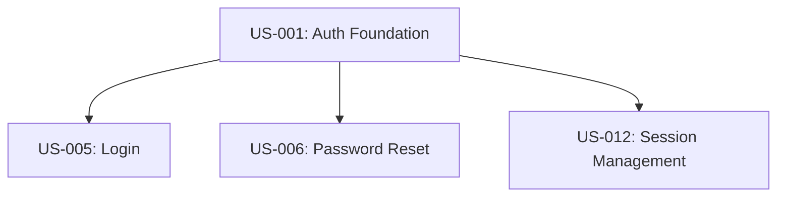

# User Story Instructions & Guidelines

This reference document defines the complete standards, formatting guidelines, criteria schemas, and complete example cases for generating User Stories within the Vespyr agent swarm. The `@product-manager` agent reads this when creating user stories.

---

## 1. Document Standards

Every user story generated must be exhaustive, precise, and highly testable:
*   **Audience:** The engineering team (developers, QA engineers, system architects).
*   **Independence:** Every user story must be self-contained and independently testable.
*   **Location:** All stories are appended to the cumulative backlog file: `artifacts/output/03-strategy/user-stories.md`.

### 1.1 Granularity & Content Standards: Functional Capabilities vs. Persona Journeys

To ensure user stories are developer-ready and sprint-actionable, they must represent **modular functional capabilities** rather than high-level **persona-based scenarios or journeys**.

#### Key Contrast and Guidelines

| Dimension | 🚫 Incorrect (Persona Journeys / Scenarios) |   Correct (Modular Functional Capabilities) |
|:---|:---|:---|
| **Concept** | Broad, end-to-end user paths containing multiple steps and functional domains in a single block. | Fine-grained, modular components focusing on a single system behavior or feature that fits in a single sprint. |
| **Focus** | Subjective, situational user context (e.g. "completes form while walking", "ships purchase under WiFi"). | Objective, digital interaction patterns (user action + system response) that can be verified by automated tests. |
| **Scope** | Too large to fit into a single developer task; hard to sequence, plan, and estimate accurately. | Small, independent, testable units that can be assigned directly to specific sprints (Sprint 1, Sprint 2, etc.). |

#### Examples Baseline

> [!WARNING]
> **DO NOT use persona journeys as user stories.** Review this comparison to ensure you write correct, modular functional stories in the next iteration:

##### 🚫 Incorrect Persona Journeys (Do NOT use)
*   **Event attendee ships purchase:** "Rina scans QR at event booth, completes form in <60s, pays via QRIS, gets printed label" *(Too broad: spans QR entry, form entry, payment, and printing).*
*   **Dropoff visitor skips queue:** "Budi scans QR at dropoff entrance, completes form while walking, gets immediate service" *(Mixes entry, form, and physical logic; uses subjective situational context).*
*   **User in poor network ships:** "Form works with progressive enhancement even on unstable event WiFi." *(This is an offline/NFR behavior, not a functional journey)*

#####   Correct Functional Capabilities (MUST use)
*   `US-001 | QR Code Entry Point (Sprint 1)` — "User scans QR code to access shipping form without app download."
*   `US-002 | Basic Shipping Form (Sprint 1)` — "User completes shipping form with sender, receiver, and package details."
*   `US-003 | Location Auto-Detection (Sprint 2)` — "System auto-detects user location for sender address using GPS/network."
*   `US-005 | QRIS Payment Integration (Sprint 1)` — "User pays for shipping using QRIS or ewallet (GoPay, OVO, Dana)."
*   `US-006 | Label Generation & Printing (Sprint 1)` — "System generates and prints shipping label after payment confirmation."
*   `US-009 | Offline Capability (Sprint 2)` — "Form works with degraded functionality during network issues."

---

### 1.2 Backlog Hierarchy Tree Summary

At the top of the `user-stories.md` file, the product manager must include a high-level tree-structured summary representing how User Stories roll up into Features and Epics.

#### Default Tree Format
Use this specific text-based indentation tree layout by default:

```text
Epic: [Epic Name / e.g., Payment Method Display Module]
    ├── Feature: [Feature Name]
    │   ├── User Story: [US-XXX] - [Title]
    │   └── User Story: [US-YYY] - [Title]
```

#### Custom Formats
While the tree structure above is the default, the user may request or provide their own custom high-level summary format (e.g., table, flat list, spreadsheet link). The `@product-manager` must respect and adapt to the user's custom layout if provided.

---

## 2. Structural Requirements

Backlog files (`user-stories.md`) must be structured hierarchically. Every section must follow the standards below:

### 2.1 Epic Block
An Epic represents a high-level strategic capability or major module (e.g., Payment Method Display Module). It groups related features and establishes context. Format each Epic block exactly as follows:

```markdown
# Epic: [Epic Title]

- **Tracker:** Epic
- **Parent:** [Parent Epic if any / e.g. Core System]
- **Purpose:** [Strategic business intent and problem solved]
- **Phase:** [Validation / Exploration / Design / Development]
- **FRs Covered:** [PRD Functional Requirement IDs / e.g. FR-001, FR-002]
```

### 2.2 Feature Block
A Feature is a discrete, tangible capability rolling up under an Epic (e.g., QRIS Payment Integration). It describes a major functional specification of the product. Format each Feature block exactly as follows:

```markdown
## Feature: [Feature Title]

- **Tracker:** Feature
- **Parent:** [Epic Name]
- **Functional Specification:** [High-level functional behaviors and requirements overview]
- **Success Criteria:** [Telemetry, user metrics, or business results indicating success]
- **FRs:** [Functional requirements mapped from PRD / e.g., FR2, FR50, FR51]
```

### 2.3 User Story Block
User Stories are modular functional capabilities nested under a Feature. Every story block contains the following standardized sections:

#### 2.3.1 Story Metadata Block
- **Tracker:** User Story
- **Story ID:** US-XXX
- **Parent:** [Feature Name]
- **Priority:** [Must-have / Should-have / Could-have / Won't-have]
- **Effort:** [Small / Medium / Large]
- **Sprint:** [Target Sprint / e.g., Sprint 1]
- **Dependencies:** [Story IDs or external blocking events]
- **Author:** @product-manager
- **Traces to PRD:** [Section reference inside requirements.md, e.g. Section 7.3: FR-001]
- **Traces to Product Spec:** [Screen Name, Flow ID, or Section ID inside product-spec.md]

#### 2.3.2 Narrative Title Header
The title of the User Story (H3 header) must represent the narrative directly in standard agile format:
`### User Story: As a [type of user], I want [goal], so that [benefit / reason]`
No separate Narrative section is needed, making the document extremely concise.

#### 2.3.3 Business Requirements (DNA 7: Radical Brevity)
Explain the commercial and customer justification concisely in 1–3 direct sentences:
*   State the core business outcome, the single source of truth (e.g. user flag), and the enforcement boundary (server-side vs. client-side).
*   State the measurable success signal (metric + target) in the final sentence where one exists — a capability without a success criterion is a wish, not a spec.
*   **Zero filler:** Avoid verbose elaboration or repetitive justification. Keep it high-density so stakeholders and engineers immediately grasp the intent without reading complex wording.

#### 2.3.4 Technical Requirements (DNA 7: Concise Contract)
Provide a compact, bulleted list detailing technical constraints:
*   Backend API behavior, parameters, and filtering logic
*   Frontend rendering expectations (e.g. renders API response as-is, no client-side filtering)
*   Session/auth level resolution vs. per-request resolution
*   Explicit fallback and error-logging rules when inputs/flags are missing or null
*   Non-functional constraints that apply (perf/latency, security/auth, state handling) — one line each, only if applicable; omit the line when there is no constraint.

---

## 3. Acceptance Criteria Guidelines

Acceptance criteria must be atomic, unambiguous, and formatted using highly legible, multi-line, indented Gherkin steps:

*   **Structure:** Under each criteria number, indent and separate each Gherkin step (`Given`, `When`, `Then`, `And`, `But`) on its own separate line.
*   **Format:**
    *   `[ ]` **AC-XX-Y:** [Short summary description of criteria]
        *   **Given** [precondition or initial state]
        *   **When** [user action or system trigger]
        *   **Then** [expected system outcome or state shift]

### 3.1 Depth is exhaustive-per-case, NOT a fixed count

The number of acceptance criteria is driven by the **case**, never by a target number. There is no "right" count — a genuinely simple story (e.g. "log out") may need one unhappy path and no edge case; a complex story (e.g. "checkout payment") may need seven unhappy paths and five edge cases. **When in doubt, be MORE exhaustive, not less.**

Do NOT produce a uniform pattern (e.g. always 2 happy / 2 unhappy / 1 edge). A repeated fixed shape across stories is a tell that coverage was hit-a-quota, not reasoned per case — that is a defect, not a standard. Two stories of different complexity should almost never have identical AC counts.

**This applies with equal force in reverse mode.** A prototype usually renders only the happy path; the PRD must still reach the same exhaustive depth the traditional flow reaches, deriving the unhappy/edge criteria the prototype does not show (tag them `[derived]`). The prototype sets the floor of *evidence*, never the ceiling of *coverage*.

### 3.2 Risk-category completeness sweep (the exhaustiveness driver)

For each story, sweep these domain risk categories and write an AC for every one that applies to *this* case. This is how depth scales with complexity: a simple story has few applicable categories; a complex one has many. A category that genuinely does not apply is marked `N/A` — it is not silently skipped.

| # | Category | Ask for this story: is there a criterion for… |
|---|---|---|
| 1 | **Invalid / malformed input** | wrong format, missing required field, out-of-range value? |
| 2 | **Empty / boundary state** | zero items, first-run, max length, min/max quantity, off-by-one? |
| 3 | **Duplicate / idempotency** | double-submit, retry, replay, repeated action? |
| 4 | **Concurrency / race** | two actors, simultaneous edits, in-flight request collision? |
| 5 | **Write ordering / partial failure** | two writes where the second depends on the first — what if they arrive reversed, or the first commits and the second fails? |
| 6 | **Auth / permission** | unauthenticated, wrong role, expired session, forbidden resource? |
| 7 | **State / lifecycle** | already-used token, expired link, wrong status transition, stale data? |
| 8 | **External dependency failure** | API/service down, timeout, partial response, retry/backoff? |
| 9 | **Rate / abuse limits** | too many attempts, throttling, quota exhaustion? |
| 10 | **Data integrity** | partial write, rollback, orphaned records, referential breakage? |
| 11 | **Clock / time** | timezone, DST, elapsed-time drift, countdown vs server clock, expiry computed on the client? |
| 12 | **Localization / encoding** | unicode, RTL, timezone, currency, special characters? |
| 13 | **Accessibility / device** | keyboard-only, screen reader, reduced motion, small viewport, offline? |
| 14 | **Degraded capability** | the platform or browser lacks the capability — no clipboard API, no push, no storage quota, no WebGL? |
| 15 | **Observability** | how does anyone know this happened — which event fires, which metric moves, what appears in the log? |
| 16 | **Security** | injection, enumeration, sensitive-data exposure, CSRF/replay? |

**Why categories 5, 11, 14 and 15 were added (2026-09-30).** `/test` step-01 §1b already asks "what breaks if things happen **out of order**?" and "**delayed**?", and step-03d's own worked example names "clipboard API absent" and "timer drift while backgrounded" — but the sweep had no slot to record those answers, so the risk could only ever land downstream in QA. Categories 5, 11 and 14 close that gap. Category 15 had no home anywhere at all: without it a behavior can be implemented correctly and still be invisible in production. (The additions are numbered 5, 11, 14 and 15 in the table above — not a contiguous block.)

### 3.3 Mandatory per-story AC Coverage Self-Audit (the reasoning gate)

Every story MUST end its Acceptance Criteria section with an **AC Coverage Self-Audit** block. This block is the mechanism that drives depth — **not a target count.** The machine never counts your acceptance criteria; it verifies that you *reasoned about every risk category for this specific case*. The number of ACs is then a natural byproduct of that reasoning: a case with many real failure modes yields many ACs; a genuinely simple case yields few. There is no "right" number and no pattern to hit.

Write the block in exactly this labeled form — one line per category, each line resolving to **either** an acceptance-criterion reference **or** a concrete, case-specific reason it does not apply. A bare `N/A` with no reason is not acceptable and fails the gate.

Do **not** wrap the alternatives in angle brackets. The example below shows both options; a real line picks one. Angle brackets are how this file marks a placeholder, and the gate reads them as an unresolved placeholder and fails all 16 lines.

```
#### AC Coverage Self-Audit
- Invalid / malformed input: AC-U2, AC-U3                     ← or: N/A because this story takes no user input
- Empty / boundary state: AC-E1                              ← or: N/A because there is no list/collection here
- Duplicate / idempotency: AC-U4                             ← or: N/A because the action is read-only
- Concurrency / race: AC-E2                                  ← or: N/A because it is a single-user, single-session action
- Write ordering / partial failure: AC-E3                    ← or: N/A because this is a single atomic write
- Auth / permission: AC-U1                                   ← or: N/A because this screen is public pre-auth
- State / lifecycle: AC-U5                                   ← or: N/A because the entity has no lifecycle states
- External dependency failure: AC-U6                         ← or: N/A because no external service is called
- Rate / abuse limits: AC-U7                                 ← or: N/A because there is no abusable submission
- Data integrity: AC-E3                                      ← or: N/A because nothing is persisted
- Clock / time: AC-E4                                        ← or: N/A because the outcome does not depend on elapsed time
- Localization / encoding: AC-E4                             ← or: N/A because no free-text is rendered
- Accessibility / device: AC-E5                              ← or: N/A because this is covered in product-spec.md §a11y
- Degraded capability: AC-U8                                 ← or: N/A because the platform always provides the capability
- Observability: AC-E6                                       ← or: N/A because this view emits no event and adds no metric
- Security: AC-U9                                            ← or: N/A because no sensitive data or state change is exposed
```

Rules the gate enforces (all mechanical):
1. The heading `#### AC Coverage Self-Audit` is present in every story. A sentence that merely *mentions* the phrase does not count.
2. Every one of the 16 category labels appears.
3. Every category line is *resolved*: it names at least one `AC-…` reference **or** gives an `N/A because <reason>` with a real reason. A line left as a placeholder, blank, or bare `N/A` fails. The reason must be at least a few words — `N/A because none` is not a reason.
4. **Every `AC-…` you reference is one you actually defined in this story.** A dangling reference means the category was resolved on paper against a criterion that does not exist. This is a hard failure.

**What the gate does and does not count.** It does not count your criteria and sets no target number, no per-story minimum beyond the structure below, and no ratio between happy/unhappy/edge. If a story honestly has one applicable failure mode, it carries one criterion there and fifteen reasoned N/As.

One structural requirement does exist and predates this sweep, so state it plainly rather than discovering it at the gate: **the document as a whole must contain at least one `AC-H*`, one `AC-U*` and one `AC-E*`.** That is a document-level shape check, not a per-story quota — it says a product must have a success path, a failure path and a boundary somewhere, and it does not dictate how many of each. A document whose only story is genuinely trivial may still need a second story, or a criterion in another class, to satisfy it.

**Reasons must be specific to the story.** The same N/A wording copy-pasted across three or more stories is flagged as a **warning** — not a failure, because a genuinely repeated situation can legitimately repeat. But three identical reasons almost always mean the sweep was filled in rather than reasoned. Write the reason for *this* story.

**Three patterns the gate warns about** (warnings never fail the build; they exist because the instructions used to say a human should challenge this reasoning and nothing ever asked one to):
- a story marking **13 or more of 16** categories N/A with no criterion at all;
- the **same N/A reason** appearing in 3+ stories;
- **every story in the document carrying an identical AC count** — the "hit-a-quota" tell.

### 3.4 Feature state model — where acceptance criteria actually go missing

The per-story sweep reasons about each story in isolation. That is its blind spot: **the transitions between stories are nobody's job.** A story may pass all sixteen categories while the entity it drives can still be moved from a terminal state back to a draft, or submitted twice through two different stories, and no criterion anywhere forbids it.

So each **Feature** — not each story — carries a state model:

```
#### State Model
**Entity:** [entity name]

| From | Event | To | Legal | Criteria |
|------|-------|----|-------|----------|
| draft | submit | pending | yes | — |
| pending | submit (double submit) | pending | no | AC-U4 |
| pending | cancel | draft | no | AC-U5 |
| paid | refund | refunded | yes | — |
| refunded | submit | pending | no | AC-E2 |
```

**Rules:**
1. One state model per Feature. If a Feature drives several entities, give each its own table.
2. List the states the entity can actually occupy. Keep it to the states that exist — padding a model with invented states makes it describe nothing.
3. Mark every transition `yes` or `no` in the **Legal** column. The gate also reads `N`, `not allowed`, `illegal`, `false` and `❌` as illegal, and `y`, `true`, `legal` and `✓` as legal. **Any other wording is reported as unreadable rather than guessed at**, so write `yes` or `no` and you will never be surprised.
4. **Every `no` row MUST name the acceptance criterion that forbids it** in the Criteria column, and **that criterion must exist in this document.** A blank or dash fails, and so does pointing at a criterion you never wrote — a transition covered by a criterion that does not exist forbids nothing. This is the whole point of the state model.
5. A model with **zero** illegal transitions fails too. If the Feature genuinely has no state machine — a static pricing page, a pure read-only view — do not invent one to satisfy the gate. **Split it into its own Feature-free section, or add the one illegal transition that really exists** (a double submit, a re-entry after completion, a cancel from a terminal state). If a Feature truly admits no illegal transition, it is not a stateful Feature and should be folded into a neighbouring one.
6. Illegal transitions are where `[derived]` criteria earn their keep in reverse mode — the prototype will not have shown them.
7. Adding a column to the table is safe: the gate finds `Legal` and `Criteria` by name, not by position.

The gate checks the table mechanically: heading present, table present, at least one illegal row, every illegal row criterion-referenced, and every referenced criterion resolvable.

### 3.5 Deferred-Evidence AC Focus (reverse mode only)

Step 2d's Fidelity Partition deliberately marks infrastructure, telemetry, persistence and DB-bound statements `[DEFERRED TO SPEC]`, because **no prototype can witness them.** That is exactly why they are dangerous: the prototype never showed them, so nothing in the normal authoring flow pushes you to think about them, and they are the rows most likely to end with thin or absent criteria.

In reverse mode, `user-stories.md` therefore carries one document-level block:

```
## Deferred-Evidence AC Focus (reverse mode only)

| Ledger row | What no prototype could witness | Covered by |
|------------|--------------------------------|------------|
| L-03 | telemetry event never emitted on the success path | AC-E4 |
| L-07 | persistence rollback leaves an orphan row | AC-U6 |
```

- Every `L-NN` whose §14 status is `[DEFERRED TO SPEC]` must appear here. Copy the ids from `requirements.md` §14 — never renumber.
- "Covered by" must name criteria that **exist in this document** — naming one you never wrote is a hard failure, because a deferred row covered by a criterion that does not exist is uncovered.
- If a deferred bound genuinely has no criterion yet, that is a **finding**: write the criterion, or raise an `[OPEN]` question in §14. Do not leave the cell empty.

Delete this section in create mode — there is no ledger to defer from.

---

### User Story: As a registered user who forgot my password, I want to receive a password reset email, so that I can regain access to my account without contacting support

- **Tracker:** User Story
- **Story ID:** US-001
- **Parent:** [Security & Authentication]
- **Priority:** Must-have
- **Effort:** Medium
- **Sprint:** Sprint 3
- **Dependencies:** US-000 (user auth system), Email service (external)
- **Author:** @product-manager
- **Traces to PRD:** Section 7.3: FR-002 Password Reset Capability
- **Traces to Product Spec:** Section 3.1: Screen: Login, Flow: 2.1 Happy Path

#### Business Requirement
*   **Stakeholder impact:** Reduces support ticket volume by ~15% (based on current ticket data).
*   **Value proposition:** Self-service password recovery reduces friction and churn.
*   **Revenue / cost implication:** Saves ~$5k/quarter in support costs.
*   **Success signal:** >80% of reset emails are clicked within 24 hours.
*   **Priority rationale:** Must-have — password recovery is a standard security requirement.

#### Technical Requirement
*   **Integration points:** Auth API (internal), SendGrid (external email service).
*   **Data requirements:** User email, reset token (UUID, 1-hour expiry), token hash stored in DB.
*   **Performance constraints:** Email sent within 5 seconds of request; reset page loads in < 1s.
*   **Security constraints:** Token must be single-use, cryptographically random, stored hashed; rate limit to 3 requests per hour per email.
*   **State management:** Token state: pending → used | expired.
*   **Error handling strategy:** If SendGrid is down, queue email for retry with exponential backoff.

#### Acceptance Criteria

##### Happy Path
*   [ ] **AC-H1:** Send reset email
    *   **Given** the user is on the login page
    *   **When** they click "Forgot password?" and enter a valid registered email
    *   **Then** a reset email is sent and a confirmation message is displayed
*   [ ] **AC-H2:** Navigate to reset form
    *   **Given** the user receives the reset email
    *   **When** they click the reset link within 1 hour
    *   **Then** they are taken to a password reset form
*   [ ] **AC-H3:** Update password successfully
    *   **Given** the user enters a new password that meets complexity requirements and confirms it
    *   **When** they submit the form
    *   **Then** the password is updated and they are logged in automatically
*   [ ] **AC-H4:** Deny login with stale password
    *   **Given** the password is reset
    *   **When** the user tries to log in with the old password
    *   **Then** access is denied

##### Unhappy Path
*   [ ] **AC-U1:** Prevent email enumeration
    *   **Given** the user enters an unregistered email
    *   **When** they submit the forgot-password form
    *   **Then** the system displays the same confirmation message as for a valid email
*   [ ] **AC-U2:** Handle expired reset link
    *   **Given** the user clicks an expired reset link (after 1 hour)
    *   **When** the page loads
    *   **Then** an expiration error message is shown and a new link can be requested
*   [ ] **AC-U3:** Handle already used reset link
    *   **Given** the user clicks an already-used reset link
    *   **When** the page loads
    *   **Then** a token-used error message is shown and a new link can be requested
*   [ ] **AC-U4:** Reject weak passwords
    *   **Given** the user enters a new password that does not meet complexity requirements
    *   **When** they submit
    *   **Then** inline validation errors are shown and the password is not changed
*   [ ] **AC-U5:** Reject mismatched passwords
    *   **Given** the user enters mismatched password and confirmation
    *   **When** they submit
    *   **Then** a mismatch error message is shown and the password is not changed
*   [ ] **AC-U6:** Rate limit reset requests
    *   **Given** the user requests a 4th reset email within 1 hour
    *   **When** they submit
    *   **Then** a rate-limit error is shown and no email is sent
*   [ ] **AC-U7:** Handle email service downtime
    *   **Given** SendGrid is down
    *   **When** the user requests a reset
    *   **Then** the request is successfully queued in the system and a generic confirmation is shown

##### Edge Cases
*   [ ] **AC-E1:** Unicode email support
    *   **Given** the user's email contains special characters or unicode
    *   **When** the reset email is sent
    *   **Then** the email is delivered and the link works correctly
*   [ ] **AC-E2:** Cross-browser recovery
    *   **Given** the user opens the reset link in a different browser than the one they requested from
    *   **When** they submit the new password
    *   **Then** the reset succeeds
*   [ ] **AC-E3:** Form submission timing boundary
    *   **Given** the user requests a reset and opens the link, but waits 61 minutes before submitting the new password
    *   **When** they click submit
    *   **Then** the form rejects with an expiration error
*   [ ] **AC-E4:** Shared email addresses
    *   **Given** two users share an email address
    *   **When** one requests a reset
    *   **Then** only that user's password is affected
*   [ ] **AC-E5:** Revisit used token page
    *   **Given** the user bookmarks the reset page and revisits it after the token is used
    *   **When** the page loads
    *   **Then** a token-invalid error is shown gracefully.

#### UI / UX Notes
*   **Product Spec Screen Reference:** Screen: 3.1 Login Screen, Screen: 3.2 Forgot Password Screen
*   **User Flow Reference:** Happy Path Flow 2.1
*   **Key UI States:** Default, Loading, Validation Error, Success, Server Error
*   **Accessibility requirements (WCAG 2.1 AA):** Custom keyboard tab order (Inputs → Buttons → Cancel), high contrast inputs, and prefers-reduced-motion animation disables.

#### Data Model Notes
*   **Entities:** `password_reset_tokens` (id, user_id, token_hash, expires_at, used_at, created_at).
*   **Validation:** Token must be 32-char hex, password must be 8+ chars with 1 uppercase, 1 lowercase, 1 number.

#### Out of Scope
1.  Phone/SMS reset (future phase).
2.  Password history enforcement.
3.  Account lockout after failed resets.

#### Open Questions
| Question | Impact | Owner | Status |
| :--- | :--- | :--- | :--- |
| Should we invalidate all existing sessions on password change? | Security | Security lead | Open |

---

### Canonical DNA 7 Concise User Story Example

Use this format as the gold standard for **prose density** — business outcome, technical contract, and testable Gherkin packed tightly with no filler.

> **This example does NOT satisfy `template_conformance.js`, by design.** It is here to show how much substance fits in few tokens, not to be copied as structure. It is missing four things the gate requires, and copying it verbatim fails the build:
> 1. Gherkin steps are bare `Given/When/Then`; the gate requires `**Given**` / `**When**` / `**Then**`.
> 2. No `AC-H*` / `AC-U*` / `AC-E*` identifiers exist, so nothing can be referenced.
> 3. No `#### AC Coverage Self-Audit` block (§3.3).
> 4. No per-Feature state model (§3.4).
>
> For a document that actually passes the gate, start from `.agents/templates/product/user-story-template.md`. Keep the density; add the structure.

```markdown
### User Story: As a retail user, I want to see only external payment methods so that I am not confused by Kasbon which I cannot use
<!-- Redmine: User Story #7520 | Parent: #7516 -->

**Business Requirement:**
The system must completely hide Kasbon from retail users — not gray it out, not show it as unavailable. The user flag on the user record is the single source of truth for segment identification. This must be enforced server-side; the frontend renders based on the API response, not local logic.

**Technical Requirement:**
- Backend API (`getPaymentMethods`) must filter payment methods based on `user_type` flag before returning the list
- `user_type = retail` → Kasbon excluded from response entirely
- Frontend renders the list as returned — no client-side filtering of Kasbon
- User flag must be resolved at session/auth level, not per-request
- If user flag is missing or null → system defaults to retail behavior (no Kasbon shown) and logs an error

**Acceptance Criteria:**

    # --- Gherkin below ---
# Happy Path
Scenario: Retail user sees only external payment methods on payment screen
  Given a user with user_type = "retail" is authenticated
  And the user has items in cart and proceeds to checkout
  When the payment screen loads
  Then the payment method list contains Virtual Account options
  And the payment method list contains E-wallet options (GoPay, OVO, Dana, ShopeePay)
  And the payment method list contains QRIS
  And Kasbon is not present anywhere on the payment screen
  And no "Kasbon unavailable" or grayed-out Kasbon entry is shown

# Unhappy Path
Scenario: User flag is missing or null on user record
  Given a user whose user_type flag is null or missing
  When the payment screen loads
  Then the system defaults to retail behavior (no Kasbon shown)
  And an error is logged for the missing user flag
  And external payment methods are shown normally

### User Story: As a retail user, I want to submit checkout payments safely so that I am never charged twice if my connection stutters or I tap twice
<!-- Redmine: #7525 | Parent: #7516 -->

**Business Requirement:**
The system must guarantee zero double-charges. If a customer clicks "Pay" multiple times, or if their internet drops and retries the request, the user is charged exactly once and receives the same order confirmation. This must be strictly enforced on the server; the frontend cannot be trusted to prevent double-taps.

**Technical Requirement:**
- **Idempotency Contract:** Backend API (`POST /api/v1/checkout/pay`) requires an `Idempotency-Key` header (UUID generated once per checkout session). This key acts like a dry-cleaning ticket number: repeated requests with the same ticket return the existing receipt immediately without washing or charging again.
- **Duplicate handling:**
  - First request → charges the payment method and saves the receipt with the key.
  - Repeated request with the same key → returns the existing receipt immediately; does not charge again.
- **In-flight concurrent requests:** If a duplicate request arrives while the first is still processing, return HTTP 409 ("Payment already processing, please wait").
- **External gateways:** Pass the same key to payment providers (Midtrans/Stripe) to prevent double-charging on provider retries.

**Acceptance Criteria:**

    # --- Gherkin below ---
# Happy Path
Scenario: User taps pay once on a stable connection
  Given a cart total of Rp 150.000 with a unique checkout session key
  When the user submits the payment
  Then the payment is processed for Rp 150.000
  And an order confirmation receipt is returned

# Unhappy / Edge Path (Duplicate Request Verification)
Scenario: User double-clicks pay button rapidly
  Given a payment request with key "order-key-999" is currently being processed
  When a second request arrives with key "order-key-999" before the first finishes
  Then the second request does not initiate a new charge
  And the user is told the payment is already in progress

Scenario: Network retries after successful charge
  Given a payment with key "order-key-999" already succeeded and created Order #501
  When the app retries sending key "order-key-999" due to a timeout
  Then the payment provider is NOT charged a second time
  And the system returns the original Order #501 confirmation
```

---

### Story Dependencies Diagram

For complex features, the `@product-manager` must map the structural dependency tree in Mermaid format. This assists the `@tech-lead` and `@developer` during planning and sequencing:


