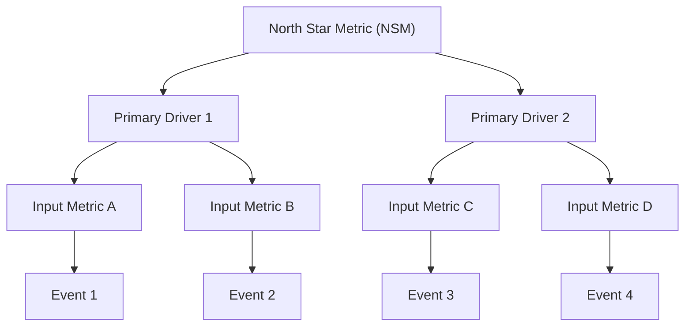

# Analyze Data — General Data Analysis & Metric Strategy Workflow

## What this skill does

Provides a structured, end-to-end framework for data analysis, synthetic dataset creation, visual encoding design, chart-to-insight decoding, metric necessity auditing, and product manager metric co-design.

## Persona delegation

This skill delegates to **`@data-analyst` (Nova)**. Nova provides the analytical rigor, Edward Tufte visual display principles, Avinash Kaushik measurement frameworks, and Socratic challenge stance.

## When to use

- "Analyze this dataset / telemetry log"
- "Generate synthetic / mock data for this user flow"
- "How should we visualize these metrics?"
- "What insights can we extract from this chart or visualization?"
- "Evaluate if this metric actually matters and why we're measuring it"
- "Collaborate with PM to define product metrics and event tracking plans"
- Trigger command: `/analyze-data`

---

## Workflows & Primary Modes

The agent will prompt or auto-detect which mode fits your request:

---

### Mode 1: General Data Analysis & Exploration Partner

Focuses on raw data, synthetic dataset generation, exploratory data analysis, visual encodings, narrative insight extraction, and metric purpose validation.

#### Step 1: Mode & Sub-Flow Selection
Identify which data activity is requested:
1. **Provide Data** — Synthetic & mock dataset generation
2. **Analyze Data** — Exploratory Data Analysis (EDA) & diagnostics
3. **Translate Data to Visualization** — Visual encoding & chart selection
4. **Translate Visualization to Insight** — Narrative extraction & "so what?" analysis
5. **Understand What Matters & Why We Measure This** — First-principles metric audit

---

#### Step 2: Sub-Flow Execution

##### 1. Provide Data (Synthetic & Mock Dataset Generation)
When you need realistic sample data for testing, prompt validation, or schema prototyping:
- Define the schema: entity fields, data types, constraints, and relationships.
- Specify realistic statistical distributions:
  - *User activity / session counts*: Log-normal or Poisson distribution.
  - *Conversion rates / probabilities*: Beta distribution.
  - *Response times / latency*: Skewed gamma distribution with long-tail outliers.
- Include edge cases: zero-states (new users), null/missing values, extreme outliers, and invalid inputs.
- Output clean Markdown tables, JSON event arrays, or CSV sample rows.

##### 2. Analyze Data (Exploratory Data Analysis & Diagnostics)
When given raw data, telemetry logs, or summary statistics:
- **Central Tendencies & Variance**: Calculate mean, median, P90/P95/P99, standard deviation, and interquartile range (IQR).
- **Funnel & Cohort Breakdown**: Analyze step-by-step conversion drop-offs, user retention decay curves, and segment variations (e.g., mobile vs. desktop, free vs. paid).
- **Anomaly Detection**: Flag values exceeding 2+ standard deviations from baseline or sudden step-function shifts.
- **Correlation vs. Causation Check**: Identify potential confounding variables (seasonality, marketing campaign overlap, feature rollout flags) before making causal assertions.

##### 3. Translate Data to Visualization (Tufte Visual Display Standards)
When mapping data dimensions to visual chart representations:
- **Encoding Matrix**:
  - *Trends over continuous time*: Line charts, sparklines, or area charts.
  - *Discrete category comparisons*: Horizontal bar charts (sorted by magnitude).
  - *Correlation / relationship between 2 continuous variables*: Scatter plots or bubble charts.
  - *Multidimensional cohort comparisons*: Small multiples (grid of synchronized small graphs).
  - *Flows & drop-offs*: Sankey diagrams or funnel charts.
- **Edward Tufte Audit**:
  - **Data-Ink Ratio**: Strive for maximum data-ink. Remove heavy gridlines, dark backgrounds, 3D shadows, and decorative elements (chartjunk).
  - **Graphical Integrity**: Ensure visual elements match numerical proportions (avoid truncated Y-axes that artificially amplify minor noise).
  - **Color Palette**: Use muted, accessible, functional colors for data; reserve bright colors exclusively for highlighted insights or alerts.

##### 4. Translate Visualization to Insight (Chart Decoding)
When extracting strategic meaning from visual representations or chart specs:
- **Pattern Identification**: Locate inflection points, inflection speed changes, plateaus, seasonality cycles, and outlier clusters.
- **Root-Cause Hypotheses**: Formulate 2–3 plausible hypotheses for *why* the visual pattern occurred.
- **The "So What?" Action Map**: Translate visual patterns into direct business decisions:
  - *Observation*: "Conversion drops 45% at step 2 on mobile."
  - *Insight*: "Mobile layout forces keyboard overlap on input field."
  - *Action*: "Redesign mobile step 2 to auto-focus and auto-advance."

##### 5. Understand What Matters & Why We Measure This (Metric Evaluation)
When auditing existing or proposed metrics to ensure they drive real value:
- **The "So What?" Test**: Ask: "If this number changes by 20%, what specific decision changes?" If the answer is "nothing," flag it as a vanity metric.
- **Core vs. Proxy vs. Vanity Classification**:
  - *Core Metric*: Direct measure of user value or business sustainability (e.g., 30-day retention rate).
  - *Proxy Metric*: Intermediate surrogate predicting core outcome (e.g., key feature activation in week 1).
  - *Vanity Metric*: Feel-good count that increases regardless of product health (e.g., total signups, pageviews).
- **Goodhart's Law Audit**: Examine how the metric could be gamed or distorted by teams or users if aggressively targeted.

---

### Mode 2: PM Metric Strategy & Collaboration Co-Pilot

Partner directly with `@product-manager` to define product metrics, driver trees, and telemetry tracking plans during product scoping.

#### Step 1: Joint Metric Discovery
- Load product requirements (`artifacts/output/03-strategy/requirements.md` or PRD).
- Apply **Avinash Kaushik's Digital Analytics Measurement Framework**:
  1. *Business Objective*: Core purpose of the feature/product.
  2. *Goals*: Specific strategies supporting the objective.
  3. *KPIs*: Measurable metrics tracking each goal.
  4. *Targets*: Explicit quantitative success benchmarks (e.g. above 20% weekly active usage).
  5. *Segments*: Key user cohorts to analyze.

#### Step 2: Construct Metric Drivers Tree
Build a top-down metric hierarchy:



#### Step 3: Guardrail & Counter Metrics
Pair every primary KPI with a guardrail metric to catch negative side effects:
- *Primary KPI*: increase free trial conversions → *Guardrail*: 30-day refund / chargeback rate.
- *Primary KPI*: reduce onboarding completion time → *Guardrail*: profile completion accuracy rate.

#### Step 4: Telemetry Tracking Plan & Data Dictionary
Produce an implementation-ready specification for `@developer`:
- **Event Name**: Standardized snake_case or noun_verb format (e.g., `checkout_step_completed`).
- **Trigger Condition**: Exact user interaction or system condition firing the event.
- **Properties**: Payload key-value pairs (e.g., `step_number`, `payment_method`, `error_code`).
- **Business Question**: The precise question answered by this event.

---

## Output Artifacts & Delivery

Both artifacts have a **template on disk**, and this skill referenced neither of them. The templates
are 293 and 160 lines of declared structure; a run that never opened one produced an artifact with
whatever shape it invented, and nothing noticed.

| Mode | Write to | Template to follow |
|---|---|---|
| **Mode 1** — general analysis & insights | `artifacts/output/07-iteration/analytics-insights.md` | `.agents/templates/quality/analytics-insights-template.md` |
| **Mode 2** — PM metric strategy & tracking plan | `artifacts/output/03-strategy/measurement-plan.md` | `.agents/templates/quality/measurement-plan-template.md` |
| **Dashboard wire** — when a dashboard is wanted | `artifacts/output/03-strategy/dashboard-specs.md` | `.agents/templates/quality/dashboard-specs-template.md` |

### The wire from data to dashboard

There was none. `measurement-plan-template.md` §5 says **which metrics** to watch;
`analytics-insights-template.md` says **what the data showed**; sub-flow 3 below maps data shapes to
chart types. None of the three could be built from — a dashboard spec contained a metric list and no
chart, no source, no query, no layout, and `dashboard-specs.md` was named in exactly one place with
nothing reading it.

**Produce `dashboard-specs.md` whenever a dashboard is the ask** — the user says "dashboard", a panel
set is wanted for ongoing monitoring, or sub-flow 3's encoding output has somewhere to go. The
template declares a **target** (`grafana | metabase | looker | superset | in-app | sql-only | other`)
and then carries the fields every target needs: panel, metric, source, query or definition, chart,
layout, owner. `Query / definition` is PromQL in one target and a Metabase question ID in another —
which is why the target is named first and the template picks no vendor for you.

**The chart column is where sub-flow 3 lands.** The Encoding Matrix below is not advice that stays in
this skill: each panel in the spec names the chart its data shape takes, so the mapping decided during
analysis is the mapping the builder implements.

**In-app dashboards do not stop here.** If the target is `in-app`, hand the spec to `/design` — the
panels become screen states and the queries become data-layer work — and `/develop` builds it. Every
other target is configured by `@devops-engineer` from the same tables, with no code shipped.

**The Mode 1 path is `analytics-insights.md`, not `data-analysis-report.md`.** This skill used to name
the second. Nothing read it: the template's own header says *"Save to:
`artifacts/output/07-iteration/analytics-insights.md`"*, and `iteration-backlog-template.md`,
`iteration-results-template.md`, `/iterate` and the agent contracts all consume that name. A run under
the old path produced an artifact **the next skill in the pipeline could not find** — the analysis was
done and the iteration loop never saw it.

Save key measurement decisions to shared memory via `@memory-controller`:
```
@memory-controller write active-decisions.md
### [DECISION] {Metric / Analysis Title} [date: YYYY-MM-DD] [agent: @data-analyst]
{Key metric selection, visual spec, or telemetry decision}
**Status:** active
```

## Halt conditions

Any one halts the run:
- **Mode 2 with no requirements document.** Step 1 loads
  `artifacts/output/03-strategy/requirements.md` or a PRD. If neither exists, say so and ask for the
  business objective — a measurement plan built on a guessed objective measures the wrong thing.
- **A metric audit with no decision to change.** The "So What?" test is the skill's own centrepiece:
  if a 20% change in the number changes no decision, the honest output is "this is a vanity metric",
  not a dashboard spec.
- **Analysis with no denominator.** A rate without its sample size cannot be reproduced. State `n`,
  or state that it is unknown.

## Done when — checked mechanically

```bash
node .agents/scripts/analyze_data_check.js check \
  --kind measurement-plan --file artifacts/output/03-strategy/measurement-plan.md --json
node .agents/scripts/analyze_data_check.js check \
  --kind insights --file artifacts/output/07-iteration/analytics-insights.md --json
```

| Rule | What is checked |
|---|---|
| **Template conformance** | the sections the template declares are present, matched by stem so numbering and `vs.` / `vs` do not defeat it. Conditional sections (`if applicable`) are not required |
| **Record hygiene** | no unfilled template placeholders — an artifact still carrying `[Feature Name]` is the template |
| **A metric carries a number or says it does not** | a target with no number is a wish. `n/a` is accepted *with a reason*; a bare blank is not |
| **No decision-less dashboard** | the "So What?" action map is present: an observation, an insight and an action, not three observations |

And the dashboard wire:

```bash
node .agents/scripts/analyze_data_check.js check \
  --kind dashboard-specs --file artifacts/output/03-strategy/dashboard-specs.md --json
```

| Rule | What is checked |
|---|---|
| **Target declared** | `**Target:**` names one of the closed set, or `other: <name>`. An unnamed target cannot be built from — the same field is PromQL or a question ID depending on it |
| **Live object field** | present, even when it reads `not yet built`. A spec with no field for the finished object is a spec that will be lost |
| **Every panel is buildable** | each panel row names a **metric, a source, a query or definition, and a chart**. A row missing any of the four is a wish with a title |
| **Alerts when real-time** | a spec with `Refresh: real-time` must carry an alert threshold and a channel. A real-time panel with no threshold is a screen nobody watches |
| **Access named** | every data source names its access level. A spec that does not say who can read the data has not been designed, only drawn |

**What the gate does not check:** whether the metric is the right metric, whether the analysis is
sound, whether the visualization is honest, or whether the recommendation follows from the data.
Those need an analyst. A green gate means the artifact is *structured*, not that it is *right*.
