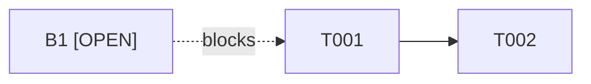

# Maintenance Plan — {plain title}

{One plain sentence describing what this plan will verify or change. This plan does not execute code changes or claim gate-green.}

## Record identity

| Field | Value |
|---|---|
| `runId` | `{exact existing maintenance run ID}` |
| `planId` | `{stable plan ID, e.g. MP-001}` |
| `planRevision` | `{positive integer; increment for every content change}` |
| `planDigest` | `{sha256:<64 lowercase hex>; canonical rule below}` |
| `baseRevision` | `{full immutable revision ID}` |
| `workingTreeIdentity` | `{canonical repository/worktree paths and identity; branch and full HEAD; clean/dirty state; the machine-readable per-file fingerprints live in the dirtyManifest field below}` |
| `dirtyManifest` | `{single-line JSON object; schema dirty-manifest-v1; files: [] when no relevant file changed}` |
| `externalStateRoot` | `{canonical absolute external path, disjoint from repository}` |
| `repoArtifactRoot` | `artifacts/output/maintenance/{runId}/` |
| `createdAt` | `{UTC timestamp}` |
| `author` | `{agent/person}` |
| `recordStatus` | `DRAFT` |

**Digest rule:** compute SHA-256 over the exact plan bytes after replacing the `planDigest` field value with the literal `[DIGEST OMITTED]`. Record that canonicalization rule with the digest. Any other content change requires a new revision and digest. The `dirtyManifest` field is part of the digested bytes, so finalize the manifest first and then recompute the digest.

**Revision rule:** keep this file immutable after review. Save a changed plan as a new `maintenance-plan-{planId}-r{revision}.md` file beneath the same run root; stale review or authorization records do not transfer to the new digest.

## Dirty manifest

`dirtyManifest` is the machine-readable form of the working-tree fingerprints. It is one JSON object on a single line in the `dirtyManifest` identity field:

```json
{
  "schema": "dirty-manifest-v1",
  "files": [
    {
      "status": "staged",
      "path": "src/app.js",
      "kind": "file",
      "mode": "100644",
      "contentSha256": "<64 lowercase hex>"
    }
  ]
}
```

**Canonicalization rules**

- `schema` is exactly `dirty-manifest-v1`; `files` is an array; every entry carries exactly `status`, `path`, `kind`, `mode`, and `contentSha256`.
- `status` is `staged`, `modified`, `deleted`, or `untracked`.
- `path` is normalized and repo-relative with forward slashes: no leading `./`, no `..` segment, no absolute path, no backslash.
- `kind` is `file`. Regular files only.
- `mode` is `100644` or `100755`; `contentSha256` is the SHA-256 of the exact bytes (64 lowercase hex). Both are `null` for an absent or deleted snapshot. A staged deletion is a `staged` row with a null mode and hash; an unstaged deletion is a `deleted` row with a null mode and hash.
- Entries are sorted by normalized path, then by status. One path may appear twice: the staged/index snapshot and a different working-tree snapshot are separate rows.
- A clean relevant set is an empty `files` array. Changed files outside the relevant set stay out of the manifest.

**Relevant-path set**

- The relevant set comes only from the plan's exact source, test, and input references: the Findings source/test/evidence cells, the Task list source and verification cells, the run-root paths in the Inputs table, and the repository source references list.
- A run-root input is named by its bare file name; a repository file uses a repo-relative path that contains a `/`.
- The plan file itself is excluded, so the manifest never describes its own bytes.
- The plan must not name any product-state or non-allowlisted output path — `artifacts/output/pipeline-state.json`, `artifacts/output/sprint-status.yaml`, `artifacts/memory/**`, `.agents/state/**`, or any output path outside this run root — even in a citation. Cite the adapted run-root copies instead. The checker rejects such a plan before it reads anything.
- A symlink, a submodule, or any other unsupported kind or mode fails closed. Never drop such a path from the manifest.

**Generate the manifest** (read-only; it writes nothing):

```bash
node .agents/scripts/maintenance_plan_check.js manifest \
  --scope maintenance \
  --repo-root <absolute-repository-root> \
  --state-root <absolute-external-state-root> \
  --run-id <run-id> \
  --plan <absolute-plan-path> \
  --json
```

The command prints the computed `manifest`, the derived `relevantPaths`, and the `planDigest` of the current plan bytes. Paste the `manifest` object into the `dirtyManifest` identity field, then recompute the digest and update the `planDigest` field.

## Scope

- **In scope:** {bounded work; cite maintenance input IDs and local links}
- **Out of scope:** {work explicitly excluded}
- **Assumptions:** {each assumption and evidence reference or `[UNVERIFIED]`}
- **Constraints:** {run boundary, no product phase/state change, no UI/design work, and any other limit}
- **Execution boundary:** This artifact is a proposal only. It does not execute code changes. Execution requires a separate maintenance workflow and explicit repository-owner authorization.

## Inputs and reconciliation

| Input | Run-root path | IDs/local links checked | Result | Limitations / inherited references |
|---|---|---|---|---|
| Bootstrap plan | `maintenance-bootstrap-plan.md` | `{IDs, decisions, local links}` | `{checked / blocked}` | `{external references not reopened}` |
| Maintenance brief | `maintenance-brief.md` | `{FR/NFR IDs, local links}` | `{checked / blocked}` | `{inherited claims}` |
| Maintenance spec | `maintenance-spec.md` | `{CAP/MS/FR/NFR/US mappings}` | `{checked / blocked}` | `{inherited claims}` |
| Maintenance work items | `maintenance-work-items.md` | `{US/AC IDs, spec and brief links}` | `{checked / blocked}` | `{inherited claims}` |
| Plan contract | `maintenance-plan-contract.md` | `{required fields and local links}` | `{draft/approved status as recorded}` | `{do not infer approval}` |

**ID and link check:** `{record IDs defined, IDs referenced, local links resolved, mismatches, and the exact check evidence}`.

**Repository source references (read-only):** `{list exact repo-relative path:line or test file + test name, why each is linked to a work item or named finding/estimate, whether it was opened, and the full revision/tree identity checked}`. Only these exact relevant sources may be opened; do not broad-scan directories or edit/run them during planning. Do not claim verification until actually opened.

**External/web/inherited references:** `{list exact references not reopened}` — mark each `NOT REOPENED — inherited/unverified` unless separately authorized and actually opened. An inherited report or citation is not current repository verification.

## Findings

| Finding ID | Claim and provenance | Current status | Owner | Decision owner | Exact source link(s) | Test/verification reference(s) | Evidence reference(s) | Revision covered | Blocked by |
|---|---|---|---|---|---|---|---|---|---|
| `{F-ID}` | `{verified within allowed inputs / inherited / unverified}` | `{OPEN / IN_PROGRESS / BLOCKED / DONE / DEFERRED / FALSIFIED}` | `{person/agent}` | `{owner or N/A with reason}` | `{maintenance-input anchor or exact permitted repo path:line}` | `{exact test file + test name/command or manual evidence; otherwise OPEN}` | `{exact artifact path or external evidence reference}` | `{full revision/tree identity}` | `{decision/task IDs or —}` |

Do not convert absent evidence into a passing status. A repository source outside the run root may be marked current only if it is an exact permitted read-only reference and was opened at the recorded revision/tree identity. Unopened repository citations and external/web references remain inherited and unverified.

## Owner decisions — blockers, not estimated tasks

Do not choose a value, infer an exception, or estimate the owner's decision time. List dependent work as blocked; do not turn an owner decision into a task.

| Decision ID | Exact question | Options shown without selection | Status | Decision owner | Dependent task/work or gate | Owner evidence |
|---|---|---|---|---|---|---|
| `B1` | Choose whether publication is blocked by all known findings or only new findings. | `{list both}` | `[OPEN]` | Repository owner | `{dependent work; no policy implementation before ruling}` | `OPEN — no disposition recorded` |
| `O-4` | Record a human disposition for each required baseline-history entry. | `{no agent-selected disposition}` | `[OPEN]` | Repository owner | `{per-entry human disposition and final closeout}` | `OPEN — no disposition recorded` |
| `B10` | Choose retain, reshape, or remove for `/brainstorming` and `/validation-patterns`. | `retain / reshape / remove` | `[OPEN]` | Repository owner | `{work changing that skill family}` | `OPEN — no disposition recorded` |
| `credential-residual` | Decide whether the measured residual miss is acceptable and what guarantee may be stated. | `{no agent-selected disposition}` | `[OPEN]` | Repository owner | `{residual acceptance and any dependent green claim}` | `OPEN — no disposition recorded` |

Other owner decisions: `{ID, exact question, options, status, owner, dependency, evidence; or none}`.

## Task list

Every executable task must be 1–4 hours, have one exact first action and observable done evidence, and be traceable to allowed source links. Do not estimate an owner decision. A decision-dependent task may be `[BLOCKED]`; if its scope cannot be bounded before the decision, leave it out of the task list and list it as unplanned/blocked scope.

| Task ID | Work item and estimate (1–4h) | First action | Done evidence | Status | Owner | Decision owner | Requirement/story/AC IDs | Exact source link(s) | Revert-proof test or manual evidence | Depends on | Parallel with |
|---|---|---|---|---|---|---|---|---|---|---|---|
| `T001` | `{bounded task; N h}` | `{exact first file, command, or record}` | `{observable result and exact evidence location}` | `[PLANNED / BLOCKED]` | `{person/agent}` | `{owner or N/A with reason}` | `{FR/CAP/US/AC IDs}` | `{maintenance-input anchor or exact permitted repo path:line}` | `{code: exact test file, case/name, command, and failure-on-revert behavior; non-code: steps, expected/observed result, verifier, date, revision}` | `{task/decision IDs or —}` | `{symmetric task IDs and coordination note, or —}` |

For every code task, the named behavior test must pass with the intended fix and fail when that fix is reverted. If the allowed inputs cannot support an exact test file/case/command, plan a bounded discovery task first and keep dependent implementation out of the ready task list. Never treat `node --check` alone as behavior or revert-proof evidence.

## Dependency graph

This graph must match the task table exactly: every task dependency is an edge, every open-decision blocker is a dashed edge, and there are no extra or missing edges. Use prerequisite → dependent direction.



Replace all example nodes and edges with this plan's IDs. The sample graph is syntax only, not a run fact.

## Parallelism

| Parallel group | Tasks | Why independent | Coordination / shared-resource check |
|---|---|---|---|
| `{P1}` | `{task IDs}` | `{no dependency path or shared resource}` | `{coordination note}` |

`{No parallel tasks, with reason}`. Do not allocate worktrees or invoke worktree helpers.

## Risk register

| Risk | Likelihood | Impact | Mitigation | Owner | Trigger/evidence |
|---|---|---|---|---|---|
| Source/test reference is stale or not inspected | `{Low/Medium/High}` | `{Low/Medium/High}` | During Step 1, inspect only exact permitted repository references read-only and record the revision/tree identity; keep unopened repository or external references inherited/unverified. Running tests or changing source requires separate execution authorization. | `{owner}` | `{exact reference}` |
| An owner decision remains open | `{Low/Medium/High}` | `{Low/Medium/High}` | Keep dependent work blocked and do not select a policy. | Repository owner | `{B1/O-4/B10/credential-residual}` |
| Plan or evidence revision drifts | `{Low/Medium/High}` | `{Low/Medium/High}` | Bind every record to the full plan digest; create a new revision and renew review after edits. | `{owner}` | `{revision/digest reference}` |
| `{additional scoped risk}` | `{Low/Medium/High}` | `{Low/Medium/High}` | `{specific mitigation}` | `{owner}` | `{trigger/evidence}` |

## Technical review and repository-owner execution authorization

These are separate records. Neither is authenticated by a state event. Keep both pending until their own evidence exists and bind them to the same `runId`, plan ID, revision, and digest.

| Record | Status | Required reviewer/owner | Scope / task IDs | Exact plan revision and digest | Evidence reference | Claim status |
|---|---|---|---|---|---|---|
| Technical plan review | `PENDING` | `@tech-lead` | Scope, sources, estimates, first actions, done evidence, verification, graph, parallelism, risks | `{runId / planId / revision / digest}` | `OPEN` | `not recorded` |
| Repository-owner execution authorization | `PENDING` | Repository owner | `{explicit authorized scope and task IDs}` | `{runId / planId / revision / digest}` | `OPEN` | `not recorded` |

Any recorded review/authorization must cite exact evidence and be labelled `recorded-claim` / `not-cryptographically-verified`. Technical review does not authorize execution. Do not rewrite this frozen plan to add later review results; record them in external maintenance state. A new plan-content revision invalidates older records.

## T008 plan-check prerequisite

- Checker: `maintenance_plan_check.js` — implemented by T008.
- Required command:

```bash
node .agents/scripts/maintenance_plan_check.js check \
  --scope maintenance \
  --repo-root <absolute-repository-root> \
  --state-root <absolute-external-state-root> \
  --run-id <run-id> \
  --plan <absolute-plan-path> \
  --json
```

- The checker is read-only, never authorizes execution (`executionAuthorized` is always `false`), and never emits a gate-green verdict. It compares the declared `dirtyManifest` against the computed working-tree state for the relevant-path set: a missing, extra, or mismatched entry fails.
- Current result: `NOT RUN — replace this line only with the exact command, raw output, exit status, run ID, and plan digest from an actual check of this revision.`

Do not run the placeholder command or claim a pass. After T008 implements and documents a run-scoped command, replace the current result only with the exact command, raw output, exit status, run ID, and plan digest from an actual check of this revision.

## Maintenance state evidence

| Event | Purpose | Evidence reference | Claim status |
|---|---|---|---|
| `plan_drafted` | Bind the draft artifact path, plan ID, revision, digest, and `DRAFT` status. | `{external state event/reference}` | `recorded-claim` |
| `verification` | Record `@tech-lead` technical review only. | `{exact review evidence}` | `recorded-claim` / `not-cryptographically-verified` |
| `plan_approved` | Record explicit repository-owner execution authorization only; include authorized task IDs and owner-authored evidence. | `{exact owner evidence}` | `recorded-claim` / `not-cryptographically-verified` |

Finish by checking the same run with `maintenance_state.js status`. State and events are evidence records, not authentication, execution, or gate-green.
