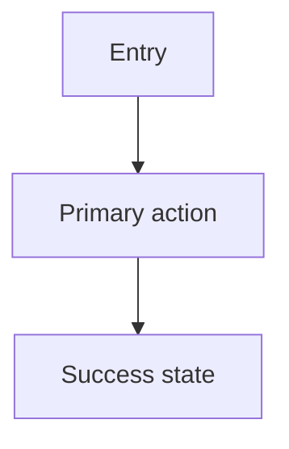
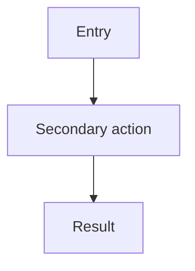
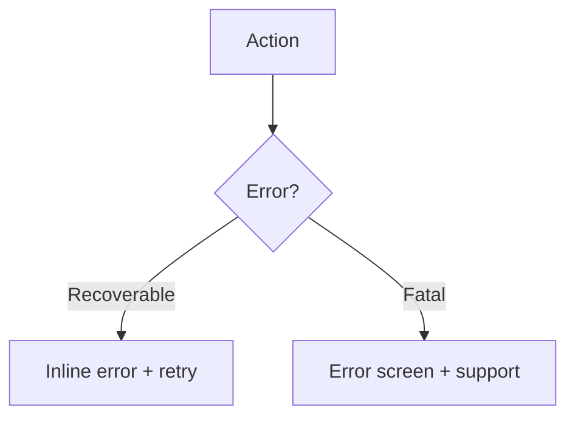

# {Feature Name} — Product Specification

## Overview
- **Feature:** {name}
- **PRD reference:** `requirements.md` CAP-{N}
- **User stories:** `user-stories.md`
- **Design direction:** {2-3 sentence summary of the visual theme and UX approach}
- **Theme rubric:** {product context} × {style menu # + name} (e.g. "Sleek Utility × Bento Grid")

## User flows

### Happy path

### Alternative paths

### Error flows

## Screen specs

### Screen: {screen name}
**Purpose:** {what this screen does}
**Associated stories:** US-{NNN}
**Entry:** {how user arrives}
**Exit:** {where user goes next}

**Content:**
- {element descriptions}

**Layout:** {arrangement notes, grid references}

**States:**
| State | Visual | Behavior |
|-------|--------|----------|
| Default | | |
| Loading | Skeleton/spinner | |
| Empty | {empty state messaging} | |
| Error | {error messaging + recovery} | |
| Success | {confirmation} | |

**Responsive behavior:** {how layout shifts at each breakpoint}

## Interaction details

| Trigger | Action | Success | Error | Loading | Motion |
|---------|--------|---------|-------|---------|--------|
| {user action} | {system response} | {result} | {error handling} | {loading state} | {MO-### from motion-spec.md, or —} |

## Content & tone

- **Voice:** {e.g. plain-spoken / warm / formal — 3 adjectives max, must match design.md brand inputs}
- **Copy source:** {where each screen's strings live — inline below, or `content.md` companion}
- **Empty state:** "{exact string}" — {tone note}
- **Error state:** "{exact string}" — never blame the user, always name the recovery action
- **Success state:** "{exact string}"
- **AI low-confidence / uncertainty:** "{exact string}" — how ungrounded or low-confidence output is worded; never present a guess as fact (required when `@product-manager` declares AC-AI criteria)
- **AI inference failed / fallback:** "{exact string}" — deterministic fallback message when the model is unavailable
- **AI citation / groundedness label:** "{exact string}" — how sources or "no source found" are surfaced next to generated content

## Visual system

> Full tokens in `design.md`. Summary below.

| Category | Key decisions |
|----------|--------------|
| Theme | {selected rubric} |
| Primary color | `--color-primary: #{hex}` |
| Typography | {heading font}, {body font} |
| Component style | {rounded/sharp, shadow/flat, etc.} |
| Breakpoints | Mobile / Tablet / Desktop / Wide |

## Edge cases

| Scenario | Story ref | Expected behavior |
|----------|-----------|-------------------|
| {edge case} | US-{NNN} | {how system handles it} |

## Open questions

| # | Question | Owner | Status |
|---|----------|-------|--------|
| 1 | {question} | @{role} | Open / Resolved |

## Cross-references

| Artifact | Link |
|----------|------|
| PRD / Spec kernel | `requirements.md` |
| User stories | `user-stories.md` |
| ADRs | `artifacts/output/04-architecture/` |
| Visual design system | `design.md` |
| Execution plan | `artifacts/output/05-planning/execution-plan.md` |

## Acceptance-Criteria ID Convention & Coverage Grammar (02o)

Acceptance criteria use stable, sweepable ids — never free-form text:

- `AC-H*` happy path · `AC-U*` unhappy/error path · `AC-E*` edge case · `AC-AI-*` AI/ML criteria (accuracy thresholds, fallback, rubric expectations).
- Ids are unique per story set; matching is anchored — `AC-1` never satisfies `AC-10`, and `AC-E-012` never satisfies `AC-E-012-1`.
- **Phase Boundary Rule (post-handoff):** contract shifts append new criteria as `AC-E*` (plus a `[DELTA-NN]` entry in `requirements.md`) — in-place edits to existing criteria are banned during engineering.
- Every AC id needs ≥1 resolvable implementation reference (code or test) or a dated deferral row — the orphan-AC sweep (`.agents/scripts/req_to_impl_check.js`) exits 1 on the first orphan, and qa-signoff cites the sweep's output.

**Coverage report grammar:** `.agents/skills/develop/templates/coverage-report.md` — rows `{ac_id, evidence_ref[], mechanism, check}`; refs use the frozen `path#id` anchor syntax (id = code/test symbol) or `path:line` (weaker — line drift).
