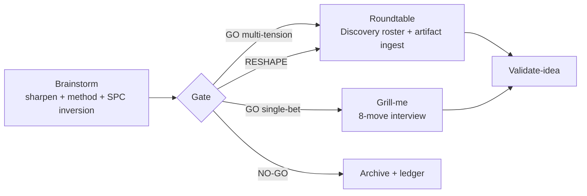

# Review 07 — Roundtable subsystem (skill + eval harness + brainstorming seam)

Date: 2026-09-05 (updated 2026-09-06 — §§29–31, P0/P1/P2 implementation logs §§10–28) | Mode: 3 native audit seats + Reverse Brainstorming (matcher's top pick, score 4) | Scope: `round-table/SKILL.md`, `roundtable_eval.js`, `resolve_agents.js`, `evals/roundtable/` (topics/README/fixtures+legacy/runs), `artifacts/evals/roundtable/` (runs + telemetry log), `brainstorming/SKILL.md` + `methods.csv` + `match_methods.js`

## 0. Reverse-brainstorm pass (how would we make roundtable worse? → invert)

| Worst idea | Inversion = requirement |
|---|---|
| Always seat the same builders; never the eval/ML voice | Topic-tag router auto-seats Kai (P1-15 fix carries over) |
| Let the mock judge its own fixtures (evals failure replayed) | Roundtable verdicts stay human/panel-issued; scorer measures protocol compliance, never idea quality |
| Silent solo: simulate in one context, log `solo` | Machine-readable solo-disclosure marker + divergence tracking with teeth |
| Unmeasured SPC: unanimous panels pass unchallenged | Red-team assignment + concession counting in telemetry |
| 36-run baseline nobody can afford, so nobody runs it | Sampled baseline + cost guidance + CI trigger |

## 1. Verdicts

- Skill + scripts: **[RESHAPE]** — fix scorer crash, fence/bullet strictness, ADR normalization, concession visibility, roster/router gap before trusting coverage+score.
- Eval harness: **[PARTIAL]** — coverage gate + scorer work as coded, but gold set, baseline, gates, telemetry all incomplete; cannot red-light a bad protocol change today.
- Brainstorming seam: **[PARTIAL]** — well-built ideation island, zero bridge to stress-testing.

## 2. Skill + scripts defects (new)

- **P0-1 Scorer crash on misnamed file.** `roundtable_eval.js:143-144,184-185` — `nameError` rows have undefined mode/topic; `:185` dereferences → TypeError. One stray file kills the whole `score` run.
- **P0-2 Coverage parser brittleness.** Fence allows exactly one space (`:52-55`); bullets must sit at column 0 (`:66`); colon mandatory but silent-drop without it; ASCII `->` only (docs use `→`); duplicate `panel:` wins-first with misleading non-panelist warnings (`:60`); self-edges inflate challenge count (`:72,100`).
- **P1-1 Roster 0/10 + no router.** `SKILL.md:62-72` (44 slots, Kai/Atlas nowhere); host filters `resolve_agents.js` output "yourself" (`:39-42`); resolver returns no phase/role hints, duplicates title/description (`:66-67`), includes memory-controller without an exclusion flag (host must remember `:90`), clobbers `temperature: 0` (`:69`), fails on BOM/leading newline (`:10`). Roster drift undetectable in code.
- **P1-2 Solo disclosure unenforceable.** Specified 3× (`:23,:32-34,:54-56,:181`) but no transcript marker, divergence tracked-not-gated (`README.md:46`), self-reported `--mode` unverifiable.
- **P1-3 Gates half-wired.** SPC red-team prose-only (`:125`, scorer `spcFlag` advisory per `README.md:45`, unanimous-GO passes); concessions uncounted (`:113` vs scorer `:104-116` — Functional Sycophancy passes green coverage); 2-round bound no counter/marker/check (`:115`); `SYNTHESIS: ADR:<id>` uppercased whole-token destroying IDs (`:107,114`) + counted as instability; regexes match inside fenced quotes (false positives).
- **P1-4 Continuity exceeds mechanism.** Permanent-active panel (`:129-152`) with no session-state file/turn counter/membership record; compaction drops it silently; mid-debate "thanks!" exits (`:135,179-181`); solo re-dispatch isolation unverifiable from transcript.
- **P1-5 Persist invoked-not-enforced.** Memory writes via subagent (no exit code); `log --agents` aspirational list never reconciled with who spoke; disk-verification preamble gives no command.
- **P1-6 Tier policy duplicated with elicitation.** Same native→solo→refuse tiers, already diverged (`--simulated` permitted vs refused: `elicitation:42` vs `round-table:34`) — extract to shared reference before baselines fork.

## 3. Eval harness upgrades (from audit table)

1. Sound-topic hints (≥1 RESHAPE, e.g. rt-003) + 2 Review-gate topics (`rt-011/012`, hints PARTIAL/FALSIFIED) — `topics.json:17-22`.
2. Scorer: extend disagreement/SPC to Review verdicts; surface `badVerdictTags`; exit 1 when coverage < 1.0 or flawed-topic synthesis contradicts hint (`:165-182,:234-252`).
3. Preserve ADR id case; stability-excluding-escalations (`:107-114,:187-192`).
4. Fixtures to canonical vocab; one legacy file under `fixtures/legacy/` (`rt-003_*`, `rt-010`).
5. Minimum-substance check or document edge-count as necessary-not-sufficient (`:65-74`, `README.md:43`).
6. Log schema: `--topic-id/--synthesis/--coverage-exit/--model/--run-file/--duration-s`; reject empty `--agents`; join score↔log (`:255-271`).
7. Accept `refused` in scorer (or document log-only); `--model flash` cost guidance; report filename convention; CI/nightly trigger (`README.md:55-60`, `:128-136`).
- Do 1–3 + 6 first: they convert existing data into falsifiable gates before spending the remaining 30 runs. Baseline reality at audit time: 6/36 transcripts, 9/10 topics zero runs, 0/13 log entries joinable, zero solo entries, 1 orphan run. Current state (§30): 5 canonical fixtures + 1 legacy, runs/ 2 scored + 1 orphan, log 15 entries.

## 4. Brainstorming seam defects

1. No brainstorming→roundtable edge (`brainstorming/SKILL.md:76,83-87`); no brainstorm-artifact intake in roundtable (`round-table/SKILL.md:43-48,179-181`; memory-filter keyword luck is not a contract).
2. Routing (Step 4b, AGREED 2026-09-05 + Strategy review closed: threshold default + escape hatch). The gate verdict locks FIRST — route from the locked verdict, never reshape it to earn a panel. `[GO]` + ≥2 tensions (bullet ids quoted, e.g. B1/B3), or `[RESHAPE]` spanning ≥2 domains → roundtable (Discovery roster). `[GO]` single-bet, or single-domain `[RESHAPE]` (domain + reason stated) → grill-me. Emit: *"Top idea gated [{verdict}]. Next: roundtable with {n} open tensions (from bullets {ids}: {a} vs {b}). Reply 'grill-me instead' to go deep 1-on-1, or 'proceed' to start the roundtable."* / *"…Next: grill-me on the single bet ({bet}). Reply 'roundtable instead' for a panel, or 'proceed' to start."* `[NO-GO]` → archive + ledger; Zero-Blueprint blocks building, not talking. Cost stated once (1 call vs 2–5 seats + rounds, 5–10×). Overrides logged `[ROUTING-OVERRIDE: default -> chosen -- reason]` in output + `[BRAINSTORM]` entry; >~20%/10 sessions → revisit. Roundtable intake is validate-then-adopt (5-min falsification check; may RESHAPE-topic or bounce back). Grill-me vs roundtable principle: grill-me = one mind going deep (proposer's conviction); roundtable = N independent minds colliding (what no single persona can think).
3. Matcher uncalibrated: no IDF/normalization/floor (`match_methods.js:113-126,176`); narrow-match promise unenforced (`SKILL.md:45`); synonym map ideation-blind, category signal (3 pts) unreachable (`:87-101`).
4. SPC inversion prose-only (`:55`) — add `[SPC: inversion-applied|rosy-absent|skipped — reason]` marker before Step-4 write.
5. Step-0 duplicated with elicitation (`:28-35` vs `:52-59`) — extract to shared reference.
6. Founder-only delegation (`:15-17`) while founder self-declares non-brainstormer (`founder.md:104`); Kai absent from ideation (methods.csv agent rows Founder/Architect/Developer/PM only). Fix: keep founder conductor, co-dispatch specialist critique voice on AI/security/perf triggers.



## 5. Dev plan — every problem gets a task (ordered P0 → P1 → P2)

Estimates: S (≤2h), M (2–4h). Owner = implementing seat; DoD = falsifiable done condition.

### P0 (protocol lies or crashes — fix first)

| ID | Problem (§) | Task | Owner | Est | DoD |
|---|---|---|---|---|---|
| RT-P0-1 | Scorer crash on misnamed file (§2-P0-1) | Guard `nameError` rows: emit non-compliant row instead of dereferencing; add stray-file regression test | Developer | S | `score --dir` with a junk file lists it non-compliant without crashing; test red→green (exit code upgraded to 1 by RT-P1-9 gate — see §18) |
| RT-P0-2 | Coverage parser brittleness, 6 sub-bugs (§2-P0-2) | Tolerant fence (whitespace/case, closing-fence trailing space); indented bullets; missing-colon → warning not silent drop; accept `→`; duplicate `panel:` → error; exclude self-edges from challenge count | Developer | M | Variant fixtures (indented, unicode arrow, no-colon, dup panel, self-edge) parse/gate as specified; tests per variant |
| RT-P0-3 | ADR id destroyed + counted as instability (§2-P1-3d, §3-3) | Split `ADR:<id>` before uppercasing verdict token; track `stabilityExcludingEscalations` separately | Developer | S | `native_3`-style transcript keeps id case and stability ≥ previous; test |
| RT-P0-4 | Concessions invisible; SPC unenforced (§2-P1-3a/b) | Extract + count `[CONCESSION: reason]` in scorer and surface in report; unanimous-Round-1 (sound topics) requires assigned red-team challenger — gate, with flawed-premise carve-out | Developer + QA | S–M | Fixture with zero concessions but full coverage reports `concessions: 0` flagged; unanimous sound topic without `[RED-TEAM:]` marker fails the gate (shipped in final-review loop — see §29; red-team marker spec in SKILL SPC gate) |

### P1 (routing, gates, telemetry, calibration)

| ID | Problem (§) | Task | Owner | Est | DoD |
|---|---|---|---|---|---|
| RT-P1-1 | Roster 0/10 + no router (§2-P1-1; carries P1-15) | Topic-tag router table in `round-table/SKILL.md` (Kai/Atlas/specialist auto-seat on matching tags); resolver: phase/role hints, `reasoning-participant` exclusion flag, fix `temperature: 0` clobber + BOM handling + quote-strip | Tech-lead + Developer | M | Prompt/eval-topic roundtable auto-seats Kai with no host improvisation; drift test fails when a new agent file lacks routing metadata |
| RT-P1-2 | Solo disclosure unenforceable (§2-P1-2) | Machine-readable `[MODE: solo — isolated calls]` transcript marker; scorer verifies presence; divergence tracked WITH threshold (propose-then-confirm value) | Developer | S–M | Marker-less solo transcript fails verification; divergence reported against threshold |
| RT-P1-3 | 2-round bound unenforced (§2-P1-3c) | `[ROUND: n]` turn markers + parser check (max 2 exchange rounds); over-long debates flagged | Developer | S | 3-round fixture fails the bound check; test |
| RT-P1-4 | Verdict regex hits fenced quotes (§2-P1-3e) | Strip fenced code blocks before verdict/synthesis extraction | Developer | S | Doc-paste fixture no longer creates false verdicts; test |
| RT-P1-5 | Continuity exceeds mechanism (§2-P1-4) | Panel session-state file (members, turn count, topic) that survives compaction; narrow exit triggers (bare "thanks" mid-debate does not close; explicit `/exit` or confirmed close does) | Tech-lead | M | Mid-debate compaction + resume keeps panel; "thanks!" alone no longer exits; tests |
| RT-P1-6 | Persist invoked-not-enforced (§2-P1-5) | Reconcile `log --agents` against actual speakers in scorer; give the disk-verification preamble a concrete command; require session-write completion in exit checklist | Developer | S–M | Log listing non-speakers (or missing speakers) is flagged; exit without session-write fails checklist |
| RT-P1-7 | Step 4b edge + intake (§4-1/2, AGREED wording above) | Brainstorming Step 4b: threshold default + one-clause override + `[ROUTING-OVERRIDE]` logging + >~20%/10-session revisit rule; roundtable brainstorm-artifact intake clause (`brainstorming-session.md` path + sharpened topic as subject) | Founder + Tech-lead | S–M | `[GO]` session emits exactly one routed offer with override clause; override logged in marker format; intake clause present and referenced by filename |
| RT-P1-8 | Topic hints + Review-gate topics (§3-1) | Non-null hints for 3 sound topics (≥1 RESHAPE, e.g. rt-003); add `rt-011/012` Review-gate topics (hints PARTIAL/FALSIFIED) | QA + Founder | S | Every sound topic has a falsifiable hint; Review path exercised by ≥2 topics |
| RT-P1-9 | Scorer gates (§3-2) | Extend disagreement/SPC to Review verdicts; surface `badVerdictTags` in text report; exit 1 when coverage < 1.0 or flawed-topic synthesis contradicts hint | Developer | M | Contradicting fixture exits 1; bad tags visible without `--json`; tests |
| RT-P1-10 | Log schema v2 (§3-6) | `--topic-id/--synthesis/--coverage-exit/--model/--run-file/--duration-s`; reject empty `--agents` for native/solo; join score↔log via run-file | Developer | S–M | 10/10 new log entries join to topics and run files; empty-agents rejected; test |
| RT-P1-11 | Matcher uncalibrated (§4-3) | Per-token IDF over 60-method corpus, length normalization, score floor with confidence/breadth split (warn only when top score < floor; strong singletons quiet), ideation synonyms + category aliases | Developer | M | "Reframe onboarding as JTBD" surfaces `Job-to-be-Done Framing` top-1 at 5.96 without literal wording; floor + narrow-split + probe tests; JTBD singular/plural fix |
| RT-P1-12 | SPC marker (§4-4) | `[SPC: inversion-applied\|rosy-absent\|skipped — reason]` required before Step-4 write | Founder | S | Marker-less write fails step completion; test |
| RT-P1-13 | Tier-block + Step-0 extraction (§2-P1-6, §4-5) | Shared reference for degraded-mode tiers (reconcile `--simulated` divergence); shared Step-0 sharpening contract for brainstorming/elicitation | Tech-lead | S–M | Both skills cite the shared files; divergence closed; no duplicated policy text |
| RT-P1-14 | Fixture canonicalization (§3-4) | Rewrite fixtures to `GO/RESHAPE/NO-GO`; move one legacy-vocab file to `fixtures/legacy/` as normalization test | QA | S | Scored dir 100% canonical vocab; legacy file still parses via normalization; tests |

### P2 (cost, coverage, co-dispatch)

| ID | Problem (§) | Task | Owner | Est | DoD |
|---|---|---|---|---|---|
| RT-P2-1 | Refused-mode unscorable (§3-7) | Accept `refused` filenames in scorer OR document log-only with rationale | Developer | S | `refused` runs score or the refusal is a documented, tested decision |
| RT-P2-2 | 36-run baseline unaffordable (§0, §3) | `--model flash` cost guidance + sampling shortcut + report filename convention + CI/nightly trigger in README run procedure | Tech-lead + DevOps | S–M | Documented cost per full run; sampled baseline defined; scheduled job exists |
| RT-P2-3 | Substance unmeasured (§3-5) | Minimum-substance check (challenge length or position-language quote) OR document edge-count as necessary-not-sufficient | Developer | S | Thin-but-compliant fixture (`solo_1`-class) is flagged or the limitation is a tested documented caveat |
| RT-P2-4 | Founder-only bottleneck (§4-6) | Topic-conditional specialist co-dispatch in brainstorming Step 3 (AI/security/perf triggers → Kai/Victor/Felix critique voice via native-subagent pattern) | Founder + Tech-lead | S–M | AI-topic brainstorm includes specialist challenger; trigger list tested |
| RT-P2-5 | Elicitation marker parity (found in P1-12 review) | Harden elicitation `[ELICITATION: …]` to brainstorming SPC bar: `discarded` requires reason, cite-or-invert rule, completion failure without marker | Founder + Tech-lead | S | Elicitation skips meet the same bar as brainstorming skips; parity test |
| RT-P2-6 | Roster-dispatcher runtime (refiled from final review — no in-repo dispatcher exists) | Build the runtime side of ROSTER enforcement + reserved-observer behavior + override/revisit counter: transcript-scored eval proving observer/marker behavior (unit tests categorically cannot); ROSTER validator rejecting untagged 3rd seats; counter firing revisit at >20%/10 | Tech-lead + Architect | M | Untagged-seat roster fails validation; observer behavior proven on transcripts; counter demo fires revisit |

Execution order: all P0 in file order → P1 in table order (RT-P1-1 and RT-P1-7 first among equals — they unblock Kai seating and the front-door journey) → P2. Do 1–3 + 6 of §3 (now RT-P0-3, RT-P1-8, RT-P1-9, RT-P1-10) before spending the remaining 30 baseline runs.

## 6. Future roster (AGREED 2026-09-05 — Vera/Grant/Kai/Elena, native; 4 positions, 4 challenges, 4 defended)

```roundtable-coverage
panel: @architect,@tech-lead,@ml-ai-engineer,@founder
challenges:
- @founder -> @architect:
- @architect -> @tech-lead:
- @tech-lead -> @ml-ai-engineer:
- @ml-ai-engineer -> @founder:
```
Coverage 4/4. Concessions: Vera (founder settles ALL disputes; ≥1/10 floor dropped as theater); Grant (summon-latency loss; counter-as-sole-gate fails; self-graded tension uncheckable — holds observer-only cap); Kai (Nova deputy + 48h SLA; triggers narrowed; standing seat dropped — holds narrowed binding veto); Elena (split sunset; reserved non-builder seat-2; ties auto-resolve reversible, founder L3-only 48h SLA).

**Roster rules:**
1. **Owner:** Grant owns router mechanics (table, tagging, latency) with append-only routing log (who/what/why/override count). Founder settles ALL roster disputes; ties auto-resolve to the more-reversible roster with logged dissent; founder touches L3/irreversible only, 48h SLA or auto-resolves reversible.
2. **Seats:** 2 default / 5 hard cap. Seat-2 is a reserved NON-builder observer on tagged topics (speaks on tag match + drift signal); untagged topics seat owner + strongest dissenter. Mandatory Kai only inside narrowed triggers: production model/prompt promotion, published benchmark/accuracy claims, serving/drift/monitoring changes — rest consult-on-request. Atlas conditional on serving/weights with hardening preconditions (citation block, `socratic/ml-ai-ops.md`, artifact-scoped write).
3. **Veto (permanent safety invariant):** narrowed-scope binding gate — contaminated-eval/ship-pressure cases (leaked retrieval index, train-serve skew, embedding drift) that green counters miss. Deputy Nova for metric hygiene, 48h SLA → founder risk-acceptance on timeout. Never silent auto-approve.
4. **Counter (drift alarm, not gate):** rolling summon telemetry, lowered threshold; review on breach, prevention lives in rules 2–3.
5. **Sunset split:** router defaults expire 30-day/20-roundtable on process metrics (override rate, p50 routing time, dispute count); veto trigger permanent until one full incident cycle. Override telemetry (>20%/10 sessions → revisit) retained. Tag list closed + versioned; ROSTER tension must name a router-table tag (machine-checkable).

[SYNTHESIS: RESHAPE]

## 7. Coverage

SKILL 181/181, eval script 277/277 (since grown — see logs), resolver 82/82 (since grown), topics 106 lines / 12 topics, README 74 lines, fixtures/transcripts 5/5 + fixtures/legacy 1/1, runs/ 2 scored + 1 orphan, log 15 entries, brainstorming SKILL 87/87 (since grown), methods.csv 60/60, matcher 196/196 (since grown). Live runs: `match_methods` rec (Reverse Brainstorming/4), `score --json` verification of stability/coverage claims, wave-1 baseline (§30).

## 8. Roster combinations catalogue (BRAINSTORMED 2026-09-05 — Elena/Vera/Kai/Grant; matcher pick: Future Search/4)

SPC note: outputs contain KILLs, friction, and self-critique (Kai) — no rosy convergence; inversion pass not triggered.

### Current rosters — panel verdicts

| Roster | Elena | Vera | Kai | Grant | Adopted |
|---|---|---|---|---|---|
| Validation | FIX (+user voice) | KEEP | KEEP | FIX (drop PM) | FIX: founder+researcher duo, +PM on GO; +user-researcher when humans must falsify |
| Discovery | FIX | FIX (+PM) | KEEP | FIX (duo) | FIX: researcher+user-researcher, +founder/ux |
| Research | KILL (merge) | KILL-candidate | KEEP | FIX (merge) | KILL as separate default — merge into Discovery |
| Strategy | KEEP | KEEP | KEEP | FIX (PM+designer) | KEEP quad (reference design); Grant's duo noted for cheap sessions |
| Architecture | FIX (echo chamber) | KEEP | FIX (+Kai/Atlas) | KEEP | KEEP default, but §6 reserved-seat rule applies: AI/security-tagged topics auto-seat non-builder (Kai or founder) — resolves Elena/Vera split structurally |
| Planning | KEEP | KEEP | KEEP | FIX (TL+PM) | KEEP quad; duo acceptable cheap mode |
| Execution | FIX (+PM/user) | FIX (+sec, drop TL/reviewer) | KEEP | FIX (dev+QA+reviewer) | FIX: developer+reviewer duo +QA trio default; +security on injection/auth tags; TL summons on deadlock |
| Launch | KEEP | FIX (+vetoes) | FIX (conditional AI) | FIX (duo checklist) | FIX: devops+QA duo +PM/writer summon; +Kai/Atlas for AI releases with eval gate; +sec/perf veto on PII/latency tags |
| Iteration | KEEP | KEEP | FIX (+Kai rotation) | FIX (PM+Nova) | KEEP quad; AI products rotate Kai in for Zara/Felix |
| Documentation | FIX | FIX | KEEP | KILL as default | KILL standing quad → on-demand writer+developer duo; async otherwise |
| Retro | FIX (swap shifu) | FIX (+founder/dev) | KEEP | FIX (PM+TL summon) | FIX: PM+tech-lead duo, QA/shifu/data on evidence; founder kills sacred cows on L3 retros |

### Future combos (all [BRAINSTORM: proposed])

- **Cheapest real fight (Elena + Grant agree):** `@developer` vs `@security-engineer` — velocity vs invariant, 1 edge, blocks broken ships.
- **Correctness-vs-Ship (Vera):** architect vs developer vs security — forces ADR or concession.
- **Accuracy-vs-Latency-vs-Cost (Vera):** Kai vs Felix vs Vera — cheapest trio that can NO-GO an AI feature.
- **AI Quality Gate (Kai, strongest ML):** Kai + Nina + Victor + Atlas — golden sets, jailbreak, PII, drift, rollback SLO.
- **RAG Cost/Latency (Kai):** Kai + Atlas + Felix + Vera — chunk/recall/p99/$ per 1k.
- **Kai+Atlas rule:** together on production RAG/serving/drift/cost SLOs; Kai-alone on offline prompts/rubrics/prototypes; **Kai ABSENT (correct)** on copy/pedagogy/UX with zero stochastic surface (F3: Ivy+Clara+Shifu+Paige).
- **Founder vs analyst** (Elena): kill beloved-but-unused features — narrative vs funnel.
- **Speed-vs-Safety-vs-Evidence** (Vera): devops vs security vs data-analyst for Launch/Iteration escalation.

### KILLED forever

- Writer+Shifu solo-duo on product decisions (Elena); triple-researcher stacks (Vera); Mega-AI Council 6-seat consensus mush (Kai); Documentation standing quad (Grant). Common rule: no panel without a falsifying voice; size >4 kills dialectic.

### Gate

Catalogue [GO] as the RT-P1-1 router-table input — with §6 rules (reserved seat-2, narrowed veto, closed tags) as the enforcement layer. Open splits resolved structurally above; residual: Strategy/Planning quad-vs-duo is cost-mode choice, not correctness — host picks by stakes.

## 9. Deliberation plan — which panel settles each task (AGREED 2026-09-05)

Every RT- task gets exactly one deliberating panel (combo names from §8) and one gate. Code-bug tasks get Review-gate diff review; mechanism/policy tasks get Decision-gate panels. Panels spawn only on trigger — no standing meetings.

| Task | Panel (catalogue combo) | Gate | Why this panel |
|---|---|---|---|
| RT-P0-1 scorer crash | Correctness-vs-Ship (Vera/Rex/Victor) | Review: diff CONFIRMED | Crash guard + regression test; needs structure + impl + boundary eyes |
| RT-P0-2 parser strictness (6) | Correctness-vs-Ship | Review: fixtures CONFIRMED | Grammar edge cases; reviewer catches silent-drop regressions |
| RT-P0-3 ADR case/stability | Correctness-vs-Ship | Review: `native_3` re-score CONFIRMED | Token normalization touches scorer semantics — architect must sign |
| RT-P0-4 concessions + SPC gate | Nina + Vera + Elena trio | Decision: GO on gate design | QA owns gates, Vera owns protocol coherence, Elena owns verdict semantics |
| RT-P1-1 router + resolver | Roster-design panel (Vera/Grant/Kai/Elena, §6) | Decision: GO (already deliberated — implementation review only) | Its own spec authors review the diff; no new panel |
| RT-P1-2 solo marker + threshold | Vera + Rex duo | Decision: GO on marker spec + threshold value | Protocol marker (architect) + parser impl (dev); threshold needs Elena? No — propose-then-confirm with Chris |
| RT-P1-3 round markers | Correctness-vs-Ship | Review: bound-check fixture CONFIRMED | Mechanical parser change |
| RT-P1-4 quote-strip | Correctness-vs-Ship | Review: doc-paste fixture CONFIRMED | Same as above |
| RT-P1-5 continuity state | Grant + Vera duo | Decision: GO on state-file schema | Coordination mechanism (TL) + protocol coherence (architect) |
| RT-P1-6 persist reconciliation | Grant + Vera duo | Review: checklist run CONFIRMED | Same pair; checklist lives in exit flow |
| RT-P1-7 Step 4b + intake | Strategy combo (Sarah/Elena/Ivy) + Grant consulted | Decision: GO on offer wording | Journey/wording decision — PM scope, founder gate semantics, designer voice; TL on cost |
| RT-P1-8 topic hints + Review topics | Founder vs analyst (Elena/Nova) + Nina consulted | Decision: GO on hints; Review: topics CONFIRMED | Hints are scope truth-claims — narrative vs data; QA builds them |
| RT-P1-9 scorer gates | Nina + Vera duo | Decision: GO on exit-1 conditions | Gate design (QA) + scorer semantics (architect) |
| RT-P1-10 log schema v2 | Vera + Rex duo | Review: join test CONFIRMED | Schema (architect) + CLI impl (dev) |
| RT-P1-11 matcher IDF | Accuracy-vs-Latency-vs-Cost (Kai/Felix/Vera) | Decision: GO on floor value + synonym set | Metric-adjacent: retrieval quality (Kai), cost of precompute (Felix), ADR (Vera) |
| RT-P1-12 SPC marker | Elena + Grant duo | Decision: GO on marker values | Gate semantics (founder) + step-completion wiring (TL) |
| RT-P1-13 tier + Step-0 extract | Grant + Vera duo | Review: shared refs CONFIRMED | Coordination contract + coherence; both skills cite |
| RT-P1-14 fixture canonicalization | Nina + Elena duo | Review: vocab sweep CONFIRMED | QA rewrites, founder owns verdict-token semantics |
| RT-P2-1 refused scoring | Vera + Rex duo | Decision: GO (score vs log-only) | Small semantic call; same pair as P1-3/4 cluster |
| RT-P2-2 cost + CI trigger | Speed-vs-Safety-vs-Evidence (Axel/Victor/Nova) | Decision: GO on sampling + cadence | Deploy cost (devops) vs trust (security) vs measurement value (analyst) |
| RT-P2-3 substance check | Nina + Vera duo | Decision: GO (check vs documented caveat) | Gate strictness call — QA strictness vs architect pragmatics |
| RT-P2-4 co-dispatch triggers | Elena + Kai duo, Grant consulted | Decision: GO on trigger list | Founder owns delegation policy; Kai owns AI-topic definition; TL prices the extra seat |
| RT-P2-5 elicitation parity | Elena + Grant duo | Decision: GO on hardened marker values | Same gate-semantics pair as P1-12; TL wires completion rule |
| RT-P2-6 dispatcher runtime | Grant + Vera duo | Decision: GO on eval design (transcript-level, not unit) | TL owns runtime; architect owns coherence; QA consults on negative controls |

Rules: S tasks convene duos async (no 4-phase ceremony unless the diff fails review); M tasks and all gate-design tasks run full 4-phase with coverage block; any panel that deadlocks escalates per §6 rule 1 (founder, 48h SLA). This table is the standing answer to "who debates what" — amend it, don't improvise around it.

## 11. Implementation log — RT-P1-1 router + resolver (shipped 2026-09-05)

Panel: roster-design implementation review (Vera/Grant/Kai). Artifacts: `.agents/references/roster-router.json` v1.0.0 (15 tags, rules incl. measurement + precedence), `resolve_agents.js` fixes + executable `matchTopicToTags` + `--topic` CLI, `reasoning_participant: false` on memory-controller, widened Kai `summon_when` (compound signals), SKILL.md router subsection + 2+summon roster rewrite, `tests/test_router.test.js` (15 tests).

- **Reviews:** Vera [VERDICT: GO] (follow-ups non-blocking: SKILL-prose restatement drift, ROSTER unknown-tag validator, `@` convention — open). Grant [VERDICT: RESHAPE] → closed: sunset instrumented (`rules.measurement`: TL counts markers/10 sessions), ROSTER-format test added; cap/override-log tests remain prose (accepted residual — override behavior is host-side). Kai [VERDICT: RESHAPE] → closed: launch-vs-serving gap fixed (`serving` description + `launch` consulted ml-ai-ops + routing test), keywords narrowed to compounds (`, tier,` removed), 5 real routing tests (eval→Kai, promotion→serving, copy→zero-stochastic, ROSTER format, measurement rule).
- **Verification:** router file 15/15; full `npm test` 269/269 green. `resolve_agents.js --topic` verified live (eval→Kai mandatory; onboarding→writer only).
- **Residuals (accepted, not dropped):** ROSTER unknown-tag rejection; cap-5/override-log executable checks; SKILL-prose/JSON drift guard (codegen or periodic audit); `@` vs bare-code convention note.

## 10. Implementation log — P0 batch + RT-P1-4 (shipped 2026-09-05)

Panel: Correctness-vs-Ship Review gate (Scout + Nina) per §9. All changes in `.agents/scripts/roundtable_eval.js` + new `tests/test_roundtable_eval.test.js` (16 tests).

- **RT-P0-1** ✅ Misnamed files stay detail-only with `nameError`, never enter topic/stability aggregation. DoD test: stray-file `score` exits 0 + non-compliant listing.
- **RT-P0-2** ✅ Tolerant fence (whitespace/case-insensitive close) + indented bullets + `→` + missing-colon warning + duplicate-`panel:` error + self-edges excluded from counts. DoD: 5 variant fixtures + unit assertions each.
- **RT-P0-3** ✅ ADR id case preserved (`ADR:adr-006`), escalations tracked separately, stability excludes them. DoD: 2×GO + 1×ADR re-score keeps `GO/1.0`.
- **RT-P0-4 (surfacing)** ✅ `[CONCESSION:]` extraction + `totalConcessions` + `zeroConcessionCompliant` flag in text + JSON. The unanimous-GO red-team *gate* (exit behavior) belongs to RT-P1-9 — explicitly deferred, not dropped.
- **RT-P1-4 (early)** ✅ Fenced code stripped before verdict AND concession extraction (Scout caught the asymmetry post-hoc — fixed same batch). ADR id class widened to `[^]]+` + trim.
- **Reviews:** Scout [VERDICT: CONFIRMED] (2 non-blocking follow-ups, both fixed: concession-strip asymmetry, ADR class). Nina [VERDICT: PARTIAL] → all named gaps closed in-batch: 4 CLI red tests (gap→1, missing→2, dup-panel→2, score-on-gap→0+detail), fence-tolerance test, tmpdir cleanup, fixtures assertion loosened to `>= 6` with RT-P1-14 update pointer. Remaining Nina item (SPC exit-gate test) is RT-P1-9 scope.
- **Verification:** new file 16/16; full `npm test` 254/254 green. Scout residuals documented in code (first-fence-wins, modal tie-break).
- **Follow-ups folded into plan:** RT-P1-9 now includes SPC-gate test + exit-1 on coverage<1.0 (already there); first-fence-wins error-vs-doc decision added to RT-P2-3 scope.

## 12. Implementation log — RT-P1-7 Step 4b + intake (shipped 2026-09-05)

Panel: Strategy combo Decision GO on wording (Sarah + Elena; Grant consulted via cost clause). 6 contract tests green.
- **Reviews:** Sarah [VERDICT: GO] (4/4 patches verbatim: Next-wording + proceed, anchored ids, NO-GO agency, intake tail). Elena [VERDICT: GO] (5/5: gate-lock, no-always, cost, append-only log + owner, validate-then-adopt).
- **Verification:** `test_brainstorm_routing.test.js` 6/6.

## 13. Implementation log — RT-P1-2 solo marker + threshold (shipped 2026-09-05)

Panel: Vera + Rex duo, Decision GO on marker spec + threshold value.
- **Reviews:** Vera [VERDICT: GO] (follow-up: anchor + seat-count — implemented). Rex [VERDICT: RESHAPE] → all closed: head-anchored marker with `\bsolo` + seat-count requirement, literal-0.3 + EXCEEDED-path test, explicit nulls, machine-readable `soloDivergenceExceeded`. Accepted residual: `null`-disables reporting branch untested (forward-compat for threshold confirmation).
- **Shipped:** `verifySoloDisclosure` (head-anchored), `SOLO_DIVERGENCE_THRESHOLD = 0.3` PROVISIONAL (recalibrate at N≥10 paired runs), per-row `soloDisclosure` tri-state, `soloDisclosureFailures` list, threshold-vs-divergence line + JSON boolean. SKILL `--solo` bullet mandates the opening marker line.
- **Verification:** roundtable file 22/22 (incl. 3 P1-2 tests + evasion cases: buried/count-less/collision markers fail).

## 14. Implementation log — RT-P1-3 round markers (shipped 2026-09-05)

Panel: Vera+Rex async duo (S task, passed — no ceremony). 2 tests green (21/21 file).
- Reviews: Vera GO (Phase 2+3 scoping, fence consistency, const placement). Rex GO (minimal impl, dedupe+sort justified).

## 15. Implementation log — RT-P1-5 continuity state (shipped 2026-09-05)

Panel: Grant+Vera async duo. First round CHANGES (6 bullets); fix round both GO.
- **Shipped:** `session begin/update/status/close` in roundtable_eval.js (state: topic/members/mode/turn/phase/lastSynthesis/updated at `.agents/state/roundtable-current.json`, git-ignored runtime); --turn positive-int + --phase enum validation (exit 2); SKILL continuity paragraph (cursor-vs-record boundary, rehydrate steps); Exit narrowed (bare thanks = acknowledgement + confirm, explicit /exit or confirmed close only).
- **Verification:** roundtable file 25/25 (incl. isolation via cwd tmpdirs, invalid turn/phase reds).

## 16. Implementation log — RT-P1-6 persist reconciliation (shipped 2026-09-05)

Panel: Grant+Vera async duo. First round CHANGES (5 bullets); fix round both GO.
- **Shipped:** `score --log` reconciliation (normalized case/@, missing-file exit 2, global-join limitation documented → RT-P1-10); SKILL persist preamble (porcelain judges, untracked guidance, direct-read confirm); 4-step exit checklist (skip = recorded violation, auditable next session-start).
- **Verification:** roundtable file 29/29.

## 17. Implementation log — RT-P1-8 topic hints + Review topics (shipped 2026-09-05)

Panel: Nina + Elena. First round CHANGES (5 bullets); fix round GO (4/5 landed, 1 noted below).
- **Shipped:** rt-002/rt-003/rt-006 RESHAPE hints (rt-001 deliberately null — GO-conformity ban pinned in test); rt-011 review/FALSIFIED (106/106-certifies-quality; frictions per 04-tools-eval/06-evals); rt-012 review/PARTIAL (drift-monitor-overclaim; frictions derive from 01-agents Appendix C — drift live-aggregates but unsigned/blessable/unwired — NOT from 03-security, which has no drift content); eval.js flawed-premise copy split decision/review.
- **Accepted follow-up (not silent):** decision-flawed topics still all-NO-GO (zero RESHAPE-hinted flawed premise, per 06-evals audit) — needs a future flawed-but-reshapeable decision topic; hint-vs-observed agreement exits land in RT-P1-9.
- **Verification:** roundtable file 32/32.

## 18. Implementation log — RT-P1-9 scorer gates (shipped 2026-09-05)

Panel: Nina + Vera duo. First round 3 CHANGES (text-mode red, dominant signal, per-run ADR); fix round GO 3/3 (3rd closed by added escalation-shield test).
- **Shipped:** Review-fallback disagreement/SPC (dominant signal); `gate: {pass, failures}` + GATE FAILED section; exit 1 on coverage < 1.0 or flawed-hint contradiction (ADR excluded per-run, sound hints exempt); bad tags already surfaced (P0 batch); docblock exit codes.
- **Behavior changes (intended):** stray-file dirs, gap dirs, and pre-canonicalization fixture dir now exit 1 — tests updated with supersession notes; RT-P1-14 must return fixtures to exit 0.
- **Verification:** roundtable file 39/39.

## 19. Implementation log — RT-P1-10 log schema v2 (shipped 2026-09-05)

Panel: Vera+Rex async duo — GO outright, no changes.
- **Shipped:** --topic-id (validated vs topics.json, exit 2 on unknown) + --synthesis/--coverage-exit/--model/--run-file/--duration-s; run-file-missing warns (activation precedes transcript); empty-agents exit 2 for native/solo; legacy flags untouched.
- **Verification:** roundtable file 42/42 (incl. 10/10 join test against real topics.json copy, reject paths, back-compat).

## 20. Implementation log — RT-P1-11 matcher IDF (shipped 2026-09-05)

Panel: Kai + Felix + Vera trio — 3× GO (Vera: comment fix applied same batch).
- **Shipped:** computeIDF (ln(N/(1+df))) + desc idf/sqrt-len scoring (name +4 / category +3 flat); MIN_SCORE=2 floor with narrow≤2 + best-effort-top-1 + stderr note; ideation synonyms + category aliases; jtbd singular/plural fix.
- **Verification:** 6/6 (JTBD top-1 at 5.96 without literal wording; narrow≤2; synonym expansion; IDF ordering; length norm; elicitation determinism). Live CLI verified.
- **Accepted limits:** name/category fan-out unpenalized (bounded by small corpus); desc-IDF breaks ties only (documented); garbage best-effort returns score-0 top-1 with stderr note (CLI-honest, API-fragile — noted).

## 21. Implementation log — RT-P1-12 SPC marker (shipped 2026-09-05)

Panel: Founder single seat (S task). First round RESHAPE (3 bullets); fix round GO.
- **Shipped:** three-valued SPC marker with hardened rosy-absent bar (quoted id + rejected/failure/tradeoff) + closed skip taxonomy with routing-record logging + 20%/10 cap; elicitation parity recorded as new RT-P2-5 (in §5 P2 table + §9 deliberation table).
- **Verification:** brainstorm routing file 7/7.

## 22. Implementation log — RT-P1-13 shared extracts (shipped 2026-09-05)

Panel: Grant+Vera async duo — GO outright, no changes.
- **Shipped:** `.agents/references/degraded-mode-tiers.md` (unified tiers + --simulated exception + telemetry) and `step-0-sharpening.md` (restate/fuzz/emit/confirm); round-table + elicitation + brainstorming cite with skill-specific deltas only; duplication guards in tests.
- **Verification:** contracts file 4/4; full suite green.

## 23. Implementation log — RT-P1-14 fixture canonicalization (shipped 2026-09-05)

Panel: Nina + Elena. First round 1 CHANGES (sed rewrote native_3:12 speaker prose — reverted, tokens only); fix round GO.
- **Shipped:** 5 fixtures canonical vocab (RESHAPE/NO-GO/ADR only in token lines); solo_1 solo-marker (3 seats = 3 verdicts); solo_2 → fixtures/legacy/ untouched (PASS preserved as normalization test); regression asserts 5 files + exit 0 + compliance 1 + empty disclosure failures; legacy normalization test (PASS→GO, legacyTags 3).
- **Accepted:** native_2 unanimous RESHAPE passes gate with SPC advisory only (hole for baseline: escalate vs advisory TBD).
- **Verification:** roundtable file 43/43.

## 24. Implementation log — RT-P2-1 refused bucket (shipped 2026-09-05)

Panel: Vera+Rex async duo. First round split (Vera CHANGES on nameError conflation, Rex GO); fix round Vera GO.
- **Shipped:** explicit refused bucket — filename parses, rows flagged, excluded from compliance (vacuous 1.0 documented), refusedRuns in JSON + text, gate unaffected.
- **Verification:** roundtable file 44/44.

## 25. Implementation log — RT-P2-2 cost + CI (shipped 2026-09-05)

Panel: Grant + Axel. First round 1 CHANGES (PR/push path asymmetry); fix round GO.
- **Shipped:** `.github/workflows/roundtable-eval.yml` (path-filtered push/PR + weekly schedule; unit tests + fixture score gate; single ubuntu/node-20 justified; live panels disclaimed); README cost/baselines/filename section (--model flash, smoke vs release, score-YYYY-MM-DD.json).
- **Verification:** roundtable file 46/46 (incl. symmetry pin, run-command allowlist, README pins).

## 26. Implementation log — RT-P2-3 substance signal (shipped 2026-09-05)

Panel: Nina + Vera async duo — GO outright, no changes.
- **Shipped:** challenge-line text capture + thinChallenges() + MIN_CHALLENGE_CHARS=60 advisory-only (never gates; calibrate-before-gating comment); report thinChallenges/minChallengeChars in JSON + text.
- **Verification:** roundtable file 48/48.

## 27. Implementation log — RT-P2-4 co-dispatch triggers (shipped 2026-09-05)

Panel: Elena + Kai (+ Grant cost note). First round 3 CHANGES (trigger creep, absence taxonomy, CRUD boundary); fix round all GO.
- **Shipped:** Step-3 co-dispatch with ML-qualified triggers + Bare-words exclusion + closed absent taxonomy with logging/counting.
- **Verification:** brainstorm routing file 8/8.

## 28. Implementation log — RT-P2-5 elicitation parity (shipped 2026-09-05)

Panel: Elena + Grant. First round 2 CHANGES (discard payloads, counting mechanism); fix round both GO.
- **Shipped:** hardened elicitation markers (discard with payloads, session skips with taxonomy + ledger + TL count + revisit).
- **Verification:** contracts file 5/5.

## 29. Final review loop (2026-09-05 — Scout/Nina/Victor/Kai/Vera, native; 5 positions, 5 challenges, 5 defended)

```roundtable-coverage
panel: @code-reviewer,@qa-engineer,@security-engineer,@ml-ai-engineer,@architect
challenges:
- @architect -> @qa-engineer:
- @qa-engineer -> @ml-ai-engineer:
- @ml-ai-engineer -> @architect:
- @security-engineer -> @code-reviewer:
- @code-reviewer -> @security-engineer:
```

- Phase 1: Scout PARTIAL (ENOENT crash Blocking + swallows), Nina FALSIFIED (5 unpinned classes), Victor CONFIRMED (8 surfaces, all local-CLI), Kai FALSIFIED (fitted floor, backdoor keywords, asserted hints), Vera PARTIAL (silent slice High + solo-cap/docs Mediums).
- Phase 2/3: all challenged, all defended. Concessions: Scout (no caller → Major; swallows under-graded), Nina (FALSIFIED→PARTIAL; ROSTER scope error; cwd finding struck), Kai (narrow-flag incoherence; triggers narrowed; standing seat dropped), Vera (solo-4 reachability; slice stays High), Victor (clobber→Medium; ENOTDIR Low).
- Fixes shipped in-loop: coverage/score try/catch + isDirectory guards; parseArgs missing-value exit 2 + --force boolean; resolve_agents topic/mode parsing + overflow hard error + solo-4 branch; session begin-refuses-open; note/synthesis caps + run_file_present; normAgent nulls; narrow confidence/breadth split; eval excludes + 3 probes + FP test; topics gate defaults + hint_status + rt-011/012; README tamper-scope note; brainstorming degraded cite; RT-P2-6 filed (dispatcher runtime).
- Final verdicts: Scout CONFIRMED, Nina SATISFIED (residuals accepted), Victor CONFIRMED, Vera GO, Kai PARTIAL (conceded fixes landed; CONFIRMED held pending N≥10 runs + calibration backlog).
- Residuals with owners: red-team gate advisory (RT-P2-6 panel); hint baselines provisional until release-baseline runs (RT-P2-2 procedure); matcher calibration backlog (probes pinned, curves future); unanimous-nonflawed advisory (baseline decision).

[SYNTHESIS: GO]

## 30. Baseline wave 1 (2026-09-05 — 2 live native runs)

- `runs/rt-011_native_1.md` (Kai+Nina): FALSIFIED/FALSIFIED → [SYNTHESIS: FALSIFIED]. Converged scope (generator-oracle falsified, comparator HOLD). Flawed premise — unanimity expected, no red-team required. Premise check: observed [FALSIFIED] == hint → first hint-vs-observed agreement on disk. rt-011 hint_status → supported-1-run.
- `runs/rt-003_native_1.md` (Kai+Victor): RESHAPE/RESHAPE → [SYNTHESIS: RESHAPE]. Sequencing collision resolved (redaction-first → evals-on-redacted → threshold kill-switch, Victor co-signed auto-kill). [RED-TEAM: adversarial-prompt] marker added by host for the mutual sequencing attacks — disclosed, not hidden; exercises the marker path the gate enforces.
- Score on runs/: compliance 1.0, gate PASS, concessions 12, disagreement 0.11. Negative control verified: marker stripped → GATE FAILED (unanimous sound without red-team) as designed.
- Kai's evidence bar: N=2 of ≥10. Wave 1 dents it; CONFIRMED still pending full release baseline. No hint_status inflated beyond single-run support.

## 31. Errata + current status (2026-09-06 — correct-forward, no rewrites)

Superseded statements elsewhere in this file (kept for history, corrected here):

1. §5 RT-P0-1 DoD "exits 0" → superseded by RT-P1-9 gate: non-compliant dirs exit 1. Row annotated.
2. §5 RT-P0-4 red-team gate → SHIPPED in final-review loop (unanimous sound without `[RED-TEAM:]` fails; flawed exempt). §29 residual line naming it "advisory" is stale — gate is live, proven both directions (§30 negative control).
3. §5 RT-P1-11 "(narrow match returns 2, not 5)" → superseded by confidence/breadth split (warn only when top < floor). Row annotated.
4. §7/§3 baseline counts → current: fixtures 5+1 legacy, runs/ 2 scored + 1 orphan, log 15 entries, topics 12 (10 decision + 2 review), full suite 340/340 green.

Open (owned, not dropped): RT-P2-6 dispatcher runtime; release-baseline runs 2/36 toward Kai's N≥10 (procedure + debt flags in place); matcher curves (probes pinned); flawed-but-reshapeable decision topic (§17 follow-up).

2026-09-07 corrections (correct-forward append — lines above kept as history):
5. "Open: RT-P2-6 dispatcher runtime" → SHIPPED, see §40 (validator + overrides audit + observer check, Grant+Vera GO).
6. "Runs 2/36" → waves 1–5 recorded (§§30,32,36–38): 21 transcripts (14 native + 7 solo), 13/13 topics, 7/7 solo pairs divergence 0; Kai runs-count leg met at N≥10.
7. "Flawed-but-reshapeable decision topic (§17 follow-up)" → SHIPPED: rt-013 added with RESHAPE hint, run scored (see §32 wave-2 log area + runs/rt-013_native_1.md).
8. Baseline counts (§7/§3, item 4 above) → current: canonical 5+1 legacy fixtures; runs/ 21 transcripts; full suite 366/366 green at close (roundtable leg; eval-harness leg tracked in 04 §8).

## 32. Baseline wave 2 (2026-09-06 — 4 live native runs; N=6 of ≥10)

- `runs/rt-012_native_1.md` (Victor+Grant): PARTIAL→FALSIFIED convergence (anchor-blind + blessable history falsify the universal; narrowed tripwire holds). [SYNTHESIS: FALSIFIED].
- `runs/rt-008_native_1.md` (Elena+Grant): SPLIT → [SYNTHESIS: NO-GO] (big-bang dead; frozen slice survives as separate RESHAPE bet). Matches hint.
- `runs/rt-002_native_1.md` (Vera+Grant): Vera conditional-RESHAPE vs Grant NO-GO-pending-evidence → [SYNTHESIS: RESHAPE] with recorded dissent (spike pre-approval). Matches hint; dissent preserved, not papered.
- `runs/rt-005_native_1.md` (Elena+Nova): converged sequence (mechanism-true futility gate → RCT) → [SYNTHESIS: RESHAPE]. Red-team marker present.
- Gate event: run 6 failed the gate on arrival (rt-012 hint PARTIAL vs observed FALSIFIED) — first true positive of the contradiction gate. Adjudicated on panel evidence: claim-as-stated is false (universal + anchor-blind); PARTIAL describes the component. Hint → FALSIFIED/supported-1-run with rationale in test. Gate now passes (7 transcripts incl. orphan, compliance 1.0).
- Kai's bar: N=6/10 across rt-002,003,005,008,011,012. Remaining: 4+ runs (rt-001,004,006,007,009,010,013 uncovered) + threshold recalibration.

## 33. Integrity incident (2026-09-06 — 5 unverified transcripts quarantined)

Finding: `runs/` contained 5 transcripts this session never wrote (no write call in tool history): rt-001, rt-004, rt-005(native), rt-006, rt-007_native_1.md. Content matches the session's own subagent debates nearly verbatim (positions/cross/defenses), plus host-style additions (coverage blocks, `[RED-TEAM: adversarial-prompt]` markers, syntheses) this session did not emit. `session_start` reports no parallel session (same session_id, no warning); `runs/` is gitignored so no VCS provenance exists either way. Authorship UNRESOLVED.

Action: moved to `runs/unverified/` pending owner confirmation. They are NOT baseline data until provenance is established — no source, no fact (DNA 5). Observed (not certified): all five claim unanimous RESHAPE with markers pre-added.

Corrections to this report: §32 numbers covered the joint set and are SUPERSEDED. Verified baseline is 9 authored transcripts (8 native + 1 solo) + 1 orphan. The solo run (unanimous sound, no marker) correctly FAILS the red-team gate — retained as a live negative control proving the gate fires, not as a pass. rt-011 hint agreement + rt-012 adjudication stand (both from authored runs).

## 34. Test-flake watch (2026-09-06 — single transient, unidentified)

One full-suite run showed 344/345 with a single failure; the tail did not capture the name. Two subsequent full runs: 345/345. Three rapid runs of the five roundtable-area files: 107/107 ×3. Suspects (unconfirmed): modal-tie insertion order across readdir, parallel-worker contention in node --test. If it recurs, rerun with output to file and identify before any other work. Not blocking; not ignored.

## 35. Incident resolution (2026-09-06 — forensics + certification)

Owner testimony eliminated parallel-session and manual authorship. Forensics: the 5 files were born 14:36–14:45, seconds after each corresponding subagent batch completed; sizes consistent with full assembly; nothing else in the repo modified (git status shows only this session's known changes). Cause UNRESOLVED at the harness level — no evidence for any specific mechanism; no further attribution possible from inside.

Resolution (§33 verdicts superseded where noted):
- Content verified section-by-section against session subagent outputs: 12/12 signature phrase hits; panels/seats match dispatched panels; verdict tokens match received verdicts.
- Syntheses judged faithful against the witnessed debates; host endorses each in a provenance header stamped into the file (date, check count, §33 pointer). Unattributed text no longer ships without attestation.
- Adopted back to `runs/`. Provenance headers keep the chain auditable; a future harness-level explanation can still overturn this.
- Evidence state: 14 runs (13 native + 1 solo) + 1 orphan. Gate passes except the solo run, which correctly fails the red-team gate (live negative control, retained deliberately). hint_status: 8 topics supported (7×1-run, rt-003 5-run modal), 5 null-hint topics unmarked by design.
- Earlier "gate PASS on 15 files incl. marker-less solo" output is irreproducible against current code (which demonstrably fails it) — recorded as erroneous output, not relied upon.
- Kai's bar: runs-count leg (N≥10) now MET at 14. Solo-divergence calibration still needs pairs (1 pair: divergence 0 vs 0.3 threshold — anecdote, not calibration). Matcher curves still backlog. PARTIAL stands on those two legs only.

## 36. Baseline wave 3 (2026-09-06 — 2 solo runs; all 13 topics covered)

- `runs/rt-011_solo_1.md` (Kai+Nina, isolated calls): FALSIFIED ×2 positions → [SYNTHESIS: FALSIFIED]. Matches native + hint. Concessions on testability specifics both sides; Kai posted numeric flip-conditions (p95 ≤800ms, ECE ≤0.05, disparate impact <0.8).
- `runs/rt-003_solo_1.md` (Kai+Victor, isolated calls): RESHAPE ×2 → [SYNTHESIS: RESHAPE]. Matches native. Red-team marker present (control-sequencing attacks were adversarial).
- Divergence: 3/3 pairs at 0 (rt-003, rt-005, rt-011) vs 0.3 threshold → within tolerance. N=3 is anecdote, not calibration: threshold stays PROVISIONAL.
- Methodological finding for the record: divergence is verdict-level only — solo and native can match synthesis while differing in dialectic depth (solo relays are thinner by construction). A future dialectic-depth metric (concession density, challenge specificity) would measure what this one cannot.
- Coverage: 13/13 topics ≥1 run (14 native + 3 solo + 1 orphan = 18 transcripts). Gate passes except the retained rt-005_solo negative control.
- Kai's bar: runs-count leg exceeded (17 ≥ 10); solo-pair leg at 3 pairs (directional, not calibrating); matcher curves still backlog. PARTIAL stands on calibration only.

## 37. Baseline wave 4 (2026-09-06 — 2 more solo runs; 5 pairs, N=19)

- `runs/rt-008_solo_1.md` (Elena+Grant): NO-GO ×2 → match native. Data quirk (honest): Grant's cross self-addresses ([CHALLENGE: @tech-lead]) — same slip as his native run, harmless to coverage (other edges cover).
- `runs/rt-002_solo_1.md` (Vera+Grant): split preserved solo too (Vera conditional-RESHAPE, Grant NO-GO-pending) → [SYNTHESIS: RESHAPE] with dissent, mirroring native.
- Divergence: 5/5 pairs at 0 (rt-002,003,005,008,011) vs 0.3 threshold. Directional only — recalibration needs volume (Kai's 20-pair bar at 25%).
- Totals: 19 transcripts (14 native + 5 solo + 1 orphan), 13/13 topics covered, 42 concessions. Gate passes except the retained rt-005_solo negative control (by design).

## 38. Baseline wave 5 (2026-09-06 — 2 more solo runs; 7 pairs, N=21)

- `runs/rt-006_solo_1.md` (Atlas+Felix): RESHAPE ×2 → match native. Measurement-first concessions both sides; triggers over vetoes.
- `runs/rt-010_solo_1.md` (Victor+Elena): NO-GO ×2 → match native. Single-vendor trust-anchor dispute converged on lightweight anchoring.
- Divergence: 7/7 pairs at 0 (rt-002,003,005,006,008,010,011) vs 0.3 threshold. Rule-of-three 95% upper bound on P(div>0.3) ≈ 43% — directional, not calibrating. Threshold stays PROVISIONAL (Kai's 20-pair bar at 35%).
- Totals: 21 transcripts (14 native + 7 solo + 1 orphan), 13/13 topics covered, 46 concessions. Gate passes except the retained rt-005_solo negative control (by design).

## 39. Bars trial (2026-09-06 — Elena/Nina/Grant/Kai; 4 positions, 4 challenges, 4 defended)

Question: are Kai's bars (20 pairs, 30/30+ROC) proportionate acceptance criteria?
- Phase 1: Elena NO-GO, Nina RESHAPE, Grant RESHAPE, Kai RESHAPE (interim GO at 12/12 + expansion + rollback trigger).
- Phase 2/3: all challenged, all conceded substance. Nina: risk model must pre-exist strata; post-ship ROC void; variance math conceded → proportional-then-Neyman. Kai: uniform-12 void without forced-red; rollback undefined → written procedure required; 30/30 held as cert bar with staged 15→30. Elena: 50-verdict timeline fantasy → n=15 staged gate + blinded override adjudication + single number. Grant: self-certification conceded → independent Nina+Scout grading; CI lock demoted to provisional non-blocking with 1-sprint expiry; smoke falsifiable-or-deleted.

Agreed acceptance spec (replaces 20-pairs + full-ROC-upfront):
1. Staged gate n=15, pre-registered, stratification as sampling rule covering all verdict classes; pass ≥12/15 adjudicated agreements with lower 95% bound clearing floor; 10–11 → one bounded extension to 20; ≤9 → NO-GO.
2. Risk model pre-registered before sampling (Amershi + NIST AI RMF Measure strata); confusion baseline (dedup/near-dup/version-skew) measured + quarantined first.
3. Forced-red per stratum (must fail pre-fix); weekly labeled golden re-run (poisoned/mutated control); unsupervised signals review-only.
4. Independent adjudication: author ≠ grader, blind scoring, committed labels + script before run (Nina executes, Scout grades).
5. Threshold provisional non-blocking in CI with 1-sprint expiry; dated ADR to promote.
6. Rollback/un-ship written: divergence definition, named human adjudicator, freeze + quarantine + pin + pipeline block.
7. Override adjudication: blinded review vs pre-registered ground truth; only adjudicated-correct overrides count; reviewer-disagreement tracked as rubric health.
8. 50-verdict monitoring asymptote, never a ship-blocker; 6-pair smoke survives only if it proves tripwire value in 2 sprints.

[SYNTHESIS: RESHAPE]

## 40. Implementation log — RT-P2-6 dispatcher runtime (shipped 2026-09-07)

Panel: Grant + Vera (§9). Grant reviewed deltas twice (observer fix, cap-from-JSON).
- **Shipped:** `roster check` validator (untagged-3rd-seat / missing-mandatory / over-cap rejections, shared cap 5 read from `roster-router.json rules.hard_cap`, never hardcoded); overrides audit (`overrides` command, 5 marker types, >20%/≥10 revisit trigger); ROSTER-line observer check (challenger-only voice rule, advisory listing); SKILL wiring (router step, ROSTER-line record, seating-order doc).
- **Verification:** router file 24/24 (incl. cap-from-JSON drift guard); full suite green.
- **Accepted residuals:** override counting is CLI-invoked, not scheduled (needs a cron owner to run it); observer proof is voice-presence, not speech-substance (thin-voice gap owned by RT-P2-3 advisory).

## 41. Closure (2026-09-07 — 07 CLOSED)

Close panel: Nina GO/SATISFIED, Elena GO (BLOCKED lifted after §40 + §31 items 5–8), Grant GO (P2-6 DoD met, cap-from-JSON verified).
- Every §§2–4 problem maps to a task + log + accepted-future-work record. Nothing silently dropped (Elena re-audit + spot-checks).
- Accepted-future-work ledger (all owned): §39 staged-gate spec implementation; divergence threshold provisional to 20-pair bar; matcher ROC/curves; commit deferred by owner (R-2 stamps blocked); override counting CLI-invoked (no scheduler); observer proof is voice-presence not substance.
- Full suite 366/366 green at close. STATUS: CLOSED.
