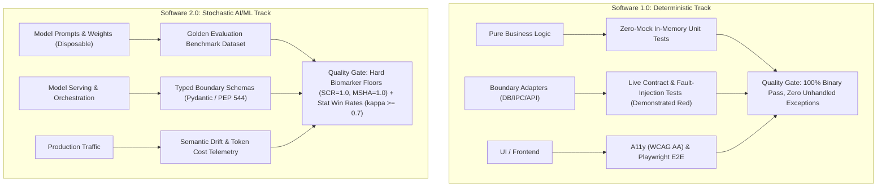

# Review 08 — Evolutionary Design and Dual Quality Architecture Plan

**Date:** 2026-09-16  
**Status:** IMPLEMENTED & RATIFIED r1  
**Target:** `lalulali/vespyr` v2.0.10  
**Scope:** `.agents/agents/{developer,ml-ai-engineer,qa-engineer,architect,tech-lead,product-manager,code-reviewer,ml-ai-ops}.md`, `.agents/references/developer-guidelines.md`, `artifacts/memory/active-decisions.md`, `CHANGELOG.md`

---

## 1. Executive Summary & Objective

This development and review plan documents the strategic and operational realignment of the Vespyr Engineering Swarm following a comprehensive multi-agent Socratic review (`/round-table`) with project owner Chris.

### The Problem
Traditional software teams often fall into one of two damaging extremes:
1. **Big Design Up Front (BDUF) / Premature Calcification:** Attempting to build extensive generic framework layers, heavy abstraction hierarchies, and "future-proof" plumbing upfront under the mistaken belief that doing so eliminates the need for future refactoring. In practice, this creates massive abstraction debt, indirection, and rigid interfaces that resist changing requirements. In ML/AI (Software 2.0), this manifests as the **Calcification Trap**—wrapping fast-evolving models in bloated orchestration frameworks that become obsolete within months.
2. **Refactoring Aversion & Unbounded Hacks:** Viewing refactoring as an "expensive waste of effort" or an emergency cleanup phase to be scheduled "later," while hacking features in without behavioral test safety nets.

### The Resolution
Through dialectic debate across `@developer` (Rex), `@ml-ai-engineer` (Kai), `@qa-engineer` (Nina), and expanded swarm roles (`@architect`, `@tech-lead`, `@product-manager`, `@code-reviewer`, `@ml-ai-ops`), the swarm converged on three foundational pillars:
1. **Evolutionary Design & YAGNI over BDUF:** Build the simplest system that satisfies current acceptance criteria (Kent Beck's 4 Rules of Simple Design). Abstractions must be earned by concrete use cases, not anticipated.
2. **Continuous Refactoring as Routine Hygiene:** Refactoring is not a deferred chore or emergency rewrite—it is an embedded, continuous phase of the Red-Green-Refactor cycle within every ticket's Definition of Done (DoD), strictly bounded by automated behavioral tests.
3. **Dual Quality Architecture:** Explicitly distinguish between **Software 1.0 (Deterministic Code)** and **Software 2.0 (Stochastic AI/ML)**, establishing specialized verification invariants, boundary contracts, and testing mechanisms for each.

---

## 2. Dialectic Review & Alignment Summary

### Initial Owner Premise
Chris proposed:
> *"for ml-ai-engineer and developer: i want the developer to put code structure, clarity, easiness to read, separation to be on top of everything, i believe that's the reason why we have a lot of code framework to ensure the code and the code layer is clean. for qa, ensure that she has the right tool to test, the right testing mechs for the right scenario... actually my goal for engineering team is that as developer we need to create a good code foundation so in the future we don't need to waste more time to do unneeded refactoring"*

### Socratic Swarm Challenge & Synthesis

| Perspective | Channeled Voices | Verdict | Stance & Critical Synthesis |
| :--- | :--- | :--- | :--- |
| **`@developer` (Rex)** | Kent Beck, Robert C. Martin (Uncle Bob), Martin Fowler | **RESHAPE** | Heavy frameworks do not create clean code; they couple domain logic to external mechanisms. True clean design isolates business logic behind clean Ports & Adapters using **Kent Beck's 4 Rules of Simple Design**: (1) passes tests, (2) reveals intent, (3) eliminates duplication, (4) fewest elements. Upfront generic abstractions violate YAGNI. Refactoring is continuous dental hygiene, not waste. |
| **`@ml-ai-engineer` (Kai)** | Andrej Karpathy, François Chollet, Harrison Chase, Jason Wei | **RESHAPE** | Heavy OOP layering in AI causes "pipeline jungles" (Sculley et al., Google). In Software 2.0: **"Disposable code, permanent evals."** Keep prompts, wrappers, and orchestration thin and disposable (<24h replacement velocity); invest engineering capacity into automated evaluation harnesses, golden benchmark datasets, and typed boundary schemas (PEP 544 Protocols / Pydantic V2). |
| **`@qa-engineer` (Nina)** | James Bach, Michael Bolton, Shreya Shankar, Eugene Yan | **RESHAPE** | Upfront framework abstractions cause mock-heavy unit tests that assert against internal method call chains rather than observable behavior—breaking during refactoring and providing zero defect prevention. Nina established the **Anti-Mock Invariant** and codified the **Dual Quality Architecture** (deterministic 1.0 verification vs. statistical 2.0 eval gates). |

### Four Core Ratifications
1. **Reduce wasteful effort:** Building speculative abstractions upfront that are never used or must be undone is the primary source of waste.
2. **Refactoring is continuous hygiene:** Refactoring keeps code pliable and maintainable. It is safe only when backed by behavioral automated regression suites.
3. **Avoid BDUF:** Defer architectural commitments to the last responsible moment when empirical requirements are known.
4. **Dual Quality Engine:** Tailor engineering standards, DoD, and testing mechanisms to deterministic Software 1.0 and stochastic Software 2.0.

---

## 3. Core Architectural Invariants

### Invariant 1: Evolutionary Design & YAGNI over BDUF
- **Kent Beck's 4 Rules of Simple Design:**
  1. *Passes the tests.*
  2. *Reveals intention (clarity and readability over cleverness).*
  3. *No duplication (DRY within reason, avoiding premature abstraction).*
  4. *Fewest elements (classes, methods, modules).*
- **Two Concrete Call Sites Rule:** Speculative interfaces, generic factory wrappers, or multi-tenant scaffolding without at least two active call sites in the same PR are blocked.
- **Ports & Adapters (Hexagonal Architecture):** Isolate pure domain logic from databases, UI, IPC, and third-party SDKs. Frameworks remain at the boundaries (adapters), never polluting core domain entities.

### Invariant 2: The Refactoring Safety Contract & Continuous DoD
- **Red-Green-Refactor:** Refactoring is an explicit step within every implementation task:
  - *Red:* Write a test proving the defect or missing capability exists.
  - *Green:* Write minimal code to pass the test.
  - *Refactor:* Clean structure, rename, eliminate duplication while tests stay green.
- **Zero Blind Refactoring:** Prohibit refactoring code that lacks automated test coverage. A safety harness must exist before restructuring begins.
- **Embedded in DoD:** No separate "refactoring tickets" or "cleanup sprints" for routine code quality. Refactoring is part of the original ticket's time budget and Definition of Done.

### Invariant 3: Dual Quality Architecture

### Invariant 4: The Anti-Mock Invariant & Demonstrated Red on Disk
- **Anti-Mock Invariant:** Tests MUST assert against observable inputs, outputs, state transitions, and external contract boundaries. Tests asserting against internal implementation details (`mock.expect(...).toBeCalledTimes()`) are defective because they freeze implementation details and break during refactoring.
- **Demonstrated Red on Disk:** Every boundary adapter (DB connector, external API client, network retry handler) must include automated negative tests demonstrating that fault injection (timeouts, HTTP 429, malformed responses, disk full) cleanly triggers the failure handler.

### Invariant 5: Disposable Code, Permanent Evals (Software 2.0)
- **Replacement Velocity:** Prompt templates, LLM wrappers, and agent loops must be designed with the explicit assumption that they will be discarded within 6 months as underlying foundation models evolve.
- **Permanent Assets:** Engineering investment belongs in:
  1. Golden evaluation datasets (curated test cases representing real user distributions).
  2. Automated evaluation runners and deterministic scoring tripwires.
  3. Typed data schemas at boundaries (no `dict[str, Any]`).

---

## 4. Implementation Record: Swarm Roles Hardening

A surgical overhaul was performed across 8 agent personas to enforce these invariants systematically:

### 1. `@developer` (Rex) — `.agents/agents/developer.md`
- **Added Stance:** Rejects both speculative BDUF and refactoring without tests. Enforces Kent Beck's 4 Rules and YAGNI (require 2 concrete use cases).
- **Added Standards:**
  - *Evolutionary Design over BDUF:* Implement the simplest design satisfying acceptance criteria.
  - *Refactoring Safety Contract:* Refactoring mandatory as routine hygiene (Red-Green-Refactor), strictly bounded by regression tests.
  - *Software 1.0 vs. 2.0 Boundary Standard:* Ports & Adapters for domain logic; prompts as disposable policy specs; explicit `TokenBudget` in contracts; Demonstrated Red fault injection on boundary adapters.

### 2. `@ml-ai-engineer` (Kai) — `.agents/agents/ml-ai-engineer.md`
- **Added Core Maxims:** *"Disposable code, permanent evals"* and *"Zero untyped dictionaries across boundaries"* (enforcing PEP 544 Protocols and Pydantic V2).
- **Added Operational Guardrails:** Strict separation between deterministic logic and stochastic models; optimize for disposability (ban deep LangChain-style wrapper hierarchies).
- **Added Failure Modes:**
  - *The Calcification Trap:* Building heavy custom frameworks to work around temporary model flaws.
  - *Treating inspectability as a substitute for automated testing.*

### 3. `@qa-engineer` (Nina) — `.agents/agents/qa-engineer.md`
- **Added The Anti-Mock Invariant:** Tests must assert against observable behavior, not internal call chains.
- **Added Risk-Proportional Layer Scoping:** 7 testing mechanisms applied proportionally to risk, not as a blanket checklist.
- **Codified Dual Quality Architecture:**
  - *Software 1.0:* Binary pass/fail, zero schema drift, Demonstrated Red negative controls on disk.
  - *Software 2.0:* Statistical evaluation, calibrated shadow judges ($\kappa \ge 0.7$), hard biomarker floors (`SCR=1.0`, `MSHA=1.0`, `PD=0.0`, `PCI=0.0`), and CI trips on >0% pass drop or >15% token inflation.

### 4. `@architect` (Vera) — `.agents/agents/architect.md`
- **Added Stance & Invariant:** Rejects speculative BDUF; specifies boundaries, invariants, and inward dependencies while deferring technical commitments.
- **Added Standards:** BDUF ban in ADRs; evaluate *Replacement Velocity* and *Cost of Disposability* for all AI/ML components (<24h swap via thin protocols).

### 5. `@tech-lead` (Grant) — `.agents/agents/tech-lead.md`
- **Added Stance & Execution Breakdown:** Prohibits horizontal framework-scaffolding tickets; enforces thin vertical slices (tracer bullets) delivering end-to-end verifiable value.
- **Added Continuous Refactoring in DoD:** Refactoring embedded in task estimates and Definition of Done, never deferred to isolated cleanup sprints.
- **Added AI Task Sequencing Invariant:**
  1. *Task 1 (Blocking):* Golden Evaluation Dataset and automated runner.
  2. *Task 2 (Blocking):* Deterministic heuristic baseline.
  3. *Task 3:* Prompt engineering, RAG, and model integration.

### 6. `@product-manager` (Sarah) — `.agents/agents/product-manager.md`
- **Added Stance:** Challenges happy-path-only briefs; mandates error boundaries and deterministic fallback specs before engineering handoff.
- **Added Story Scoping Standards:**
  - *Mandatory Failure Scenarios:* Explicit Unhappy paths (`AC-U*`) and Edge cases (`AC-E*`).
  - *AI Feature Requirements Contract (`AC-ML*`):* Quantitative budgets (hallucination rate, p95 latency ceiling, token cost cap) and verified heuristic baseline prerequisites.
  - *QA Enrichment Ingestion:* Formally backport enriched criteria surfaced by `@qa-engineer`.

### 7. `@code-reviewer` (Scout) — `.agents/agents/code-reviewer.md`
- **Added Blocking Gates:**
  - *Anti-Mock Invariant:* Block PRs asserting against internal method call chains.
  - *Demonstrated Red on Disk:* Block boundary adapters lacking negative fault-injection tests.
  - *Reject Speculative Abstractions:* Block classes/interfaces lacking two active call sites (YAGNI).
  - *Software 2.0 Gate:* Block untyped dictionaries; enforce "No Eval Benchmark, No Merge" on prompt/model changes.

### 8. `@ml-ai-ops` (Atlas) — `.agents/agents/ml-ai-ops.md`
- **Added Operational Standards:**
  - *Automated CI/CD Eval Gate (BLOCKING):* Wire Golden Dataset evals into deployment; halt deployment on accuracy drops or >10% token cost inflation.
  - *Continuous Semantic Drift Telemetry:* Monitor cosine distance against baseline embeddings, prompt cache hit rates, and transaction token costs.
  - *Shadow Routing Verification:* Shadow live production traffic before promoting model/prompt updates.

---

## 5. Master Developer Playbook Updates

In addition to persona definitions, `.agents/references/developer-guidelines.md` was updated to ensure that human developers and instantiated subagents adhere to these execution standards:
- **Section 2 (Implementation Workflow):**
  - Updated Step 3 to mandate Evolutionary Design (Kent Beck's 4 Rules) and Ports & Adapters.
  - Updated Step 6 to mandate the Anti-Mock Invariant, Demonstrated Red for boundary adapters, and Software 2.0 eval dataset creation.
- **Section 3 (Definition of Done):**
  - Added explicit check for Continuous Refactoring completed under green regression tests.
  - Added check verifying zero mocks on domain logic and negative fault tests on boundary adapters.
- **Section 4 (Coding Standards):**
  - Added "YAGNI & Evolutionary Design" standard requiring 2 active call sites for abstractions.
  - Added "Software 1.0 vs. 2.0 Boundary Standard" mandating typed schemas and disposable AI wrappers.

---

## 6. Roundtable Audit & Dialectic Remediations (Wave 2)

During the multi-agent roundtable audit with `@code-reviewer` (Scout), `@developer` (Rex), `@qa-engineer` (Nina), and `@ml-ai-engineer` (Kai), nine concrete operational gaps were surfaced and immediately remediated:

1. **Executable Static Check Scripts (`package.json`):** Added `"lint"` and `"typecheck"` scripts to `package.json` running `node --check` syntax validation across core CLI and eval entrypoints, eliminating phantom DoD checks.
2. **YAGNI 2-Callsite Clarification (`developer-guidelines.md`):**
   - Outbound boundary ports (Ports & Adapters) isolating pure domain logic from external I/O are justified by boundary decoupling, exempt from internal callsite counts.
   - Unit test invocations explicitly do NOT count as a callsite, closing the "Test as Second Call Site" loophole.
3. **Wire-Level Simulation Legitimized (`developer-guidelines.md`):** Clarified that wire-level simulation (MSW, local Node `http.createServer`, testcontainers) is expected at external boundary adapters; the Anti-Mock ban applies strictly to mocking internal domain class methods.
4. **Tech Lead Vertical Phasing (`tech-lead.md`):** Replaced legacy horizontal scaffolding phrasing (`"Phase 1: Foundation (auth, DB schema, project scaffolding)"`) with vertical milestones: Walking Skeleton $\to$ Core Slices $\to$ Secondary Slices $\to$ Release Hardening.
5. **Token Drift Ceiling Harmonization:** Unified the token inflation ceiling across `@qa-engineer`, `@ml-ai-ops`, and `@code-reviewer` to a consistent $\le 10\%$ threshold against baseline.
6. **AI Requirements Contract in PM (`product-manager.md`):** Updated `AC-ML*` to mandate Golden Evaluation Dataset criteria (holdout size, distribution, rubric) alongside the heuristic baseline.
7. **Demonstrated Red on Disk (`tools/eval/adapters/` & `tests/`):**
   - Added `signal: AbortSignal.timeout(options.timeout || 30000)` to all model adapters (`openai`, `anthropic`, `gemini`, `ollama`).
   - Added automated negative fault-injection contract tests in `tests/test_model_adapters.test.js` verifying clean error handling on HTTP 429 rate limits, HTTP 500 server errors, request timeouts, and HTTP 503 service unavailable.
8. **Production Model Handoff Specification:** Enriched `.agents/templates/architecture/model-approved-for-production.md` with drift baseline embeddings path, shadow-routing duration, and machine-readable eval links.
9. **Global Perimeter Invariants (`GUARDRAILS.md`):** Enshrined the Anti-Mock Invariant, Demonstrated Red on Disk, YAGNI 2-Callsite Invariant, and Continuous Refactoring directly into `.agents/GUARDRAILS.md`.

---

## 7. Verification & Acceptance Checklist

- [x] Socratic round-table review completed with project owner Chris; mutual alignment documented.
- [x] Active decision ratified and logged to `artifacts/memory/active-decisions.md` via `memory_write.js`.
- [x] Swarm persona `.agents/agents/developer.md` updated with Beck's 4 Rules, YAGNI, Refactoring Contract, and Demonstrated Red.
- [x] Swarm persona `.agents/agents/ml-ai-engineer.md` updated with "disposable code, permanent evals", typed protocols, and Calcification Trap guard.
- [x] Swarm persona `.agents/agents/qa-engineer.md` updated with Anti-Mock Invariant, Risk-Proportional Scoping, and Dual Quality Architecture.
- [x] Swarm persona `.agents/agents/architect.md` updated with BDUF ban, Evolutionary Architecture, and Replacement Velocity evaluation.
- [x] Swarm persona `.agents/agents/tech-lead.md` updated with vertical slices, continuous refactoring in DoD, and AI task sequencing (eval first).
- [x] Swarm persona `.agents/agents/product-manager.md` updated with mandatory `AC-U*`/`AC-E*` failure scenarios, `AC-ML*` quantitative budgets, and QA enrichment ingestion.
- [x] Swarm persona `.agents/agents/code-reviewer.md` updated with blocking review gates for Anti-Mock, Demonstrated Red, YAGNI 2-callsite rule, and No Eval No Merge.
- [x] Swarm persona `.agents/agents/ml-ai-ops.md` updated with automated CI/CD eval gate, semantic drift telemetry, and shadow routing.
- [x] Master developer playbook `.agents/references/developer-guidelines.md` aligned with the 5 core invariants.
- [x] `CHANGELOG.md` updated under `[Unreleased]` documenting the 8-agent swarm hardening and architecture review.
- [x] `package.json` wired with `lint` and `typecheck` static analysis commands.
- [x] Demonstrated Red fault-injection tests implemented and passing on model boundary adapters (`tests/test_model_adapters.test.js`).
- [x] Global perimeter guardrails `.agents/GUARDRAILS.md` updated with core engineering invariants.
- [x] Regression test suite passes with zero regressions (479/479 pass).

---

## 7. Non-goals & Residual Risks

- **Non-goal: Elimination of All Refactoring:** Refactoring is healthy code hygiene, not a defect. The objective is eliminating *unnecessary* refactoring caused by premature, brittle upfront abstractions that guessed wrong.
- **Non-goal: Dogmatic "Zero Mocks Anywhere":** Mocking external third-party I/O (e.g. simulating Stripe or OpenAI in CI) is legitimate; the Anti-Mock Invariant specifically prohibits mocking *internal class method calls* in domain unit tests.
- **Residual Risk — Developer Calibration on YAGNI:** Developers may struggle to distinguish between necessary boundary decoupling (Ports & Adapters) and premature over-abstraction. Mitigation: `@code-reviewer` enforces the concrete 2-callsite rule as a mechanical check.
- **Residual Risk — Eval Dataset Maintenance:** In Software 2.0, evaluation datasets require ongoing curation as edge cases emerge. Mitigation: `@ml-ai-engineer` and `@ml-ai-ops` treat eval datasets as versioned, permanent engineering assets subject to automated drift monitoring.
