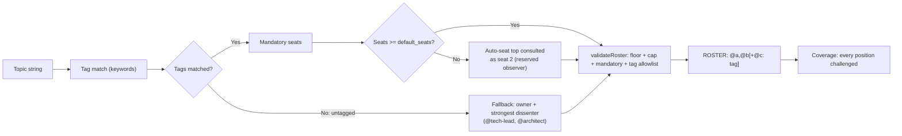

# Review 09 — Roundtable Roster Integrity Plan

**Date:** 2026-09-11 (r3 ratified 2026-09-16; implementation record + Review-12 corrections 2026-09-21; CR fixes 2026-09-22)  
**Status:** IMPLEMENTED r3 — **review-validated 4/4 SATISFIED `[CONFIRMED]` 2026-09-22** (r2 text below retained as plan-of-record; r3 = 4/4 round-table GO 2026-09-16 with 6 binding amendments; evidence in §7; final transcript `artifacts/evals/roundtable/transcripts/review-implementation-12_native_1.md`)  
**Target:** `lalulali/vespyr` v2.0.10  
**Scope:** `.agents/references/roster-router.json`, `.agents/scripts/resolve_agents.js`, `.agents/scripts/roundtable_eval.js` (contract only), `.agents/skills/round-table/SKILL.md`, `tests/test_router.test.js`, `evals/roundtable/topics.json`, `evals/roundtable/tag-probes.json` (new)

---

## 1. Objective

A roundtable route must never emit a roster the scorer cannot accept, and the panel must reflect the **risk** of the topic rather than the **vocabulary** of the prompt.

Three invariants:

1. **Seat floor:** every emitted roster satisfies ≥2 panelists (the coverage state machine in Phase 2/3 is unsatisfiable below that).
2. **Router table is executable truth:** every rule the table declares is either read by code or deleted — never prose that reads as enforced.
3. **One floor, one source:** the floor is declared once in `roster-router.json` and read by *both* the router and the scorer. Today each side owns its own copy — `resolve_agents.js` has no floor at all, `roundtable_eval.js:89` hardcodes the literal `2` — so the invariant has two owners and no contract.

Source of this plan: a live session (`2026-09-11`) where a leak-purge topic routed to a single seat, which would have produced an unscoreable transcript.

---

## 2. Defect Audit

### D1 — The 2-seat floor is declared, tested, and unenforced

| Fact | Evidence |
| :--- | :--- |
| `rules.default_seats: 2` is declared | `.agents/references/roster-router.json` |
| A test asserts it exists | `tests/test_router.test.js:33` — `assert.ok(ROUTER.rules.default_seats === 2, "2-seat default")` |
| **No code reads it** | `default_seats` appears in zero non-test `.js` files |
| The matcher emits `mandatory` only | `resolve_agents.js:88` — `const seats = mandatory.slice(0, cap)` |
| The validator has no floor | `resolve_agents.js:145-160` — checks empty, `> cap`, missing mandatory, untagged seats. **No `< 2` check.** |
| 11 of 15 tags declare exactly one mandatory seat | `eval, prompt, security, performance, architecture, planning, tooling, data, design, review, docs` |
| The scorer rejects what the router emits | `roundtable_eval.js:89` — `panel.length < 2` → malformed coverage block (exit 2) |
| Confirmed live | `roster check --topic "private folder isolation plan: docs packaging git history purge CI test breakage" --seats "@developer"` → `{"pass": true}` |
| The scorer hardcodes its own floor independently | `roundtable_eval.js:89` — `panel.length < 2`, a literal, not a table read |
| The scorer never reads the router table at all | `grep -n "roster-router\|loadRouter" .agents/scripts/roundtable_eval.js` → **0 hits** |

**Root cause — two owners, one invariant.** `roster-router.json` is declared the single source of truth (`rules.precedence`), yet it is read by exactly one of its two consumers. The scorer picks its own floor as a literal; the router has no floor at all; nothing forces them to agree. Adding `norm.length < 2` to `validateRoster` closes today's symptom and leaves tomorrow's, because the next edit to either literal silently re-opens the gap. **The durable fix is the floor having one home with both consumers reading it** (Phase 1.4, Phase 3.5).

**Consequence:** for 11/15 tags the router's own `rosterLine` cannot produce a scoreable transcript. The green test at `test_router.test.js:33` guards a constant, not the invariant it names. A one-seat Round-1 is also trivially unanimous, which arms the SPC red-team gate — demanding a named challenger that does not exist.

### D2 — Panel composition depends on whether the user typed the magic word

`matchTopicToTags` (`resolve_agents.js:57-97`) is pure lowercased substring matching over `keywords`.

| Topic string | Matched tags | Emitted roster |
| :--- | :--- | :--- |
| `private folder isolation plan: docs packaging git history purge CI test breakage` | `tooling` | `ROSTER: @developer` |
| `security audit of supply chain packaging and CI pipeline` | `security`, `tooling` | `ROSTER: @security-engineer,@developer` |

Same subject matter — a plan to purge leaked internal documents from a public repository. The first gets **no security seat** because `security.keywords` is `secret, PII, threat model, vulnerability, auth, injection, compliance, security audit, incident, breach` and contains none of `leak`, `purge`, `history rewrite`, `filter-repo`, `redaction`, `private repo`, `exposure`.

The SKILL mandates the table over host judgment ("mandatory — replaces host improvisation"), and `rules.precedence` states the JSON wins over SKILL.md prose. That is defensible, but it converts a keyword miss from a judgment call into a structural blind spot: the exact topic category this router exists to cover routes to no security seat, and the host is forbidden from correcting it.

### D3 — Dead rules and unimplemented precedence

| Router key | Read by non-test code? | Class |
| :--- | :--- | :--- |
| `hard_cap` | Yes — `resolve_agents.js:86,150` | enforced |
| `default_seats` | **No** — test-only assertion at `test_router.test.js:33` | dead |
| `reserved_seat_2` | **No** — zero references | dead |
| `hard_cap_native`, `hard_cap_solo` | **No** — zero references | dead |
| `precedence` | **No** — asserted to exist (`test_router.test.js:178`), never applied | dead |
| `override` | **No** — the only JS hits are a comment and the `overrides` subcommand name | prose |
| `revisit_threshold` | **No** — `roundtable_eval.js:740` hardcodes `0.2`/`10` as literals and re-emits them at `:745-746`; the script contains **zero** reads of the router table | dead-as-config |
| `sunset`, `measurement` | **No** — process policy, human-owned | prose |

The table claims authority over SKILL.md ("this file wins") while **9 of its 10 rules have no code reader**. r1's inventory listed five and missed four — most damagingly `revisit_threshold`, a *number* the code duplicates as a literal, so the table and the code can silently disagree while each looks authoritative. Prose that reads as enforced but is not is a record-integrity defect, not a documentation nit — and putting prose keys in the same `rules` namespace as enforced keys is the mechanism that keeps producing them (Phase 3.1/3.4).

### D4 — Substring matching seats `@security-engineer` on the word "author"

The matcher is `text.includes(kw)` (`resolve_agents.js:69`) — no word boundary — and `security.keywords` carries the bare 4-character token `auth`.

| Topic | Emitted roster |
| :--- | :--- |
| `author a new agent persona for the team` | `ROSTER: @security-engineer,@user-researcher,@researcher` |
| `authority model for tool permissions` | `ROSTER: @security-engineer` — single seat, therefore unscoreable (D1) |
| `authentication flow review` | `ROSTER: @security-engineer` |

This is not merely a pre-existing wart — it is the reason Phase 2 cannot ship as specified. r1 proposes *widening* `security.keywords` with more bare tokens (`purge`, `redaction`, `exposure`, `private repo`). Widening a substring matcher multiplies the existing false-positive class (`purge the cache`, `double exposure`). Keyword expansion and the boundary rule are one change, not two.

**Measured, not assumed:** a word-*start* boundary does not fix this — `\bauth` still matches "author"/"authority". Whole-word matching does, at the cost of inflections, which is why Phase 2.1 lists surface forms explicitly. The first draft of this plan specified the word-start rule and it was wrong.

### D5 — `reserved_seat_2`'s "non-builder observer" is an undefined predicate

| Fact | Evidence |
| :--- | :--- |
| No agent declares a builder/non-builder attribute | `grep -rn "builder" .agents/agents/*.md` → **0 hits** |
| The only participation attribute is binary reasoning-participation | `memory-controller.md:17` — `reasoning_participant: false`, the sole occurrence |
| Auto-seating from `consulted[0]` seats a builder-attributed agent for several tags | `data` → `ml-ai-engineer`; `prompt` / `performance` / `security` → `architect` |
| An existing test already treats Kai's presence as a conditional | `test_router.test.js:160-167` — "Kai absence rule" for non-technical topics |

A contract with no machine-readable predicate cannot be verified, so "wire `reserved_seat_2` to Phase 1" would be false completion. Either a per-agent `non_builder` flag is introduced (new taxonomy, new drift surface) or seat 2 becomes **positional** and the prose is rewritten to match. This plan takes the positional route.

---

## 3. Target Behavior



Rules:
- **One floor.** `rules.default_seats` (2) is read by `matchTopicToTags`, `validateRoster` **and** `roundtable_eval.js`'s panel-size check. No consumer hardcodes it.
- **Tagged topics:** if the mandatory union has fewer than `default_seats`, seat 2 is filled deterministically from the highest-scoring matched tag's `consulted` list (first entry not already seated). **Seat 2's contract is positional** — "highest-ranked consulted seat" — not a `non-builder` predicate, because no such predicate exists in agent frontmatter (D5). `rules.reserved_seat_2` is rewritten to say exactly that; the words "non-builder observer" are deleted rather than left as unenforceable prose. **[SHIPPED AS `policy.reserved_seat_2` — 2026-09-21, recorded in §7.2; the enforced `rules` namespace holds only keys code reads.]**
- **Untagged topics (0 tags matched):** fall back to `rules.untagged_fallback`, **read from the JSON** (`["tech-lead", "architect"]`). The list is added to the table, not written as a literal in the script — hardcoding it in `resolve_agents.js` would re-create the exact defect class this plan exists to delete (a constant shadowing the adjacent prose rule).
- **Keyword matching:** keywords of length ≤ 6 match as **whole words** (`\bkw\b`); longer compound keywords keep plain substring matching. Measured, not assumed — a word-*start* boundary (`\bkw`) does **not** fix D4: `\bauth` still matches "author" and "authority". Whole-word matching does, at the cost of inflections (`auth` stops matching "authentication"), so surface forms are listed explicitly: `authentication`, `authorization`, `authz`, `secrets`, `purges`, `purging`. The boundary rule and the surface-form list are one change.
- **Auto-seat logging & telemetry:** reported in matcher JSON as `autoSeated: [{ tag, agent }]` and emitted in transcripts as `[ROUTER-AUTOSEAT: <tag> → @<agent>]`. Normal deterministic router behavior, **distinct from user overrides or host deviations**, tracked as an informational biomarker and excluded from the revisit rate.
- **Validation:** `validateRoster` fails any roster below `default_seats` (exit 2) and **never waives for a marker** — it takes no marker argument and has no transcript access; its own docblock already says so (`resolve_agents.js:142-143`). Markers are a *host-level* bypass: the host proceeds and logs `[ROUTING-OVERRIDE]` / `[ROUTER-DEVIATION]`, and `roundtable_eval.js:724` counts them. The allowlist check covers seats from position 3 onward (`norm.slice(2)`), which is what the code does today — this plan must not claim it covers seats 1–2.

**Rejected alternative:** raising every tag's `mandatory` to two seats. That converts an observer into an accountable seat and changes ownership semantics across the whole table. Keep it as a per-tag escalation owned by the table owner, not a blanket change.

---

## 4. Work Breakdown

### Phase 1 — Enforce the floor, from one source
1. `.agents/references/roster-router.json`:
   - Add `rules.untagged_fallback: ["tech-lead", "architect"]`.
   - Rewrite `rules.reserved_seat_2` to the **positional** contract (tagged: highest-ranked consulted seat; untagged: owner + strongest dissenter). Delete "non-builder observer" (D5). **[SHIPPED AS `policy.reserved_seat_2` — see §7.2.]**
2. `resolve_agents.js` `matchTopicToTags`:
   - Read `rules.default_seats` (default 2) — no literal.
   - If tags matched and mandatory union < `default_seats`: auto-seat the first agent from the top-ranked matched tag's `consulted` list not already mandatory. Populate `autoSeated: [{ tag, agent }]`; include in `rosterLine`.
   - If 0 tags matched: read `rules.untagged_fallback`; set `untaggedFallback: true`.
   - Apply the boundary rule for short keywords (≤6 chars) per §3.
3. `resolve_agents.js` `validateRoster`:
   - Enforce floor: when `norm.length < (router.rules.default_seats || 2)`, fail with `roster below default_seats (<n>) — seat at least <n> agents`.
   - Allowlist: seats from position 3 onward must belong to `allowed` (`mandatory + consulted`; for untagged topics, `untagged_fallback`). **No marker parameter and no waiver** — the validator never has transcript access.
4. `roundtable_eval.js` panel-size check: replace the literal `2` at `:89` with a read of `rules.default_seats` (the scorer does not currently import `resolve_agents.js`; a small shared loader is the minimum). If the table cannot be resolved, fall back to `2` **and warn** — never diverge silently.
5. Emit the `[ROUTER-AUTOSEAT: <tag> → @<agent>]` contract in `.agents/skills/round-table/SKILL.md` (§ Topic-Tag Router) and document the untagged fallback.

**Accepted cost:** one extra seat per session for 11/15 tags → more tokens and latency. Owner decision; if unacceptable, shard the table (per-tag `default_seats` override) rather than leaving the floor unenforced.

### Phase 2 — Routing recall & false-positive guarding
1. Rework `security.keywords` for the whole-word rule (§3) and leak/purge recall:
   - **Short-token surface forms** (the whole-word rule drops inflections, which would otherwise silently kill real detection): keep `secret` + add `secrets`; keep `auth` + add `authentication`, `authorization`, `authz`.
   - **Leak/purge recall:** `purge`, `purges`, `purging`, `secret leak`, `credential leak`, `data leak`, `token leak`, `artifact leak`, `history rewrite`, `filter-repo`, `redaction`, `secret scan`, `private repo`, `exposure`.
   - `purge` is required for Phase 4 #3 and the D2 checklist item — without it that topic still matches only `tooling`.
   - Audit every addition against the fixture corpus — and expect it to find nothing: `purge the cache`, `exposure`, `author`, and `memory leak` all return **0 hits** across `evals/roundtable/` today. The exclusions below are therefore preventive, reasoned about, not corpus-driven; do not treat a green corpus run as proof the keywords are safe.
2. Add the memory vocabulary to **`performance.keywords`** — what the D2 acceptance test actually requires, and what r1 omitted:
   `"memory leak"`, `"heap"`, `"gc pause"`, `"allocation"`.
   Without it, `investigate memory leak in Node.js event loop` matches **no tag at all** (verified: `tags: []`, empty roster) and the criterion "routes to `performance`" is unmeetable — the excludes guard vetoes tags, it does not seat them.
3. Negative guards on `security.excludes`: `"memory leak"`, `"resource leak"` (compound-topic effect, above), plus `"purge the cache"` and `"cache purge"` — the accepted false positive of adding `purge` to a whole-word matcher. Prefer these cheap, testable exclusions over weakening the keyword.
   **State its real effect precisely.** On a pure memory-leak topic the guard changes nothing, because `security` never scores a hit — the assertion passes vacuously. Its actual effect is on *compound* topics: `security audit of a memory leak in the cache` seats `@security-engineer` today and does not after the guard. Test the compound form; the pure form proves nothing.
4. Regression corpus: positive recall on leak/purge/exposure probes; **zero** false positives for the `auth` → "author"/"authority" class (`author a new agent persona`, `authority model for tool permissions`); and memory-leak probes asserted as *not* seating `@security-engineer`.

### Phase 3 — Rule hygiene, dead-key elimination, and a structural guard
1. **Split the table's namespaces.** Move every key with no code reader out of `rules` into a sibling `policy` object (`override`, `sunset`, `measurement`, `precedence`). `rules` becomes the enforced namespace; `policy` is prose no code reads and no reader pretends to. (`revisit_threshold` is decided in 3.5 — it is the one key that could legitimately stay in `rules`.)
   Rationale: `rules` is exactly what the matcher reads (`rules.hard_cap`, `rules.default_seats`). Mixing unenforced prose into the enforced namespace is what makes D3 recur one key at a time.
2. Delete the genuinely dead duplicates in `rules`: `hard_cap_native`, `hard_cap_solo` (unified to `hard_cap: 5` by the 2026-09-06 decision; zero readers).
3. Wire `reserved_seat_2` to Phase 1's auto-seating logic **and rewrite its text to the positional contract** (D5). Wiring the key while leaving "non-builder observer" in the string is false completion.
4. **Structural guard — the actual D3 fix.** Add a test asserting every key in `rules.*` is read by non-test code (`resolve_agents.js` / `roundtable_eval.js`), with an explicit reader map in the test as the only escape hatch. This makes a dead rule impossible to add again. r1 fixed five keys and left the mechanism that produced them.
5. `roundtable_eval.js`:
   - `cmdOverrides`: count `router_autoseat` (`/\[ROUTER-AUTOSEAT:/g`) as an independent informational metric, excluded from the revisit rate.
   - **Resolve `revisit_threshold`.** It is currently a hardcoded `0.2` / `10` literal pair (`:740`, re-emitted at `:745-746`) and the script reads `roster-router.json` zero times. Either (a) read it as two numbers — then it stays in `rules` and joins the guard in 3.4; or (b) delete it and keep the literals as acknowledged code constants. r1 left it as a prose string the code duplicates numerically: the worst of both, because the table reads as config while the code can drift.
6. Ship `evals/roundtable/tag-probes.json` — a `tag → probe topic` map covering all 15 tags. There is no tag-keyed routing API (`matchTopicToTags` takes a topic string) and no probe artifact today (`evals/roundtable/` holds `fixtures/`, `README.md`, `topics.json`), so "every tag emits ≥2 seats" is untestable as written. The map makes it executable.
7. Replace `tests/test_router.test.js:33` (constant echo) with behavioral assertions driven by that artifact:
   - Iterate `tag-probes.json`: every tag's probe yields ≥2 `rosterLine` seats.
   - Untagged topic (`"completely untagged obscure query xyz"`) yields the `rules.untagged_fallback` pair **read from the JSON**, not a literal in the test.
   - `"investigate memory leak in Node.js event loop"` → `performance` tag, `@performance-engineer` seated, and **no** `@security-engineer`.
   - `"security audit of a memory leak in the cache"` → **no** `security` tag — this probe actually exercises `security.excludes`.
   - Leak/purge/exposure probes seat `@security-engineer`.
   - `"author a new agent persona"` and `"authority model for tool permissions"` do **not** seat `@security-engineer`, while `"authentication flow review"` **does** (D4 — assert both directions so the fix cannot silently kill real auth detection).
   - `roster check` rejects a single-seat panel; no literal seat-floor `2` remains in either script.
   The existing suite already covers missing-mandatory (`:193`) and over-cap (`:199`) — do not duplicate them.

### Phase 4 — Verification
```bash
# 1. Every tag must emit >= 2 seats — probes are data, not prose:
node -e "const p=require('./evals/roundtable/tag-probes.json');const {matchTopicToTags,loadRouter}=require('./.agents/scripts/resolve_agents');const r=loadRouter();for(const [tag,t] of Object.entries(p)){const m=matchTopicToTags(t,r);const n=m.rosterLine.replace('ROSTER: ','').split(',').filter(Boolean).length;console.log(tag.padEnd(14),n>=2?'OK':'FAIL',n,m.rosterLine)}"
# expect: 15/15 OK

# 2. Untagged fallback must emit >= 2 seats:
node .agents/scripts/resolve_agents.js --topic "completely untagged obscure query xyz"
# expect: "tags": [], "untaggedFallback": true, rosterLine "ROSTER: @tech-lead,@architect"

# 3. Security keyword expansion:
node .agents/scripts/resolve_agents.js --topic "private folder isolation plan: docs packaging git history purge CI test breakage"
# expect: seats include @security-engineer

# 4. Memory-leak routing (three probes — the pure one alone proves nothing):
node .agents/scripts/resolve_agents.js --topic "investigate memory leak in Node.js event loop"
# expect: performance tag matched, @performance-engineer seated, NO @security-engineer
node .agents/scripts/resolve_agents.js --topic "security audit of a memory leak in the cache"
# expect: NO security tag (this is the probe that exercises security.excludes)
node .agents/scripts/resolve_agents.js --topic "author a new agent persona for the team"
# expect: NO @security-engineer (D4 whole-word rule)
node .agents/scripts/resolve_agents.js --topic "authentication flow review"
# expect: @security-engineer still seated (surface forms preserved)
node .agents/scripts/resolve_agents.js --topic "purge the cache after deploy"
# expect: NO security tag (excludes guard for the accepted purge false positive)

# 5. D1 floor repro must now be rejected:
node .agents/scripts/resolve_agents.js roster check \
  --topic "private folder isolation plan: docs packaging git history purge CI test breakage" \
  --seats "@developer"          # expect exit 2: roster below default_seats (2)

# 6. Scorer contract verification:
printf '```roundtable-coverage\npanel: @developer\nchallenges:\n```\n' | \
  node .agents/scripts/roundtable_eval.js coverage   # expect exit 2

# 7. Test suite regression check:
node --test tests/test_router.test.js
node tests/run-all.js
```

---

## 5. Verification & Acceptance Checklist

> **Implementation status (verified 2026-09-21, @code-reviewer, Review 12):** every item below verified on disk; one partial annotated. Evidence and deviations in §7.

- [x] All 15 tags emit `rosterLine` with ≥2 seats, driven by `evals/roundtable/tag-probes.json` (15/15 OK).
- [x] Untagged topics emit the `rules.untagged_fallback` pair read from the JSON (≥2 seats); the pair appears nowhere as a literal in `resolve_agents.js` (`rulesOf()` hard-fails on a malformed table — Review-12 R09-D1 fix).
- [x] `resolve_agents.js roster check --seats "@developer"` exits 2 with the floor message across all topics.
- [x] `roundtable_eval.js`'s panel-size check reads `rules.default_seats` — the literal `2` at `:89` is gone, and the scorer reads `roster-router.json` at least once.
- [~] No literal seat-floor `2` remains in either script (grep assertion). `resolve_agents.js` has none (hard fail); `roundtable_eval.js` retains the plan-sanctioned fallback-to-2-with-warning (§Phase 1.4) plus `parseCoverage`'s default parameter.
- [x] The D2 topic string seats `@security-engineer`.
- [x] `"investigate memory leak in Node.js event loop"` routes to `performance` (not empty, not `security`) and does NOT seat `@security-engineer`.
- [x] `"security audit of a memory leak in the cache"` does NOT match the `security` tag — the probe that actually exercises `security.excludes`.
- [x] `"author a new agent persona"` and `"authority model for tool permissions"` do NOT seat `@security-engineer`, and `"authentication flow review"` still DOES (D4, both directions).
- [x] `"purge the cache after deploy"` does NOT match the `security` tag (accepted-false-positive exclusion).
- [x] `reserved_seat_2` prose contains no undefined predicate ("non-builder") and matches the implemented positional rule (D5).
- [x] `[ROUTER-AUTOSEAT: …]` appears when the observer is auto-seated and is excluded from the revisit rate.
- [x] `hard_cap_native` / `hard_cap_solo` removed; every remaining `rules.*` key has a non-test reader (guard test passes with an explicit reader map).
- [x] `revisit_threshold` is read as numbers from the table — resolved as `rules.revisit_sla`, consumed by `roundtable_eval.js` (Review-12 R09-D5 correction: moved out of `policy` into the enforced namespace; no prose-as-config).
- [x] Each of the 13 `evals/roundtable/topics.json` topics routes to ≥2 seats.
- [x] `tests/test_router.test.js` asserts behavior, not constants; no new assertion duplicates `:193`/`:199`.
- [x] `node tests/run-all.js` green (501/501 after roundtable RESHAPE corrections; 496/496 after Review-12 fixes; 494/494 at review start).
- [x] SKILL.md prose matches implemented behavior.

---

## 6. Non-goals & Residual Risk

- **No LLM-based routing.** Keyword tables are brittle by construction; the alternative (a model picking seats) needs its own eval and a drift gate before it can be trusted. Widen keywords now; revisit only with evidence.
- **Do not soften the scorer.** `roundtable_eval.js:89` (≥2 panelists) is the correct invariant — the fix belongs in the router, and the scorer's floor should come *from the table*, never from a new literal.
- **Boundary rule scope, and what it costs.** Whole-word matching applies to keywords ≤6 characters only; longer compounds keep plain substring behavior. It removes the `auth` → "author"/"authority" class but also drops legitimate inflections — hence the explicit surface-form list in Phase 2.1. A word-*start* boundary was measured and rejected: `\bauth` still matches "author". And it does not make matching semantic: adding `purge` needed its own `"purge the cache"` exclusion.
- **Residual — the shared contract is a loader, not a module.** Phase 1.4 has the scorer read `roster-router.json`; it does not refactor the two scripts onto a shared library. A future third consumer can still diverge. Full extraction is out of scope until a third consumer exists.
- **Residual — the probe map is a maintenance surface.** `tag-probes.json` must be updated when a tag's keywords change, or the guard silently stops covering that tag. Mitigation: the guard asserts the probe map's key set equals the router's tag set, so a *new* tag fails loudly; a renamed keyword inside an existing tag will not.
- **Residual:** substring matching still misroutes topics that use none of the table's vocabulary; the untagged fallback prevents runtime crash or single-seat emission, but human topic sharpening remains required for domain-specialized panels.

---

## 7. Implementation Record & Review-12 Corrections (2026-09-21)

### 7.1 Delivery

| Artifact | State on disk |
| :--- | :--- |
| `.agents/references/roster-router.json` v1.1.0 | `rules`/`policy` namespace split; `untagged_fallback`; `revisit_sla` in `rules`; security/performance/architecture/planning/tooling/launch/data/serving/docs keyword expansion; `security.excludes`; `hard_cap_native`/`hard_cap_solo` deleted |
| `.agents/scripts/resolve_agents.js` | whole-word matching for tokens ≤6 chars; auto-seat cascade (`autoSeated`); untagged fallback; floor in `validateRoster`; `rulesOf()` hard-fails on a malformed table |
| `.agents/scripts/roundtable_eval.js` | panel floor read from `rules.default_seats` (warn-fallback sanctioned by Phase 1.4); `rules.revisit_sla` read as numbers; `router_autoseat` partitioned from override patterns |
| `.agents/skills/round-table/SKILL.md` | `[ROUTER-AUTOSEAT: …]` contract; untagged fallback; positional seat-2 dialectic mandate |
| `evals/roundtable/tag-probes.json` | 15-tag probe map — single source (duplicate `tests/fixtures/` copy deleted in Review 12) |
| `tests/test_router.test.js` | behavioral probes, boundary/memory probes, QA-ENRICH-1..5, explicit reader map, probe-map ↔ tag-set equality guard |

**r3 provenance:** ratified 2026-09-16 by round table 4/4 GO across 6 binding amendments (`artifacts/memory/session-summaries/history.md:1938-1940`); implemented same day (`history.md:1945-1946`); QA GO with 33/33 feature + 5/5 journey tests (`artifacts/output/05-execution/quality/test-report.md`). The r3 amendments were never written back into this document — §5/§7 are the forward correction (Review 12 A5).

### 7.2 Review-12 corrections applied

| # | Correction | Evidence |
| :--- | :--- | :--- |
| R09-D1 | Literal fallbacks removed; `rulesOf()` throws on a missing `rules.*` key instead of shadowing the table | `resolve_agents.js` (no `\|\| 2`, no inline `['tech-lead','architect']`) |
| R09-D2 | Duplicate probe artifact deleted; tests read `evals/roundtable/tag-probes.json` | `tests/fixtures/` removed; `test_router.test.js` reads the evals path |
| R09-D3 | Constant echo replaced by a floor-invariant assertion | `test_router.test.js` RT-P1-1 |
| R09-D4 | Structural guard now uses the plan's explicit reader map as the only escape hatch | `test_router.test.js` "declared non-test reader" |
| R09-D5 | `revisit_sla` moved from `policy` into `rules` — enforced namespace holds every key code reads | `roster-router.json`; `roundtable_eval.js` reads `rules.revisit_sla` |
| R09-D6 | `roundtable_eval.js` SLA clamps (`max_override_rate ≤ 0.50`, `min_sessions ≥ 5`) retained as defensive validation — accepted, no behavioral deviation | `roundtable_eval.js` |
| — | Probe-map ↔ tag-set equality guard added (closes the §6 residual mitigation as specified) | `test_router.test.js` RT-P1-1 |
| RT-01 | Inflection surface forms completed for the whole-word rule (`launches/launched/deploys/deployed/ships/shipped`, `oauth/oauth2`) + inflected-phrase regression corpus | `roster-router.json`; `test_router.test.js` "inflected surface forms" |
| RT-02 | `review` added to the `review` tag keywords — evidence: the 2026-09-21 roundtable topic "review the implementation" missed every tag and hit the untagged fallback | `roster-router.json`; live probe now seats `@code-reviewer,@qa-engineer` |
| RT-03 | `rulesOf()` upgraded from presence-only to type/range validation (`default_seats` integer ≥2, `hard_cap` positive integer, `default_seats ≤ hard_cap`, `untagged_fallback` non-empty string array) + throw tests | `resolve_agents.js`; `test_router.test.js` "rulesOf rejects malformed router tables" |
| RT-04 | `reserved_seat_2` namespace relocation (`rules` → `policy`) recorded; stale plan references annotated at §3 and Phase 1.1 | this section; `roster-router.json` |
| RT-05 | `validateRoster` docblock corrected to match the implemented positions-3+ allowlist (the claim never covered seats 1–2) | `resolve_agents.js` docblock |
| RT-06 | Untagged allowlist test made discriminating (seat 3 outside `untagged_fallback` → exit 2 via allowlist, not missing-mandatory) | `test_router.test.js` RT-P3-1 |

### 7.3 Residuals

- `roundtable_eval.js` keeps the Phase 1.4 warn-fallback to `2` when the router cannot be resolved — the only remaining seat-floor literal, by plan design.
- A renamed keyword inside an existing tag remains uncovered until the probe topic is updated (§6 residual stands; the equality guard catches added/removed **tags**, not reworded keywords). The inflected-phrase corpus (RT-01) now covers the whole-word inflections class; other vocabularies still rely on the probe map.
- Router recall: keywords remain vocabulary-bound — the 2026-09-21 roundtable supplied one live miss ("review the implementation" → untagged) now fixed by RT-02; new domains still require a table edit, per §6.
- QA-report claims corrected by dated annotation in `artifacts/output/05-execution/quality/test-report.md` (the `§7` backport claim and the inverted `"memory leak" removed from excludes` claim).
- `reserved_seat_2` (policy) has no behavioral test linking the prose to the implemented positional seating; traceability is via §7.2 RT-04 and the QA-ENRICH-2 auto-seat test. **Owner: @tech-lead** (table/mechanics owner per SKILL.md router rule 7; added to Review 12's residual list — roundtable R2, 2026-09-22).
