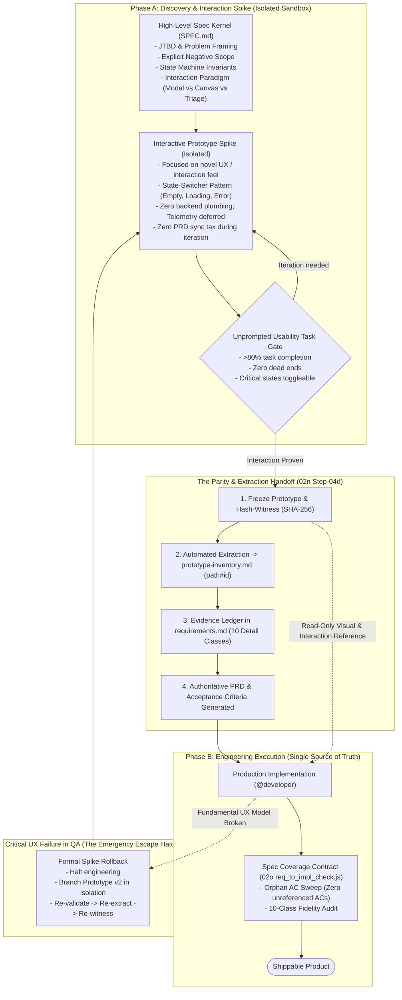
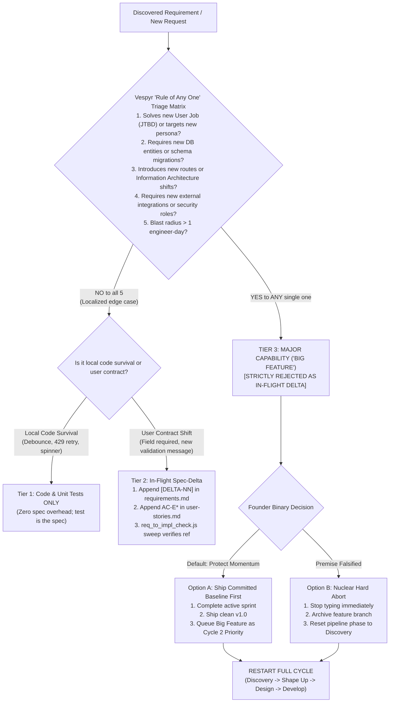

# Review 11 — Design Phase Architecture: Spec & Prototype Lifecycle, Phase Boundary Rule, and Big Feature Restarts

**Date:** 2026-09-16  
**Status:** RATIFIED & PLANNED  
**Target:** `lalulali/vespyr` v2.0.10 (Phase 1 / vespyr 2.0.0 roadmap)  
**Scope:** `artifacts/docs/strategy/development-plan/02n-phase-1-reverse-prd-design-fork.md`, `artifacts/docs/strategy/development-plan/02o-phase-1-prd-prototype-fidelity.md`, `.agents/skills/design/`, `.agents/skills/develop/`, `.agents/agents/{product-manager,product-designer,founder}.md`

---

## 1. Executive Summary & Objective

This plan documents the strategic architecture, operational lifecycle, and execution plan for the **Design-to-Implementation Phase** in Vespyr, resulting from a comprehensive multi-agent Socratic review (`/round-table`) with project owner Chris.

### The Problem: AI Simplification Across Stages (The Asymmetry Law)
Chris surfaced the core disease in AI-driven software creation: **Lossy Semantic Compression across modalities**:
1. `Detailed Plan / Spec -> High-Level (Dumbed-down) Prototype`: High-salience happy paths survive; loading, empty, and edge states evaporate.
2. `Detailed Prototype -> High-Level (Generic Mush) Spec`: A working interaction model is flattened into vague prose (*"handles errors gracefully"*), losing data schemas and validation rules.

When teams attempt to solve this by creating an open-ended, bidirectional iteration loop (*"develop both step-by-step and continually update both based on user feedback"*), they trigger **Split-Brain Syndrome**: dual mutable sources of truth that diverge within two iterations, generating a crushing synchronization tax and stalling engineering velocity.

### The Resolution: The 4 Foundational Pillars
Through four rounds of dialectic collision between `@product-manager` (Sarah), `@product-designer` (Ivy), and `@founder` (Elena), the swarm established four non-negotiable architectural pillars:
1. **The 2-Phase Lifecycle with Frozen Reference Handoff:** Prototypes and Specs are never parallel, living co-equals. During Phase A (Discovery), the prototype iterates rapidly in an **isolated sandbox** with zero documentation overhead. At the Handoff Gate, the prototype is **frozen and hash-witnessed (SHA-256)**, and an **Evidence Ledger** extracts the PRD. In Phase B (Engineering), the **Spec is the sole contractual truth**; the prototype is an immutable visual reference.
2. **Cognitive Completeness ("State Switcher" Pattern):** Prototypes do not build backend plumbing or live telemetry. They achieve sensory completeness through real content topology (ban on Lorem Ipsum), real design tokens, micro-feedback, and the **3 Critical State Moments (Day 0 Empty, Day 30 Populated, Error Recovery)** via simple UI state toggles.
3. **The Phase Boundary Rule for Document Mutations:**
   - *Pre-Handoff (Discovery & Design):* **100% In-Place Canonical Updates.** Single unified blueprint; zero patch notes or addenda clutter; Git diff tracks history.
   - *Post-Handoff (Active Engineering):* **Append-Only Spec-Deltas (`[DELTA-NN]` / `AC-E*`).** In-place edits are strictly banned to prevent pulling the rug out from active git branches and test suites.
   - *Post-Ship (`/retro`):* **Compact and fold** approved deltas back into the main body for the next version.
4. **The "Rule of Any One" for Big Features:** Tactical edge cases ($\le 1$ day) stay in Code & Unit Tests. In-flight spec deltas stay in `[DELTA-NN]`. But if a change triggers **any single one** of: new DB entity, new route/IA navigation shift, new external service, new user persona/JTBD, or $>1$ day blast radius $\rightarrow$ **it is strictly banned from being an in-flight delta**. The team either finishes the committed baseline and queues the big feature for Cycle 2, or performs a Hard Abort. The "Half-Sprint, Half-Pivot" mutant is permanently outlawed.

---

## 2. Dialectic Review & Alignment Summary

### Initial Owner Premise & Flow
Chris proposed a symmetrical, dual-branch mental model:
```
Flow 1: create high level spec -> create prototype based on high level spec -> create detailed spec based on prototype if ok -> iteratively refine both based on user feedback -> satisfy user requirement
Flow 2: create high level spec -> create detailed spec based on high level spec -> create prototype based on detailed spec if ok -> iteratively refine both based on user feedback -> satisfy user requirement
```
Core claim: *"Develop spec and prototype step by step and always update them to reduce simplification and iterate both of them to ensure the integrity of the product."*

### Socratic Swarm Challenge & Synthesis (4 Turns)

| Agent | Focus & Mentors | Stance & Critical Synthesis |
| :--- | :--- | :--- |
| **`@product-manager` (Sarah)** | Marty Cagan, Teresa Torres, Shreyas Doshi | **RESHAPE**: "Iteratively refine both" causes Split-Brain failure. Prototypes are disposable discovery tools; specs are durable contracts. A high-level spec must be a **Spec Kernel** (JTBD, anti-scope, state transitions, interaction paradigm). Mid-dev discoveries use the **Spec-Delta Protocol** (`AC-E*`) with `req_to_impl_check.js` sweeps failing builds on orphan ACs. |
| **`@product-designer` (Ivy)** | Don Norman, Julie Zhuo, Jony Ive | **RESHAPE**: "UX without UI" is a category error; users interact with signifiers and affordances. Low-UI wireframes distort cognitive load. "If OK" cannot be a vibe check; it requires **Unprompted Behavioral Task Completion** and the **State Switcher Pattern**. Pre-handoff must be in-place to avoid the "Mental-Diff Tax" on developers. |
| **`@founder` (Elena)** | Paul Graham, Ben Horowitz, Elon Musk, Steve Jobs | **RESHAPE**: The circular dependency is an invitation to double-build and generate fake work. Exactly ONE artifact is authoritative at any time. Established the **2-Tier Filter** (Tier 1 Code/Test vs Tier 2 Delta Log) and the **Two Valid Founder Responses** to mid-sprint big features (Ship Baseline & Queue vs Hard Abort & Restart). Banned the "Half-Sprint Mutant." |

---

## 3. Core Architectural Invariants

### Invariant 1: The 2-Phase Lifecycle & The Freeze Boundary



### Invariant 2: Cognitive Completeness & The State Switcher Pattern
A prototype is "complete enough" when it achieves **Cognitive and Affordance Completeness** without writing production backend plumbing:
1. **Realistic Content Topology:** Tested with real data shapes (long names, negative currencies, multi-line descriptions). `Lorem Ipsum` and `John Doe` are banned.
2. **The 3 Critical State Moments:** Toggleable via a lightweight UI state switcher:
   - *Day 0 (Empty State):* Tests onboarding, empty list CTA, and mental model.
   - *Day 30 (Populated State):* Tests visual hierarchy under full data density.
   - *Error State (Recovery):* Tests inline field validation, error feedback, and recovery escape hatches.
3. **Real Design Tokens:** Uses exact tokens from `artifacts/output/03-strategy/design.md` (colors, type scale, spacing grid, border radius). Zero ad-hoc hex codes.
4. **Tactile Micro-Feedback:** Active button states, focus rings, hover signifiers, and skeleton loaders to close Norman's Gulf of Evaluation.
5. **Fidelity Partition:** Telemetry schemas, complex regex, DB constraints, and network retry algorithms are explicitly signed off as `[DEFERRED TO SPEC]` in the Evidence Ledger.

### Invariant 3: The Phase Boundary Rule for Document Mutations
- **Pre-Handoff (Discovery & Design):** **100% In-Place Canonical Updates.**
  - Specs, user flows, and Mermaid diagrams are edited directly in place.
  - Zero appendices, patch notes, or addenda cluttering the document body.
  - Eliminates the "Mental-Diff Tax" on developers and prevents Frankenstein specs.
  - Version archaeology is tracked exclusively by Git.
  - Frontmatter carries a compact 4-line revision table (`Version | Date | Author | Core Change`).
- **The Commitment Gate (`/plan` Handoff / Sprint Lock):**
  - The spec transitions from a living draft into an immutable contract baseline.
- **Post-Handoff (Active Engineering):** **Append-Only Spec-Deltas.**
  - Silent in-place edits are banned to protect active git branches and test suites.
  - Changes are recorded as explicit `[DELTA-NN]` logs in `requirements.md` and new `AC-E*` criteria in `user-stories.md`.
  - Enforced by `@code-reviewer` and verified by `req_to_impl_check.js`.
- **Post-Ship (`/retro`):** **Compact Deltas Forward.**
  - The PM folds all approved deltas back into the main body of the spec, deletes the delta list, and resets a clean canonical baseline for the next release.

### Invariant 4: The "Rule of Any One" Scope Boundary & Big Feature Cycle Restarts



- **The Half-Sprint, Half-Pivot Mutant is Banned:** Sprints must never be stretched or hybridized to accommodate unshaped big features mid-flight.

---

## 4. Integration into Sub-Plans 02n and 02o

This ratified architecture unblocks the execution hold on both **02n** and **02o**:

### Alignment with 02n (Reverse-PRD Workflow):
1. **Step-00 (Scope Gate):** Codifies the **Spec Kernel** (`SPEC.md`) as the required input anchor for Reverse Mode.
2. **Step-01d (Ingest Prototype):** Evaluates the prototype against the **4 Cognitive Completeness Criteria** and the **State Switcher Pattern**. Prototypes failing this check are rejected before inventorying.
3. **Step-02d (Evidence Ledger):** Enforces the **Fidelity Partition**—infrastructure and telemetry items are cleanly marked `[DEFERRED TO SPEC]` rather than stalling the reverse extraction.
4. **Step-04d (Parity Gate):** Enforces the **Freeze Boundary**—stamps the SHA-256 hash witness in `parity-report.md`.
5. **Step-05d (Sync Contract):** Repurposed from an "open-ended live sync loop" into a **Formal Spike Rollback Protocol** (invoked only if QA falsifies the interaction model).

### Alignment with 02o (Traditional-Direction Parity & Fidelity):
1. **Spec Coverage Contract (`coverage-report.md`):** Operates under the **Phase Boundary Rule**—post-handoff, new edge cases append as `AC-E*` and must be referenced in code/tests.
2. **Orphan-AC Sweep (`req_to_impl_check.js`):** Enforces the **"Rule of Any One"**—verifies that all in-flight deltas map to localized implementation refs without introducing un-specced structural mutations.
3. **Fidelity-Review Step (`step-06a-fidelity-review.md`):** Audits the 10 Detail Classes at develop handoff, ensuring that deferred classes from the prototype are fully implemented in production code.

---

## 5. Actionable Build Tasks & Implementation Plan

### Sprint 1: Core Tooling & Verification Scripts
- [ ] **Task 1.1: Spec Parity Engine (`02n.5`)**  
  Implement `.agents/scripts/spec_parity.js` + `tests/test_spec_parity.js`:
  - Parses `prototype-inventory.md` and Evidence Ledger in `requirements.md`.
  - Computes ghost statements, orphan behaviors, grounding rate, and 10-class coverage.
  - Implements `witness check` subcommand comparing prototype file/snapshot SHA-256 hash against frontmatter witness.
  - Exits 1 on broken anchors, orphan behaviors, missing detail classes, or stale hash witness.
- [ ] **Task 1.2: Orphan-AC Sweep Engine (`02o.2`)**  
  Implement `.agents/scripts/req_to_impl_check.js` + `tests/test_req_to_impl_check.js`:
  - Greps every `AC-*` ID from `user-stories.md` across implementation and test files.
  - Enforces anchored ID-unique matching (`AC-1` $\ne$ `AC-10`).
  - Exits 1 on first orphan AC with zero implementation/test references.
  - Implements `--fidelity` flag auditing the 10 Detail Classes in `coverage-report.md`.

### Sprint 2: Step Files & Workflow Scaffolding
- [ ] **Task 2.1: Reverse-Mode Design Steps (`02n.1`–`02n.4`, `02n.6`)**  
  Scaffold the 5 reverse step files in `.agents/skills/design/steps/`:
  - `step-01d-ingest-prototype.md`: Ingests prototype, enforces 4 completeness criteria + State Switcher, extracts `prototype-inventory.md`.
  - `step-02d-evidence-ledger.md`: Builds Evidence Ledger with `path#id` anchors; marks plumbing as `[DEFERRED TO SPEC]`.
  - `step-03d-prd-synthesis.md`: Looped derivation through create-mode steps (personas $\to$ stories $\to$ screen states $\to$ tokens).
  - `step-04d-parity-gate.md`: Runs `spec_parity.js`, verifies zero ghosts/orphans, stamps SHA-256 witness.
  - `step-05d-sync-contract.md`: Implements formal Spike Rollback re-sync protocol.
- [ ] **Task 2.2: Develop Fidelity Step & Templates (`02o.1`, `02o.3`)**  
  - Create `.agents/skills/develop/templates/coverage-report.md` template.
  - Create `.agents/skills/develop/steps/step-06a-fidelity-review.md` auditing 10 Detail Classes before QA handoff.
  - Update `.agents/skills/design/SKILL.md` router to include reverse-mode precedence and Step-0 staleness hook.

### Sprint 3: Persona Governance & Documentation
- [ ] **Task 3.1: Swarm Persona Hardening**  
  - `@product-manager` (`.agents/agents/product-manager.md`): Add Spec Kernel standards, Spec-Delta Protocol, and the "Rule of Any One" scope matrix.
  - `@product-designer` (`.agents/agents/product-designer.md`): Add 4 Cognitive Completeness Criteria, State Switcher pattern, and Phase Boundary Rule (in-place pre-handoff).
  - `@founder` (`.agents/agents/founder.md`): Add Two Valid Responses to Big Features, ban on Half-Sprint Mutant, and Freeze Boundary rule.
  - `@code-reviewer` (`.agents/agents/code-reviewer.md`): Add checks rejecting PRs with contract shifts lacking `[DELTA-NN]` entries or un-tokenized rogue UI styles.
- [ ] **Task 3.2: Developer Guidelines & Global Guardrails**  
  - Update `.agents/references/developer-guidelines.md` with the 2-Tier Iteration Filter and Phase Boundary Rule.
  - Update `.agents/GUARDRAILS.md` enshrining the Freeze Boundary and Rule of Any One.
  - Update `CHANGELOG.md` under `[Unreleased]`.

---

## 6. Definition of Done & Verification Checklist

- [ ] Socratic round-table review completed; consensus ratified with project owner Chris.
- [ ] Active decision stamped in `artifacts/memory/active-decisions.md` via `memory_write.js`.
- [ ] Review 11 plan published to `artifacts/docs/review/11-design-phase-spec-prototype-fidelity-and-lifecycle-plan.md`.
- [ ] Sub-plans `02n` and `02o` updated to reference Review 11 and released from execution hold.
- [ ] `spec_parity.js` and `req_to_impl_check.js` implemented with automated test suites passing on negative and positive controls.
- [ ] Reverse-mode step files (`step-01d` through `step-05d`) live in `.agents/skills/design/steps/`.
- [ ] Fidelity review step (`step-06a`) live in `.agents/skills/develop/steps/`.
- [ ] Swarm personas (`@product-manager`, `@product-designer`, `@founder`, `@code-reviewer`) updated with new invariants.
- [ ] Master developer guidelines and `GUARDRAILS.md` updated.
- [ ] Full regression suite passes cleanly (179/179+ tests).

---

## 7. Non-Goals & Residual Risks

- **Non-Goal: Full-Stack Code in Prototypes:** Prototypes must never be burdened with production backend plumbing, WebSockets, or live databases. The State Switcher pattern is the hard ceiling for prototype depth.
- **Non-Goal: Eliminating All Scope Adjustments:** Small edge-case refinements are expected in engineering. The goal is eliminating *uncontrolled scope explosions* that hijack sprints.
- **Residual Risk — Developer Calibration on "Rule of Any One":** Developers or stakeholders may try to argue that a major database migration is "small enough" to fit into a sprint.  
  *Mitigation:* `@product-manager` and `@code-reviewer` enforce the literal "Rule of Any One" as a hard blocking gate—if any single condition in the matrix is true, the delta is rejected unconditionally.
- **Residual Risk — Prototype Abandonment in Spike Rollback:** If an interaction model breaks in QA, teams may be tempted to patch the production code directly rather than rolling back to a prototype spike.  
  *Mitigation:* `@product-designer` has veto authority at QA sign-off if novel interaction mechanics are rewritten in production code without design review.
