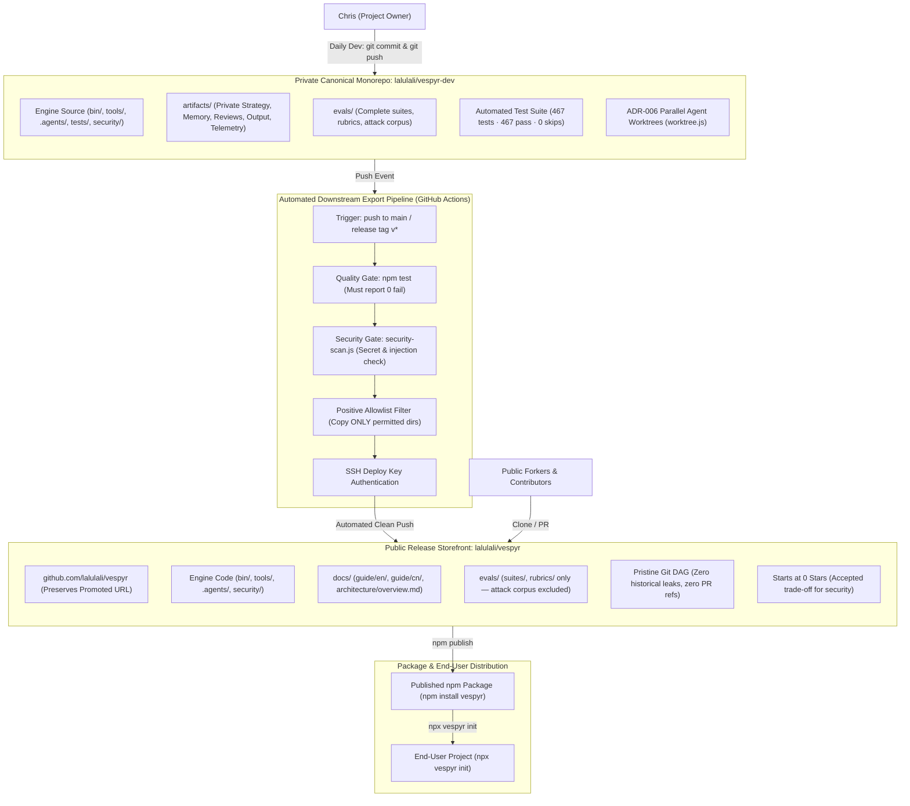

# Review 11 — Documentation Tidy & Private Workspace Isolation Plan

**Date:** 2026-09-18 (Revised r3 — Ratified by Multi-Agent Round Table)  
**Status:** RATIFIED r3 (Supersedes r2 history-rewrite and nested-repo blueprint; adopts Private Dev Monorepo + Automated Public CI Export)  
**Target Repositories:** `lalulali/vespyr-dev` (Private Canonical Monorepo) and `lalulali/vespyr` (Public Release Storefront)  
**Scope:** `Guide/`, `artifacts/`, `evals/`, `security/`, `tests/`, `tools/`, `.gitignore`, `package.json`, `.npmignore`, `.github/workflows/`

---

## 1. Executive Summary & Architectural Shift (r3 Ratification)

The objective is to establish an impenetrable boundary between **public user-facing materials**, **published npm runtime packages**, and **private internal strategy & agent runtime artifacts**.

### 1.1 Autopsy of Revision r2 (Why History-Rewrite & Nested-Repo Were Killed)
On 2026-09-16–18, a four-agent Round Table panel (`@architect`, `@security-engineer`, `@devops-engineer`, `@developer`) conducted an exhaustive review of Revision r2 (which proposed running `git-filter-repo` in a scratch clone and nesting a private `.git` repository inside `artifacts/`). The panel issued a **unanimous 4/4 `[NO-GO]` verdict** based on the following fatal flaws:

1. **The PR #1 Hidden Ref Backdoor (Option B Fallacy):** GitHub permanently preserves pull request head refs (`refs/pull/1/head` $\rightarrow$ `0fc42e32…`). Under r2, rewriting 89 historical commits on `main` was pure security theater: any user or crawler could query the GitHub Contents API for commit `0fc42e32` and retrieve the complete proprietary strategy tree.
2. **Local Data Annihilation (`git clean -fdx` Trap):** Git treats ignored directories containing nested `.git` repos as untracked debris. Running the standard hygiene command `git clean -fdx` in the parent repository silently and permanently deleted `artifacts/.git` and all uncommitted agent memory, traces, and defect registers.
3. **Multi-Agent Concurrency Collapse (ADR-006):** Parallel agent sessions rely on `git worktree add` (`worktree.js`). Git worktrees cannot replicate untracked nested repositories. Subagents in parallel sessions wrote to unlinked shadow folders that were never committed and were lost upon session teardown.
4. **Tautological Test Skips:** r2 converted test failures into conditional skips (`skip(private workspace absent…)`), creating false-positive green passes in public CI that verified zero contracts against real strategy documents.
5. **The 8-Star Asymmetry:** r2 accepted extreme operational fragility, broken worktrees, and data wipe hazards solely to preserve 8 GitHub stars.

### 1.2 The Ratified r3 Architecture (Physical Monorepo Split)
Revision r3 terminates the in-place history rewrite and nested repo pattern. It replaces them with the standard enterprise dual-repository distribution model (used by Meta, Google, and major open-source ecosystems):

- **Private Authoritative Monorepo (`lalulali/vespyr-dev`):** The existing `lalulali/vespyr` repository is renamed to `vespyr-dev` and toggled to **Private**. All 89 historical commits, PR #1, master development plans (Phases 0–8), internal reviews, agent persistent memory, and full test suites are preserved 100% intact behind GitHub IAM authentication. All 467 tests run and pass without conditional skips.
- **Fresh Public Release Storefront (`lalulali/vespyr`):** A clean, net-new public repository is instantiated at `github.com/lalulali/vespyr` (retaining the exact promoted URL). It starts at `v2.0.0` with a pristine commit history and zero historical leaks. The 8 stars remain with `vespyr-dev`; the public repo starts at 0 stars.
- **Automated Downstream Export Pipeline (GitHub Actions):** In `vespyr-dev`, an automated GitHub Action triggers on `push to main` (or release tags). It runs tests and security scans, copies only allowlisted production directories (`bin/`, `tools/`, `.agents/`, `docs/guide/`, `security/`, `package.json`), and pushes a verified, clean release commit to `lalulali/vespyr` using an SSH Deploy Key.

---

## 2. Leak Audit & Security Invariant Resolution

Git enforces access control exclusively at the repository boundary. By making `vespyr-dev` private and seeding `vespyr` from an empty state via a positive allowlist, all leaked surfaces are completely resolved:

| Path / Surface | Current State in Public History | Resolution Under Revision r3 | Security Invariant |
| :--- | :--- | :--- | :--- |
| `artifacts/docs/strategy/` | **Tracked (Public)** across 89 commits | **100% Private in `vespyr-dev`**. Never copied to public repo. | **CLOSED.** Proprietary roadmaps completely inaccessible to public. |
| `artifacts/docs/review/` | **Tracked (Public)** | **100% Private in `vespyr-dev`**. | **CLOSED.** Internal audits and defect registers protected. |
| `artifacts/memory/` | Runtime memory committed | **100% Private in `vespyr-dev`**. | **CLOSED.** Swarm context and decisions protected. |
| `refs/pull/1/head` (`0fc42e3…`) | Permanently queryable on GitHub | **100% Locked behind GitHub IAM**. Converting repo to Private revokes public API access. | **CLOSED.** GitHub returns 404 to unauthenticated queries. |
| `evals/security/corpus/` | 88 lines of absolute owner paths | **Locked in `vespyr-dev`**. Public repo receives only sanitized `evals/suites/` and `evals/rubrics/`. | **CLOSED.** Zero owner paths in public Git history. |
| `Guide/` (`en/`, `cn/`) | Cosmetic hygiene | Normalized to `docs/guide/en/` and `docs/guide/cn/` (Phase 0). | **CLEAN.** Standard open-source doc layout. |
| Worktree Concurrency | Broken in r2 | **100% Supported.** Standard monorepo allows `worktree.js` to function natively. | **PRESERVED.** ADR-006 multi-session swarm operates with zero lock collisions. |
| Workspace Hygiene | `git clean -fdx` was fatal in r2 | **100% Safe.** Standard Git tracking protects workspace; no untracked nested repos exist. | **PRESERVED.** Standard Git commands work safely. |

---

## 3. Target Architecture: The Physical Boundary Topology



---

## 4. Subsystem Audit: `tools/`, `tests/`, `security/`, and `evals/`

### 4.1 Subsystem Classification & Distribution Across Boundaries

| Subsystem | In `vespyr-dev` (Private)? | Exported to `vespyr` (Public)? | Included in npm Tarball? | Purpose & Rationale |
| :--- | :--- | :--- | :--- | :--- |
| **`bin/`** | **Yes** | **Yes** | **Yes (100%)** | CLI entrypoints (`cli.js`, `vespyr-eval.js`). |
| **`tools/`** | **Yes** | **Yes** | **Yes (100%)** | Runtime eval runner (`tools/eval/runner.js`) and telemetry. Required for `npx vespyr-eval`. |
| **`.agents/`** | **Yes** | **Yes** (allowlisted) | **Yes (100%)** | Agent personas, skills, and runtime scripts. |
| **`security/`** | **Yes** | **Yes** | **Yes (100%)** | Supply-chain spec (`security/audit-spec.json`) read by `npx vespyr audit`. |
| **`docs/`** | **Yes** | **Yes** (guide + arch) | **Excluded** | Public user documentation (`docs/guide/`) and engine architecture primers. |
| **`tests/`** | **Yes** (full suite) | **Excluded / Optional** | **Excluded (0%)** | Unit and integration tests. Excluded from npm via `.npmignore` to prevent package bloat. |
| **`evals/`** *(Root)* | **Yes** (full corpus) | **Split** (see below) | **Split** | Benchmark definitions ship in npm; security attack corpus is banned from npm and public repo. |
| **`artifacts/`** | **Yes** (full history) | **EXCLUDED (0%)** | **EXCLUDED (0%)** | Proprietary roadmaps, development plans, reviews, memory, and telemetry. |

### 4.2 Detailed Breakdown of `evals/` Across Boundaries

```
evals/
├── suites/             # Core benchmark definitions               --> EXPORTED to Public & npm
├── rubrics/            # Checklist rubrics for Tier-1 judge       --> EXPORTED to Public & npm
├── fixtures/           # Offline deterministic test inputs        --> EXPORTED to Public & npm
├── mock-baseline.json  # Reference benchmark scores               --> EXPORTED to Public & npm
├── meta-eval/          # Evaluation calibration & gold standards  --> EXPORTED to Public & npm
├── roundtable/         # topics.json                              --> EXPORTED to Public & npm
└── security/           # Attack corpus (beacon-1.sh, exploits)    --> PRIVATE in vespyr-dev | BANNED from Public & npm
```

1. **Why `evals/security/` is Banned from Public & npm:**
   `evals/security/corpus/positive/` contains live reverse shells (`beacon-1.sh`), malicious git hooks, and prompt injections. Shipping live malware fixtures triggers registry takedowns, AV flags (ClamAV, Windows Defender), and firewall blocks. In r3, this entire directory remains isolated in `vespyr-dev`.
2. **Positive Allowlist Export Rule:**
   The export pipeline enforces a positive allowlist. Directories not explicitly declared are omitted by default.

---

## 5. Work Breakdown & Execution Phases (r3)

### Phase 0: Local Documentation Hygiene (Working Workspace)
1. **Normalize documentation directory** (`git mv`):
   - Move `Guide/en/` $\rightarrow$ `docs/guide/en/`
   - Move `Guide/cn/` $\rightarrow$ `docs/guide/cn/`
   - Remove legacy empty `Guide/` folder.
2. **Establish public architecture documentation**:
   - Create `docs/architecture/overview.md` (high-level engine design, agent personas, skill lifecycle).
   - Create `docs/architecture/adr/index.md` (public ADR index).
3. **Repoint markdown links**:
   - Update 12 links in `README.md` and `README_CN.md` pointing to `Guide/` $\rightarrow$ `docs/guide/`.
   - Update references in `AGENTS.md`, `CLAUDE.md`, `agent.md`, and canonical templates.
4. **Commit local hygiene**:
   ```bash
   git add docs/ README.md README_CN.md AGENTS.md CLAUDE.md agent.md .agents/
   git commit -m "docs: normalize public documentation to docs/guide and add architecture overview"
   ```

### Phase 1: Repository Flip (GitHub Web UI)
1. Navigate to **`https://github.com/lalulali/vespyr`** $\rightarrow$ **Settings** $\rightarrow$ **General**.
2. Under **Repository name**, enter: `vespyr-dev` and click **Rename**.
3. Scroll down to the **Danger Zone** $\rightarrow$ **Change repository visibility**:
   - Click **Change visibility** $\rightarrow$ **Make private**.
   - Confirm the prompt.
4. *Result:* `lalulali/vespyr-dev` is now private. All 89 commits, PR #1 (`refs/pull/1/head`), and 65 strategy files are instantly secured behind GitHub IAM authentication. Unauthenticated requests to commit `0fc42e32` return 404.

### Phase 2: Create Fresh Public Repository (GitHub Web UI)
1. Navigate to **GitHub** $\rightarrow$ **New repository**.
2. Configuration:
   - **Owner:** `lalulali`
   - **Repository name:** `vespyr`
   - **Visibility:** **Public**
   - **Initialize with:** Uncheck all (Do **NOT** add README, `.gitignore`, or license). Create an empty repository.
3. *Result:* The public storefront URL `github.com/lalulali/vespyr` is reclaimed, starting with a clean slate.

### Phase 3: Re-point Local Workspace Remote
In your primary local development terminal (`/Users/christianhadianto/Documents/TechSmith/vespyr`):
```bash
git remote set-url origin git@github.com:lalulali/vespyr-dev.git
git push -u origin main
```
*Result:* Your local workspace tracks the private authoritative monorepo. Daily development proceeds with zero friction.

### Phase 4: Provision CI Deploy Key
To allow automated GitHub Actions in `vespyr-dev` to push clean releases to `vespyr`:
1. Generate an SSH keypair on your local machine:
   ```bash
   ssh-keygen -t ed25519 -C "vespyr-export-ci" -f /tmp/vespyr_deploy_key -N ""
   ```
2. **Configure Public Repo (`lalulali/vespyr`):**
   - Go to `lalulali/vespyr` $\rightarrow$ **Settings** $\rightarrow$ **Deploy keys** $\rightarrow$ **Add deploy key**.
   - Title: `CI Downstream Export`
   - Key: Paste contents of `/tmp/vespyr_deploy_key.pub`
   - Check: **Allow write access** $\rightarrow$ Click **Add key**.
3. **Configure Private Repo (`lalulali/vespyr-dev`):**
   - Go to `lalulali/vespyr-dev` $\rightarrow$ **Settings** $\rightarrow$ **Secrets and variables** $\rightarrow$ **Actions** $\rightarrow$ **New repository secret**.
   - Name: `PUBLIC_REPO_DEPLOY_KEY`
   - Secret: Paste contents of `/tmp/vespyr_deploy_key` (private key) $\rightarrow$ Click **Add secret**.
4. Securely delete temporary keys from local machine:
   ```bash
   rm -f /tmp/vespyr_deploy_key /tmp/vespyr_deploy_key.pub
   ```

### Phase 5: Implement Automated Downstream Export Pipeline
Add the export script and GitHub Actions workflow in `vespyr-dev`:

#### 5.1 Allowlist Export Script (`tools/export/export-public.js`)
A deterministic Node.js script that builds a clean export in `/tmp/vespyr-export`:
```javascript
// Copies ONLY allowlisted runtime paths:
const ALLOWLIST = [
  'bin',
  'tools',
  '.agents/agents',
  '.agents/skills',
  '.agents/templates',
  '.agents/references',
  'security/audit-spec.json',
  'security/supply-chain-audit-spec.md',
  'evals/suites',
  'evals/rubrics',
  'evals/fixtures',
  'evals/meta-eval',
  'evals/roundtable/topics.json',
  'docs',
  'package.json',
  'README.md',
  'README_CN.md',
  'LICENSE',
  'AGENTS.md',
  '.npmignore'
];
// Enforces hard negative assertion: fails if 'artifacts/' is detected.
```

#### 5.2 GitHub Actions Workflow (`.github/workflows/export-public.yml`)
Triggered on `push: branches: [main]` and `tags: ['v*']`:
1. Checks out `vespyr-dev`.
2. Runs `npm ci && npm test` (Ensures 100% green build before export).
3. Runs `security-scan.js` (Scans for accidental secrets or injection patterns).
4. Runs `node tools/export/export-public.js /tmp/vespyr-export`.
5. Clones `lalulali/vespyr` using `PUBLIC_REPO_DEPLOY_KEY`.
6. Syncs `/tmp/vespyr-export` into the clean clone.
7. Commits and pushes the clean release to `lalulali/vespyr:main`.

---

## 6. Verification & Acceptance Checklist (r3)

- [ ] **Documentation Normalized:** `docs/guide/en/` and `docs/guide/cn/` render properly; `docs/architecture/overview.md` exists.
- [ ] **Links Verified:** `README.md` and `README_CN.md` point to `docs/guide/`.
- [ ] **Private Monorepo Active:** `lalulali/vespyr-dev` exists on GitHub and is confirmed **Private**.
- [ ] **PR #1 Locked:** Direct HTTP query to `https://api.github.com/repos/lalulali/vespyr-dev/contents/artifacts/docs/strategy?ref=0fc42e32a5741621440f3140b0a6fb5bc5e861ad` returns `404 Not Found` for unauthenticated requests.
- [ ] **Fresh Public Repo Active:** `lalulali/vespyr` exists on GitHub and is confirmed **Public** and empty.
- [ ] **Local Remote Re-pointed:** `git remote -v` in local workspace points to `git@github.com:lalulali/vespyr-dev.git`.
- [ ] **Zero History Mutation:** `git log -n 5` in `vespyr-dev` confirms all original commit SHAs remain unchanged.
- [ ] **Unskipped CI Pass:** `npm test` in `vespyr-dev` reports 467 tests, 467 pass, **0 fail, 0 skipped**.
- [ ] **Worktree Verification:** `node .agents/scripts/worktree.js create test-session` creates a functional worktree with full access to strategy and memory without lock contention.
- [ ] **Deploy Key Configured:** Write deploy key active on `lalulali/vespyr`; `PUBLIC_REPO_DEPLOY_KEY` secret present in `lalulali/vespyr-dev`.
- [ ] **Automated Export Verified:** Pushing to `vespyr-dev:main` triggers `.github/workflows/export-public.yml`, resulting in a clean, working commit on `lalulali/vespyr:main`.
- [ ] **Public Repo Cleanliness:** `git clone https://github.com/lalulali/vespyr.git /tmp/verify-pub` confirms:
  - `artifacts/` does not exist.
  - `git log --all --oneline -- artifacts/` returns strictly 0 lines.
  - `git grep -I -e "christianhadianto" -e "TechSmith"` returns strictly 0 lines outside standard copyright.
  - `npm test` passes 100% on the public clone.
